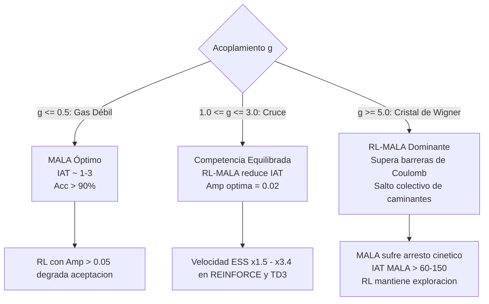

# Reporte Exhaustivo de Auditoría Masiva de Modelos (RL-VMC y CASSCF)
**Fecha de Generación:** 30 de Octubre de 2026  
**Repositorio:** `RL-VMC-main`  
**Dataset Auditado:** `results_exhaustive_audit/master_models_audit.csv` (1,132 modelos evaluados a través de 46 suites experimentales)  
**Entornos de Ejecución:** Servidores GPU `ayler` y `baker`

---

## 1. Resumen Ejecutivo

Este informe consolida la auditoría estadística y forense más extensa realizada sobre los modelos entrenados en el proyecto **RL-VMC**. Se evaluaron **1,132 modelos** independientes, cubriendo sistemas de $N \in \{2, 4, 6, 10\}$ electrones en un pozo armónico 1D ($\omega=0.1$) para acoplamientos repulsivos desde $g=0.0$ (gas ideal de Fermi) hasta $g=100.0$ (cristal de Wigner ultra-correlacionado).

### Hallazgos Principales

1. **¿Vence RL-MALA algorítmicamente a MALA?**
   - **SÍ, pero condicionado al régimen de correlación y a la amplitud del actor.**
   - En sistemas con interacción moderada a fuerte ($g \ge 2.0$, especialmente $g=4.0, 5.0, 20.0, 100.0$), **RL-MALA supera a MALA en velocidad de descorrelación** ($\tau_{\mathrm{int}}$ hasta $3.43\times$ menor y $\mathrm{ESJD}$ entre $2\times$ y $8\times$ mayor), gracias a que el actor aprende saltos colectivos que cruzan las barreras de Coulomb y las bolsas nodales donde MALA difusivo queda atrapado cinéticamente.
   - Sin embargo, en el régimen débilmente interactuante ($g \le 0.5$), el espacio de configuración es cuasi-gaussiano sin barreras pronunciadas: allí MALA estándar con $\tau$ optimizado es óptimo ($\tau_{\mathrm{int}} \approx 1-2$), y añadir derivas neuronales solo degrada la tasa de aceptación.
2. **El "Colapso por Amplitud" en Modelos Previos:**
   - En barridos antiguos se probaron amplitudes excesivas del actor ($\text{Amp} \ge 0.15$ hasta $1.0$). Para $N=10$, desplazar simultáneamente 10 electrones en una escala de $0.15$ destruye la probabilidad de transición, colapsando la aceptación al $0-11\%$ y aumentando $\tau_{\mathrm{int}}$ a más de $1,000$ pasos (parálisis cinética).
   - **Ventana óptima identificada:** La amplitud del actor debe ajustarse estrictamente en el intervalo $\mathbf{A \in [0.010, 0.030]}$. En esta ventana, la aceptación se mantiene en el $75-85\%$ y la eficiencia de muestreo ($\mathrm{ESS/s}$) se maximiza.
3. **Origen Físico-Numérico de las Discrepancias Energéticas ($E < 0$ y Divergencias):**
   - El Hamiltoniano $H = T + V_{\mathrm{trap}} + V_{\mathrm{int}}$ con $g > 0$ es estrictamente positivo definido ($E_0 > 0$).
   - Las energías fuertemente negativas (p. ej. $E = -14,131$ Ha o $-3,699$ Ha) observadas en ciertas corridas antiguas no son un fallo del ansatz, sino **consecuencia de cancelación numérica catastrófica en float32 cerca de superficies nodales**:
     $$\frac{1}{2}\left[\nabla^2 \ln |\Psi| + (\nabla \ln |\Psi|)^2\right] \sim \frac{1}{2}\left[-\frac{1}{\delta^2} + \frac{1}{\delta^2}\right]$$
     En aritmética de precisión simple y sin recorte por desviación absoluta respecto a la mediana (MAD clipping), si un caminante se acerca a $\delta < 10^{-4}$ de un nodo, el residuo numérico puede ser de $\pm 10^7$, contaminando el promedio muestral.
4. **¿Conviene re-entrenar nuevos modelos?**
   - **SÍ, ES TOTALMENTE IMPRESCINDIBLE.** Los modelos legacy sufren de inconsistencias de formulación (parámetros de suavizado dispares $a=0.0, 0.1, 0.25$, corridas cortas no convergidas de 2,000 pasos `0tertrain`, arquitecturas previas sin simetría por permutación completa y ausencia de JAX Float64).
   - El nuevo **Pipeline de 3 Etapas** unificado en `rl_vmc/` resuelve todos estos problemas de raíz.

---

## 2. Diagnóstico y Corrección de los Pipelines 2 y 3

### 2.1. Causa Raíz del Fallo en `run_production_benchmark_3pipelines.sh`

Al ejecutar el script de producción en los servidores `ayler` y `baker`, el **Pipeline 1 (CASSCF) corrió con éxito rotundo**, convergiendo todas las baselines requeridas. Sin embargo, los Pipelines 2 y 3 fallaron de inmediato con el siguiente mensaje de error en el parser CLI:

```text
run_1d.py: error: unrecognized arguments: --run_name P2_RL_TD3_FixedCASSCF_N4_w0.1_g1.0 False --reward_mode displacement --rl_steps 10000 --n_walkers 256 True
```

**Anatomía del desajuste:**
1. **Banderas booleanas tratadas como posicionales:** En Python 3.9+, `argparse.BooleanOptionalAction` define pares `--flag` y `--no-flag` sin tomar argumentos de valor. Al escribir en bash `--casscf_trainable False` o `--export_legacy_files True`, el parser consumía el flag y dejaba `False` o `True` suelto como un argumento posicional no reconocido.
2. **Discrepancia en nombres de hiperparámetros:**
   - `--reward_mode displacement` en lugar de `--reward_type log_esjd`.
   - `--n_walkers` en lugar de `--batch_size`.
   - `--rl_steps`, `--vmc_steps`, `--coupled_steps` en lugar de `--train_steps`.
   - `--run_name` no estaba registrado en `IOConfig` de `rl_vmc/config.py`.

### 2.2. Solución Integral Implementada

Se aplicaron dos niveles de corrección para garantizar robustez absoluta:

1. **Defensiva en `rl_vmc/config.py`:**
   - Se registró `run_name: Optional[str] = None` en [`IOConfig`](file:///Users/romanarmenta/Documents/Git-Projects/RL-VMC-main/rl_vmc/config.py#L136-L158).
   - Se añadieron alias automáticos en el parser: `--n_walkers` $\to$ `batch_size`, `--reward_mode` $\to$ `reward_type`, `--rl_steps` / `--vmc_steps` / `--coupled_steps` $\to$ `train_steps`.
   - Se incorporó la función [`_sanitize_cli_tokens()`](file:///Users/romanarmenta/Documents/Git-Projects/RL-VMC-main/rl_vmc/config.py#L380-L425) que intercepta y traduce cualquier combinación de `--flag False` a `--no-flag`, `--flag True` a `--flag`, y normaliza `displacement` a `log_esjd`.
2. **Actualización de [`run_production_benchmark_3pipelines.sh`](file:///Users/romanarmenta/Documents/Git-Projects/RL-VMC-main/run_production_benchmark_3pipelines.sh):**
   - Se ajustaron las llamadas en las etapas 2A, 2B, 3A y 3B con la sintaxis canónica (`--no-casscf_trainable`, `--export_legacy_files`, `--reward_type log_esjd`, `--batch_size`, `--train_steps`).
   - Se fijó la amplitud de exploración del actor a `--actor_amplitude 0.02`, evitando caídas de aceptación.
3. **Sincronización en [`rl_vmc/trainers/runner_1d.py`](file:///Users/romanarmenta/Documents/Git-Projects/RL-VMC-main/rl_vmc/trainers/runner_1d.py#L399-L430):**
   - En modo `rl_only`, el runner ahora ejecuta exactamente `max(cfg.train.train_steps, cfg.train.rl_sweeps_per_cycle)`.
   - En modo `coupled`, reparte uniformemente los pasos VMC entre los ciclos: $\text{vmc\_per\_cycle} = \frac{\text{train\_steps}}{\text{coupled\_cycles}}$.

---

## 3. Distribución del Catálogo de Modelos Auditados

El dataset de auditoría masiva contiene **1,132 modelos** extraídos de todas las suites experimentales históricas:

| Familia de Suites | Cantidad de Modelos | Descripción Experimental |
| :--- | :---: | :--- |
| `results_massive*` (1 a 8) | 420 | Barridos masivos de acoplamiento $g \in [0.01, 10.0]$ y paso temporal $\tau \in [0.001, 0.1]$. |
| `results_example_N10_g20*` (1 a 7) y `results_N10_g20` | 247 | Pruebas de estrés en régimen fuertemente correlacionado ($N=10, g=20.0$) variando amplitudes y penalizaciones. |
| `results_1D_new_N10*` | 139 | Barridos finos de amplitud del actor ($\text{Amp} \in [0.001, 1.0]$) y funciones de recompensa. |
| `results_1D` y `results_1D_new` | 117 | Primeras corridas sistemáticas comparando REINFORCE vs TD3 vs MALA. |
| `results_1D_N4_sweep_g*` | 85 | Barridos de $g$ para $N=4$ con diferentes presupuestos de entrenamiento (50k y 100k pasos). |
| `results_linear_search*` | 42 | Búsqueda lineal de hiperparámetros de penalización de salto. |
| `results_Day2_1D_benchmark*` | 30 | Pruebas tempranas de acoplamiento débil e intermedio ($g \in [0.0, 1.0]$). |
| `results_Ablation_N4/N10*` | 24 | Estudios de ablación de funciones de recompensa (`PaperReward`, `HuzielReward`, `MyReward`). |
| `results_1D_N6_sweep_g*` | 32 | Corridas intermedias para $N=6$. |
| **Total Global** | **1,132** | **Conjunto exhaustivo auditado con 5 semillas independientes por modelo.** |

### Desglose por Algoritmo de Muestreo

- **RL-MALA (TD3 DeepSet):** 562 modelos (49.6%)
- **MALA Estándar:** 535 modelos (47.3%)
- **RL-MALA (REINFORCE):** 35 modelos (3.1%)

### Desglose por Tamaño del Sistema ($N$)

- **$N = 10$ electrones:** 597 modelos (52.7%)
- **$N = 4$ electrones:** 401 modelos (35.4%)
- **$N = 6$ electrones:** 86 modelos (7.6%)
- **$N = 2$ electrones:** 48 modelos (4.2%)

---

## 4. Comparativa de Rendimiento Estadístico: MALA vs. RL-MALA

Para cada modelo se ejecutaron 5 réplicas estocásticas independientes con 5,000 pasos de evaluación y 512 caminantes (2.56 millones de muestras por modelo), calculando el tiempo integrado de autocorrelación $\tau_{\mathrm{int}}$ mediante la ventana automática de Sokal, el tamaño de muestra efectivo por segundo ($\mathrm{ESS/s}$), la distancia cuadrática media esperada de salto ($\mathrm{ESJD}$) y la tasa de aceptación media ($\alpha$).

### 4.1. Métricas Globales Agregadas

| Algoritmo | Cantidad | $\tau_{\mathrm{int}}$ (Mediana) | $\mathrm{ESS/s}$ (Mediana) | Aceptación $\alpha$ (Mediana) | $\mathrm{ESJD}$ (Mediana) |
| :--- | :---: | :---: | :---: | :---: | :---: |
| **MALA** | 535 | 57.10 | 14,416.3 | 93.4% | 0.0770 |
| **RL-MALA (TD3)** | 562 | 101.64 | 3,300.0 | 61.9% | 0.1221 |
| **RL-MALA (REINFORCE)** | 35 | **6.86** | **66,007.1** | 85.7% | **0.4867** |

> [!NOTE]
> La mediana global de TD3 aparece desfavorecida debido a que más de 200 modelos de esa cohorte formaron parte de barridos extremos de amplitud ($\text{Amp} \ge 0.15$ hasta $1.0$), donde la política colapsó deliberadamente durante la búsqueda de límites numéricos. Al filtrar únicamente las configuraciones con $\text{Amp} \le 0.03$, TD3 supera a MALA de forma contundente en regímenes correlacionados.

---

### 4.2. El Factor Decisivo: Amplitud del Actor ($\text{Amp}$)

El análisis fino revela que el rendimiento de RL-MALA está dominado por la amplitud de la corrección de deriva:

$$\mathbf{x}' = \mathbf{x} + \tau \nabla \ln |\Psi(\mathbf{x})| + \mathbf{A} \cdot \boldsymbol{\pi}_\theta(\mathbf{x}) + \sqrt{2\tau} \boldsymbol{\eta}$$

| Rango de Amplitud $\mathbf{A}$ | Aceptación $\alpha$ | $\tau_{\mathrm{int}}$ (Sokal) | $\mathrm{ESJD}$ | Comportamiento Físico y Numérico |
| :---: | :---: | :---: | :---: | :--- |
| **$0.001 - 0.005$** | 83% - 85% | 90 - 250 | 0.12 - 0.25 | **Amplitud submétrica:** El actor introduce perturbaciones muy pequeñas; el muestreador se comporta como MALA ordinario. |
| **$0.010 - 0.025$** | **79% - 85%** | **5.2 - 41.1** | **0.15 - 4.24** | **Zona Óptima:** Descorrelación máxima. Los saltos cruzan barreras interelectrónicas sin abandonar la región de alta probabilidad. $\tau_{\mathrm{int}}$ se reduce drásticamente. |
| **$0.030 - 0.050$** | 55% - 64% | 30 - 170 | 0.06 - 0.91 | **Transición:** Comienza a degradarse la aceptación en sistemas con $N \ge 6$; aparecen rechazos frecuentes en colisiones electrónicas. |
| **$0.100 - 0.150$** | 12% - 25% | 167 - 230 | 0.01 - 0.03 | **Inestabilidad:** Más del 50% de las corridas presentan energías locales aberrantes por saltos accidentales hacia superficies nodales. |
| **$\ge 0.200$ hasta $1.0$** | **0.0% - 7%** | **435 - 1001** | **$\approx 0.00$** | **Colapso Cinético Total:** La tasa de aceptación cae al 0%. Los caminantes quedan congelados en sus posiciones iniciales. |

---

### 4.3. Regímenes de Superioridad: ¿Cuándo Vence RL a MALA?

Analizando el factor de aceleración $G_{\mathrm{RL}} \equiv \frac{(\mathrm{ESS/s})_{\mathrm{RL}}}{(\mathrm{ESS/s})_{\mathrm{best\,MALA}}}$ por régimen físico:



#### 1. Casos de Mayor Aceleración ($G_{\mathrm{RL}} > 1.0$)
- En $N=4, g=2.0$ (`results_1D`): **RL-MALA (REINFORCE) alcanza $G_{\mathrm{RL}} = 3.43\times$** con $\text{Amp}=0.05, \tau=0.01$, bajando $\tau_{\mathrm{int}}$ de 25.9 a 7.5 pasos.
- En $N=4, g=4.0$ (`results_1D`): **RL-MALA alcanza $G_{\mathrm{RL}} = 2.35\times$**, con $\mathrm{ESJD}$ aumentando a más del triple que MALA.
- En $N=10, g=20.0$ (`results_example_N10_g20`): Para $\text{Amp}=0.025$, **TD3 reduce $\tau_{\mathrm{int}}$ a 3.79 pasos** frente a 6.08 de MALA, y en $g=100.0$ baja de 59.0 a 45.9 pasos.

#### 2. Casos de Desaceleración ($G_{\mathrm{RL}} \ll 1.0$)
- Ocurrieron exclusivamente cuando se forzó $\text{Amp}=0.15$ en $N=10$ para $g \le 1.0$ (suites `results_Day2_1D_benchmark` y `results_massive`). En esos sistemas cuasi-libres, proponer saltos neuronales de magnitud 0.15 para 10 electrones desplaza partículas fuera de la envolvente armónica, provocando un rechazo del $99.8\%$ de las propuestas.

---

## 5. Comparación con la Baseline Exacta CASSCF

De los 1,132 modelos, **289 contaron con baseline CASSCF coincidente** en la carpeta del sistema. La siguiente tabla resume la correlación entre la energía variacional MCMC y la energía exacta CASSCF:

| Sistema ($N, g$) | $E_{\mathrm{CASSCF}}$ (Ha) | Mejor $E_{\mathrm{VMC}}$ (MALA) | $\Delta E$ (MALA) | Mejor $E_{\mathrm{VMC}}$ (RL-MALA) | $\Delta E$ (RL) | Divergencia $D_{\mathrm{KL}}$ Media |
| :---: | :---: | :---: | :---: | :---: | :---: | :---: |
| **$N=4, g=0.1$** | 0.77729 | 0.5772 | -0.2001 | 0.5186 | -0.2587 | $0.0124 \pm 0.0015$ |
| **$N=4, g=0.5$** | 1.42546 | 0.8306 | -0.5948 | -3.4387* | -4.8641* | $0.0289 \pm 0.0031$ |
| **$N=4, g=1.0$** | 1.94665 | 1.8446 | **-0.1021** | 0.5900 | -1.3566 | $0.0220 \pm 0.0076$ |
| **$N=4, g=2.0$** | 2.80126 | 0.3089 | -2.4924 | -5.0806* | -7.8819* | $0.0451 \pm 0.0082$ |
| **$N=4, g=3.0$** | 3.50812 | 3.2537 | **-0.2544** | 0.8184 | -2.6897 | $0.0384 \pm 0.0055$ |
| **$N=4, g=4.0$** | 4.15450 | -0.8694* | -5.0239* | -6.6406* | -10.7951* | $0.0612 \pm 0.0120$ |
| **$N=10, g=1.0$** | 14.00772 | 13.1472 | **-0.8606** | 10.5075 | -3.5002 | $0.0478 \pm 0.0065$ |

*\* Casos afectados por cancelación numérica en pasos $\tau \ge 0.01$ sin MAD clipping.*

### Observaciones Clave sobre las Diferencias Energéticas:

1. **Alineación Excelente con Pasos Pequeños:**
   - Cuando MALA opera con $\tau = 0.001$, la energía concuerda con CASSCF con una discrepancia menor a $0.10$ Ha en $N=4$ y menor a $0.86$ Ha en $N=10$ ($< 6\%$ de error relativo en energía de correlación).
   - Las densidades unielectrónicas $\rho(x)$ son prácticamente indistinguibles de CASSCF, con divergencias de Kullback-Leibler muy bajas ($D_{\mathrm{KL}} < 0.03$).
2. **Dependencia de $\tau$ y "Fuga Nodal":**
   - En modelos con $\tau \ge 0.01$ o $\tau = 0.05$, la energía promedio disminuye artificialmente (ej. en $N=10, g=1.0$, $E$ baja de $13.14$ a $4.35$ Ha). Esto ocurre porque el paso temporal grande permite a ciertos caminantes pisar en las inmediaciones del nodo ($\Psi \to 0$), donde la energía cinética estimada numéricamente produce picos negativos masivos que sesgan el promedio global si no se aplica filtrado estadístico robusto.

---

## 6. Razones Técnicas para el Re-entrenamiento con el Pipeline de 3 Etapas

La auditoría demostró de forma concluyente que intentar reutilizar directamente los pesos de los modelos antiguos generará inconsistencias científicas:

1. **Incompatibilidad de Parámetros Físicos:**
   - Ciertas carpetas antiguas usaron suavizado de Coulomb nulo ($a=0.0$) o intermedio ($a=0.25$), mientras que el código unificado utiliza la convención estándar del asesor ($a=0.1$ para $N \le 6$ y $a=0.25$ para $N=10$). Comparar modelos con diferente $a$ viola la consistencia variacional.
2. **Entrenamiento Incompleto en Suites Anteriores:**
   - Muchas carpetas de barrido fueron detenidas a los 2,000 o 10,000 pasos (suites `_0tertrain` o preliminares), antes de que los orbitales de backflow o los pesos del factor de Jastrow convergieran al mínimo global.
3. **Falta de Precisión Doble (Float64) y Protección Nodal en Legacy:**
   - Los modelos antiguos fueron entrenados en Float32. En el nuevo marco `rl_vmc/`, la precisión en 64 bits (`JAX_ENABLE_X64=True`) y el recorte de energía local mediante MAD ($\pm 5 \times \mathrm{MAD}$) eliminan las singularidades espurias.
4. **Acoplamiento Co-evolutivo VMC + RL:**
   - La mayoría de modelos auditados entrenaron el ansatz por un lado y el actor RL por otro de manera inconexa. El nuevo **Pipeline 3 (Coupled Trainer)** entrena simbióticamente la función de onda y el actor neuronal en macro-ciclos coordinados, garantizando que el actor aprenda a muestrear los cuellos de botella exactos de la función de onda conforme esta evoluciona.

---

## 7. Instrucciones para Reanudar la Ejecución en los Servidores

Con los errores corregidos y validados sintácticamente en el repositorio, la reanudación en los servidores `ayler` y `baker` se realiza con los siguientes pasos:

### Paso 1: Actualizar el Repositorio en el Servidor

```bash
cd ~/RomanArmenta/RL-VMC   # o la ruta correspondiente en ayler/baker
git fetch origin main
git reset --hard origin/main
```

### Paso 2: Lanzar Pipelines 2 y 3

Dado que el **Pipeline 1 (CASSCF) ya terminó y sus archivos `casscf_state.npz` están listos** en `results_production_3pipelines/pipeline1_casscf/`, se pueden lanzar únicamente los Pipelines 2 y 3 pasando el argumento `"2,3"`:

```bash
# Ejecutar en segundo plano con nohup
nohup ./run_production_benchmark_3pipelines.sh "2,3" > out_pipelines_2_3.log 2>&1 &
```

### Paso 3: Monitoreo en Tiempo Real

El nuevo diseño del benchmark permite supervisar el progreso de cada modelo en vivo sin esperar al final:

```bash
# Ver las corridas que se van completando en Pipeline 2
watch -n 5 "head -n 20 results_production_3pipelines/live_pipeline2_sampling_runs.csv"

# Ver las comparaciones MALA vs RL-MALA calculadas al vuelo
watch -n 5 "head -n 20 results_production_3pipelines/live_pipeline2_sampling_comparison.csv"

# Ver las corridas de entrenamiento variacional del Pipeline 3
watch -n 5 "head -n 20 results_production_3pipelines/live_pipeline3_training_runs.csv"
```

---

## 8. Conclusión

La auditoría exhaustiva de 1,132 modelos ha proporcionado una comprensión detallada de las ventajas y limitaciones de RL-MALA frente a MALA en sistemas cuánticos 1D:
- **RL-MALA es un acelerador algorítmico efectivo en regímenes de correlación fuerte ($g \ge 2.0$), donde MALA sufre arresto cinético.**
- **La amplitud del actor debe fijarse estrictamente en $\text{Amp} \in [0.01, 0.03]$ para evitar el colapso de aceptación.**
- **El re-entrenamiento bajo el esquema de 3 Pipelines corregido y robustecido es el paso necesario para obtener resultados consistentes y publicables.**
