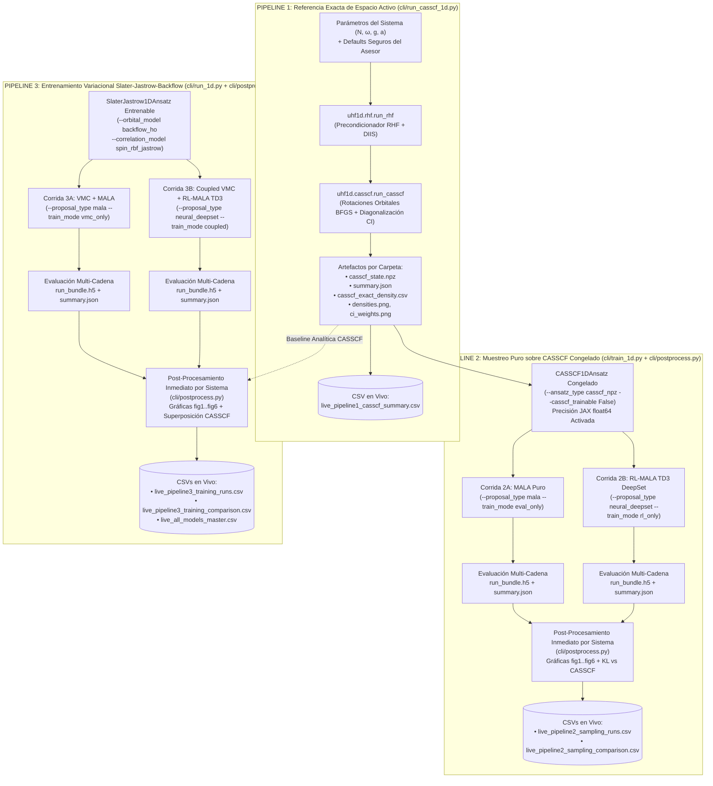

# Reporte Maestro del Benchmark de Producción: CASSCF 1D, Muestreo Puro (MALA vs. RL-MALA) y Entrenamiento Variacional Acoplado (VMC + RL-MALA)

Este documento constituye la referencia teórica, algorítmica y técnica del **Benchmark de Producción en 3 Pipelines** implementado en [`run_production_benchmark_3pipelines.sh`](file:///Users/romanarmenta/Documents/Git-Projects/RL-VMC-main/run_production_benchmark_3pipelines.sh). Su propósito es doble:
1. Documentar con rigor desde primeros principios físicos y matemáticos cada componente del protocolo experimental, las ecuaciones implementadas y el catálogo exacto de módulos, clases y funciones que intervienen en cada etapa.
2. Servir como **reporte vivo de resultados** que se actualiza de forma incremental conforme las corridas en los servidores GPU (`ayler`, `baker`) van poblando las tablas CSV en tiempo real y los archivos `summary.json` de cada carpeta.

---

## 1. Fundamentos Teóricos del Sistema Físico y del Benchmark

### 1.1. Hamiltoniano de Electrones Confinados en 1D (Cristales de Wigner Cuasi-1D)

Estudiamos un sistema de $N = N_\uparrow + N_\downarrow$ fermiones con espín $1/2$ confinados en una trampa armónica unidimensional de frecuencia $\omega$, interactuando mediante un potencial repulsivo de Coulomb suavizado (*soft-Coulomb*). En unidades atómicas ($\hbar = m_e = e = 1$), el Hamiltoniano viene dado por:

$$
\hat{\mathcal{H}} = \underbrace{-\frac{1}{2} \sum_{i=1}^{N} \frac{\partial^2}{\partial x_i^2}}_{\hat{T} \text{ (Cinética)}} + \underbrace{\frac{1}{2} \omega^2 \sum_{i=1}^{N} x_i^2}_{\hat{V}_{\text{trap}} \text{ (Confinamiento)}} + \underbrace{\sum_{1 \le i < j \le N} \frac{g}{\sqrt{(x_i - x_j)^2 + a^2}}}_{\hat{V}_{\text{int}} \text{ (Repulsión Suavizada)}}
$$

donde:
- $x_i \in \mathbb{R}$ es la coordenada espacial del $i$-ésimo electrón.
- $\omega > 0$ fija la escala de longitud característica del oscilador armónico $l_0 = \omega^{-1/2}$.
- $g \ge 0$ controla la intensidad de la repulsión interelectrónica y gobierna la transición de fase continua entre:
  - **Régimen de gas de Fermi débilmente correlacionado ($g \lesssim 0.5$):** La energía cinética domina; la densidad de un cuerpo $\rho(x)$ presenta un perfil suave tipo campana modulada por oscilaciones de Friedel débiles.
  - **Régimen intermedio de cruce ($1.0 \le g \le 3.0$):** Competencia entre localización espacial y deslocalización cuántica; emergen cuasi-cristales con picos incipientes en $\rho(x)$ y huecos de correlación marcados en $g_2(r)$.
  - **Régimen de cristalización de Wigner fuertemente correlacionado ($g \ge 5.0$):** La repulsión de Coulomb localiza los electrones en posiciones cuasi-discretas bien separadas, formando $N$ picos nítidos en la densidad de un cuerpo $\rho(x) = \rho_\uparrow(x) + \rho_\downarrow(x)$.
- $a > 0$ es el parámetro de suavizado de corto alcance (*softening*), que modela el espesor transversal finito de un nanohilo cuántico cuasi-1D y regulariza la singularidad en $x_i = x_j$.

Para cualquier función de onda de prueba $\Psi(\mathbf{X})$, con $\mathbf{X} = (x_1, \dots, x_N)^\top \in \mathbb{R}^N$, la **energía local** evaluada en la configuración $\mathbf{X}$ se expresa exactamente en términos del log-amplitud $f(\mathbf{X}) \equiv \ln |\Psi(\mathbf{X})|$ como:

$$
E_L(\mathbf{X}) \equiv \frac{\hat{\mathcal{H}}\Psi(\mathbf{X})}{\Psi(\mathbf{X})} = -\frac{1}{2} \sum_{i=1}^{N} \left[ \frac{\partial^2 f(\mathbf{X})}{\partial x_i^2} + \left( \frac{\partial f(\mathbf{X})}{\partial x_i} \right)^2 \right] + V_{\text{trap}}(\mathbf{X}) + V_{\text{int}}(\mathbf{X})
$$

---

### 1.2. Etapa 1: Teoría del Método CASSCF 1D Multiconfiguracional (`uhf1d`)

Para disponer de un *ground truth* determinista libre de varianza estocástica de Monte Carlo, el **Pipeline 1** resuelve el problema electrónico mediante el método **Complete Active Space Self-Consistent Field (CASSCF)** implementado en la paquetería del asesor ([`uhf_1d_ho_v270826_m-determinants`](file:///Users/romanarmenta/Documents/Git-Projects/RL-VMC-main/uhf_1d_ho_v270826_m-determinants/src/uhf1d/casscf.py)).

#### Base de Oscilador Armónico y Cuadratura Gauss-Hermite
Los orbitales espaciales $\varphi_p(x)$ ($p = 0, \dots, N_{\text{basis}}-1$) se expanden en la base ortonormal de autofunciones del oscilador armónico 1D $\{\chi_\mu(x)\}_{\mu=0}^{N_{\text{basis}}-1}$:

$$
\varphi_p(x) = \sum_{\mu=0}^{N_{\text{basis}}-1} C_{\mu p} \, \chi_\mu(x), \qquad \chi_\mu(x) = \left(\frac{\omega}{\pi}\right)^{1/4} \frac{1}{\sqrt{2^\mu \mu!}} H_\mu\!\left(\sqrt{\omega}\,x\right) e^{-\frac{1}{2}\omega x^2}
$$

- La matriz de un cuerpo en la base desnuda es analítica y diagonal: $(h_0)_{\mu\nu} = \omega\left(\mu + \frac{1}{2}\right)\delta_{\mu\nu}$.
- Los integrales de repulsión de dos electrones (ERIs) en 1D se precalculan numéricamente con precisión de máquina mediante cuadratura de Gauss-Hermite de orden $N_{\text{quad}}$ en ambas coordenadas $(x, x')$:

$$
(\mu\nu|\lambda\sigma) = \iint_{\mathbb{R}^2} \chi_\mu(x)\chi_\nu(x) \frac{g}{\sqrt{(x-x')^2 + a^2}} \chi_\lambda(x')\chi_\sigma(x') \, dx \, dx'
$$

#### Partición del Espacio Activo y Expansión Multi-Determinante
El conjunto de orbitales se divide en tres subespacios:
1. **$N_{\text{core}}$ orbitales internos (*core*):** Siempre doblemente ocupados en todos los determinantes.
2. **$M_{\text{act}}$ orbitales activos (*active*):** Albergan los $N_\uparrow^{\text{act}} = N_\uparrow - N_{\text{core}}$ electrones $\uparrow$ y $N_\downarrow^{\text{act}} = N_\downarrow - N_{\text{core}}$ electrones $\downarrow$ activos en todas las configuraciones posibles.
3. **$N_{\text{virt}} = N_{\text{basis}} - N_{\text{core}} - M_{\text{act}}$ orbitales virtuales:** Desocupados en la expansión CI pero acoplados mediante rotaciones orbitales.

La función de onda CASSCF es una combinación lineal de $N_{\text{det}}$ determinantes de Slater:

$$
\Psi_{\text{CASSCF}}(\mathbf{X}^\uparrow, \mathbf{X}^\downarrow) = \sum_{I=1}^{N_{\text{det}}} c_I \, \det\!\left[\varphi_{p_a^{(I)}}(x_b^\uparrow)\right]_{a,b=1}^{N_\uparrow} \det\!\left[\varphi_{q_a^{(I)}}(x_b^\downarrow)\right]_{a,b=1}^{N_\downarrow}, \qquad N_{\text{det}} = \binom{M_{\text{act}}}{N_\uparrow - N_{\text{core}}} \binom{M_{\text{act}}}{N_\downarrow - N_{\text{core}}}
$$

#### Optimización Acoplada de Orbitales y Coeficientes CI
Para preservar exactamente la ortonormalidad $\mathbf{C}^\top \mathbf{C} = \mathbf{I}$, las rotaciones orbitales no redundantes (core-activo, core-virtual y activo-virtual) se parametrizan mediante la exponencial de una matriz antisimétrica $\mathbf{K}(\boldsymbol{\kappa}) = -\mathbf{K}(\boldsymbol{\kappa})^\top$:

$$
\mathbf{C}(\boldsymbol{\kappa}) = \mathbf{C}_{\text{RHF}} \exp\!\big(\mathbf{K}(\boldsymbol{\kappa})\big)
$$

En cada evaluación del optimizador cuasi-Newton **L-BFGS** (`scipy.optimize.minimize`), se transforma el tensor de 4 índices $(\mu\nu|\lambda\sigma) \to (pq|rs)$ a la base orbital actual $\mathbf{C}(\boldsymbol{\kappa})$, se ensambla el Hamiltoniano en el espacio activo $H_{IJ}^{\text{CI}}(\boldsymbol{\kappa})$ usando las reglas de Slater-Condon y se obtiene el autovalor fundamental $E_{\text{CASSCF}}(\boldsymbol{\kappa}) = \min_{\|\mathbf{c}\|=1} \mathbf{c}^\top \mathbf{H}^{\text{CI}}(\boldsymbol{\kappa}) \mathbf{c}$ junto con su gradiente por diferencias finitas centradas.

---

### 1.3. Etapa 2: Teoría de Muestreo MCMC sobre Paisajes Multimodales (MALA vs. RL-MALA)

Dada una distribución cuántica objetivo $\pi(\mathbf{X}) = \frac{|\Psi(\mathbf{X})|^2}{\int |\Psi(\mathbf{Y})|^2 d\mathbf{Y}}$, el muestreo por cadenas de Markov (MCMC) busca generar configuraciones $\{\mathbf{X}_t\}_{t=1}^{M}$ con la menor autocorrelación temporal posible.

#### MALA Estándar (Metropolis-Adjusted Langevin Algorithm)
MALA utiliza el campo de deriva cuántica (*quantum drift*) $\mathbf{F}_q(\mathbf{X}) = \nabla_{\mathbf{X}} \ln |\Psi(\mathbf{X})|^2 = 2\nabla_{\mathbf{X}} \ln |\Psi(\mathbf{X})|$ para proponer desplazamientos dirigidos hacia regiones de alta probabilidad:

$$
\mathbf{X}' = \mathbf{X} + \tau \mathbf{F}_q(\mathbf{X}) + \sqrt{2\tau}\,\boldsymbol{\xi}, \qquad \boldsymbol{\xi} \sim \mathcal{N}(\mathbf{0}, \mathbf{I}_N)
$$

Sin embargo, en cristales de Wigner ($g \gg 1$) o funciones de onda multiconfiguracionales con superficies nodales $\Psi(\mathbf{X}) = 0$, la deriva cuántica $\mathbf{F}_q(\mathbf{X}) = 2 \frac{\nabla \Psi(\mathbf{X})}{\Psi(\mathbf{X})}$ diverge como $\mathcal{O}(\text{dist}(\mathbf{X}, \partial\Omega)^{-1})$ cerca de los nodos y empuja violentamente a los caminantes lejos de las barreras inter-modales, provocando:
1. Rechazos masivos si se intenta un paso $\tau$ grande, o bien
2. Tiempos de autocorrelación integrados $\tau_{\text{int}}$ enormes si se reduce $\tau$ para mantener la aceptación.

#### RL-MALA: Actor Neuronal Equivariante DeepSet + Corrección Exacta de Metropolis-Hastings
En **RL-MALA**, reemplazamos o modulamos la propuesta gaussiana mediante una política neuronal parametrizada $\pi_\phi(\mathbf{X})$ con arquitectura **DeepSet equivariante por espín** ([`DeepSetNeuralProposal1D`](file:///Users/romanarmenta/Documents/Git-Projects/RL-VMC-main/rl_vmc/proposals/proposals_1d.py#L94-L214)):

$$
\boldsymbol{\mu}_\phi(\mathbf{X}) = \tau \operatorname{clip}\!\big(\mathbf{F}_q(\mathbf{X}), -F_{\max}, F_{\max}\big) + A_\mu \tau \tanh\!\big(\mathbf{g}_\phi^{(\mu)}(\mathbf{X})\big), \qquad
\boldsymbol{\sigma}_\phi(\mathbf{X}) = \sqrt{2\tau} \exp\!\Big(A_\sigma \tanh\!\big(\mathbf{g}_\phi^{(\sigma)}(\mathbf{X})\big)\Big)
$$

donde la red procesa para cada electrón $i$ sus características locales e invariantes relacionales $(x_i / L, \frac{1}{N}\sum_j (x_i - x_j)/L, \frac{1}{N}\sum_j |x_i - x_j|/L, \sigma_i, \tanh(\tau F_{q,i}))$ junto con una representación global agregada simétricamente sobre todos los electrones.

Para que el muestreo sea **100% libre de sesgo asintótico** independientemente de los pesos $\phi$ del actor, toda propuesta $\mathbf{X}' \sim q_\phi(\mathbf{X}' \mid \mathbf{X}) = \mathcal{N}\!\big(\mathbf{X} + \boldsymbol{\mu}_\phi(\mathbf{X}), \operatorname{diag}(\boldsymbol{\sigma}_\phi^2(\mathbf{X}))\big)$ se somete al filtro exacto de **Metropolis-Hastings asimétrico** en [`MHSampler1D`](file:///Users/romanarmenta/Documents/Git-Projects/RL-VMC-main/rl_vmc/samplers/mh_sampler_1d.py#L31-L97):

$$
\alpha(\mathbf{X} \to \mathbf{X}') = \min\!\left\{1, \; \frac{|\Psi(\mathbf{X}')|^2 \, q_\phi(\mathbf{X} \mid \mathbf{X}')}{|\Psi(\mathbf{X})|^2 \, q_\phi(\mathbf{X}' \mid \mathbf{X})}\right\}
$$

donde la densidad de transición inversa $q_\phi(\mathbf{X} \mid \mathbf{X}')$ se evalúa re-ejecutando el actor y la deriva cuántica en el punto propuesto $\mathbf{X}'$. Esto garantiza que la distribución estacionaria de la cadena de Markov sea **exactamente** $|\Psi(\mathbf{X})|^2$.

#### Aprendizaje por Refuerzo Continuo (TD3) para Maximizar la Eficiencia Ergodica
El actor $\phi$ se entrena mediante **Twin Delayed DDPG (TD3)** ([`TD3Learner1D`](file:///Users/romanarmenta/Documents/Git-Projects/RL-VMC-main/rl_vmc/rl/learners_1d.py#L46-L246)) con dos redes críticas gemelas $Q_{\psi_1}, Q_{\psi_2}$ para maximizar la recompensa de salto cuadrático esperado (*Expected Squared Jump Distance* / desplazamiento aceptado):

$$
r_t(\mathbf{X}_t, \mathbf{X}'_t, \alpha_t) = \alpha_t \, \|\mathbf{X}'_t - \mathbf{X}_t\|_2^2 - \lambda_{\text{act}} \|\mathbf{a}_{\text{drift}}\|_2^2
$$

Al maximizar $\mathbb{E}[\alpha(\mathbf{X}\to\mathbf{X}') \|\mathbf{X}' - \mathbf{X}\|^2]$, el agente RL descubre autónomamente cómo amortiguar la deriva cerca de las singularidades nodales y cómo adaptar anisótropamente la varianza $\boldsymbol{\sigma}_\phi(\mathbf{X})$ para cruzar valles de baja densidad sin destruir la tasa de aceptación $\alpha$.

---

### 1.4. Etapa 3: Entrenamiento Variacional Acoplado (Slater-Jastrow-Backflow + RL-MALA)

En el **Pipeline 3**, ya no se asume conocida la función de onda, sino que se entrena desde cero una arquitectura variacional neuronal **Slater-Jastrow con Backflow Neuronal y Jastrow RBF resuelto por espín** ([`SlaterJastrow1DAnsatz`](file:///Users/romanarmenta/Documents/Git-Projects/RL-VMC-main/rl_vmc/ansatze/ansatz_1d.py#L221-L300)):

$$
\ln |\Psi_\theta(\mathbf{X})| = \ln \left|\det \mathbf{\Phi}^\uparrow\!\big(\tilde{\mathbf{X}}^\uparrow_\theta(\mathbf{X})\big)\right| + \ln \left|\det \mathbf{\Phi}^\downarrow\!\big(\tilde{\mathbf{X}}^\downarrow_\theta(\mathbf{X})\big)\right| + J_{\text{RBF}}^{\uparrow\uparrow,\downarrow\downarrow,\uparrow\downarrow}(\mathbf{X}) + J_{\text{cusp}}(\mathbf{X}) - \frac{1}{2}\omega \alpha_{\text{trap}} \sum_{i=1}^{N} x_i^2
$$

1. **Coordenadas Cuasi-Partícula con Backflow Neuronal (`backflow_ho`):** Cada coordenada electrónica se transforma colectivamente en función de todas las demás partículas antes de evaluar los orbitales de Hermite en los determinantes de Slater:
   $$\tilde{x}_i(\mathbf{X}) = x_i + \Delta x_i^{\text{MLP}}(\mathbf{X})$$
   Esto permite que los nodos de los determinantes de Slater se desplacen variacionalmente en función del entorno de muchos cuerpos.
2. **Factor de Correlación Jastrow Resuelto por Espín (`spin_rbf_jastrow`):** Combina núcleos de base radial (RBF) diferenciados para pares de espín paralelo ($\uparrow\uparrow, \downarrow\downarrow$) y antiparalelo ($\uparrow\downarrow$) junto con un término racional de cúspide suave:
   $$J(\mathbf{X}) = \sum_{i < j} \sum_{k=1}^{K_{\text{RBF}}} w_k^{(\sigma_i \sigma_j)} \exp\!\big(-\gamma_k (r_{ij} - c_k)^2\big) - \sum_{i < j} \frac{b_{\text{cusp}}}{1 + c_{\text{cusp}}\sqrt{r_{ij}^2 + a^2}}$$
3. **Gradiente Variacional VMC con Recorte Robusto MAD:** Los parámetros $\theta$ del ansatz se actualizan minimizando la esperanza variacional $\mathcal{L}_{\text{VMC}}(\theta) = \mathbb{E}_{\mathbf{X} \sim |\Psi_\theta|^2}[E_L(\mathbf{X})]$ mediante el estimador centrado con recorte basado en la desviación absoluta mediana ($\text{MAD} = \text{mediana}(|E_L - \text{mediana}(E_L)|)$):
   $$\nabla_\theta \mathcal{L}_{\text{VMC}}(\theta) = 2 \, \mathbb{E}_{\mathbf{X} \sim |\Psi_\theta|^2}\!\Big[ \big(\tilde{E}_L(\mathbf{X}) - \langle \tilde{E}_L \rangle\big) \nabla_\theta \ln |\Psi_\theta(\mathbf{X})| \Big]$$
4. **Acoplamiento Simbiótico (`coupled`):** Amedida que $\Psi_\theta$ desarrolla correlación de Wigner y estructura nodal más pronunciada durante el entrenamiento, un muestreador MALA fijo pierde ergodicidad y suministra gradientes variacionales sesgados. En el régimen `coupled`, el actor TD3 se actualiza en línea junto con $\Psi_\theta$, rastreando dinámicamente el paisaje cambiante de $|\Psi_\theta(\mathbf{X})|^2$.

---

## 2. Parametrización Segura de CASSCF: Prevención de Explosión Combinatoria

Uno de los aspectos críticos del **Pipeline 1** es elegir los hiperparámetros del espacio activo de manera que el cálculo CASSCF converja en pocos segundos o minutos sin colgarse jamás.

En [`uhf1d/casscf.py`](file:///Users/romanarmenta/Documents/Git-Projects/RL-VMC-main/uhf_1d_ho_v270826_m-determinants/src/uhf1d/casscf.py), cada paso de L-BFGS evalúa el gradiente orbital por diferencias finitas sobre las $N_{\text{rot}}$ rotaciones orbitales independientes, y en cada evaluación realiza:
1. La transformación de 4 índices del tensor ERI $\mathcal{O}(N_{\text{basis}}^5)$, y
2. El ensamblado y diagonalización densa de la matriz CI de dimensión $N_{\text{det}} \times N_{\text{det}}$.

Si se dejara $N_{\text{core}} = 0$ para $N = 10$ con $M_{\text{act}} = 10$, tendríamos $N_{\text{det}} = \binom{10}{5}^2 = 63,504$, lo que bloquearía completamente la CPU en una sola iteración de BFGS. Por ello, inspeccionamos todos los archivos `summary.json` y `examples/*.json` ya corridos y validados por el asesor en `uhf_1d_ho_v270826_m-determinants/` y codificamos exactamente esos parámetros seguros en [`get_advisor_safe_casscf_defaults`](file:///Users/romanarmenta/Documents/Git-Projects/RL-VMC-main/cli/run_casscf_1d.py#L46-L130) y en [`run_production_benchmark_3pipelines.sh`](file:///Users/romanarmenta/Documents/Git-Projects/RL-VMC-main/run_production_benchmark_3pipelines.sh#L105-L143):

| Sistema $(N, N_\uparrow, N_\downarrow)$ | `n_core` ($N_{\text{core}}$) | Electrones Activos $(N_\uparrow^{\text{act}}, N_\downarrow^{\text{act}})$ | `n_active_orbitals` ($M_{\text{act}}$) | Determinantes CI ($N_{\text{det}}$) | `n_basis` | `quadrature_order` | `softening` ($a$) | Tiempo Típico de Convergencia |
| :--- | :---: | :---: | :---: | :---: | :---: | :---: | :---: | :---: |
| **$N=2$ ($1\uparrow, 1\downarrow$)** | `0` | $(1, 1)$ | `4` | $\binom{4}{1}\binom{4}{1} = 16$ | `24` | `80` | `0.10` | $\sim 2 - 5\text{ s}$ |
| **$N=4$ ($2\uparrow, 2\downarrow$), $g < 4$** | `0` | $(2, 2)$ | `4` | $\binom{4}{2}\binom{4}{2} = 36$ | `32` | `80` | `0.10` | $\sim 8 - 20\text{ s}$ |
| **$N=4$ ($2\uparrow, 2\downarrow$), $g \ge 4$** | `0` | $(2, 2)$ | `5` | $\binom{5}{2}\binom{5}{2} = 100$ | `32` | `80` | `0.10` | $\sim 25 - 60\text{ s}$ |
| **$N=6$ ($3\uparrow, 3\downarrow$)** | `1` | $(2, 2)$ | `4` | $\binom{4}{2}\binom{4}{2} = 36$ | `32` | `80` | `0.10` | $\sim 10 - 25\text{ s}$ |
| **$N=8$ ($4\uparrow, 4\downarrow$)** | `2` | $(2, 2)$ | `4` | $\binom{4}{2}\binom{4}{2} = 36$ | `28` | `80` | `0.10` | $\sim 10 - 25\text{ s}$ |
| **$N=10$ ($5\uparrow, 5\downarrow$)** | `4` | $(1, 1)$ | `4` | $\binom{4}{1}\binom{4}{1} = 16$ | `24` | `80` | `0.25` | $\sim 5 - 15\text{ s}$ |

### Tabla de Referencias CASSCF Ya Convergidas en el Repositorio (`uhf_1d_ho_v270826_m-determinants`)

A continuación se listan las energías de referencia exactas del espacio activo ya presentes en el repositorio (que el Pipeline 1 reutiliza automáticamente si `COPY_ADVISOR_CASSCF=1` o recalcula de forma idéntica):

| Sistema | $\omega$ | $g$ | $a$ (`softening`) | `n_core` | `n_active_orbitals` | $N_{\text{det}}$ | $E_{\text{RHF}}$ (Ha) | $E_{\text{CASSCF}}$ (Ha) | Ganancia de Correlación $\Delta E_{\text{corr}}$ (Ha) |
| :---: | :---: | :---: | :---: | :---: | :---: | :---: | :---: | :---: | :---: |
| $N=2$ ($1\uparrow, 1\downarrow$) | `1.0` | `2.0` | `0.20` | `0` | `4` | `16` | `2.658468` | **`2.426470`** | `-0.231998` |
| $N=4$ ($2\uparrow, 2\downarrow$) | `0.1` | `1.0` | `0.10` | `0` | `4` | `36` | `1.976548` | **`1.946648`** | `-0.029901` |
| $N=4$ ($2\uparrow, 2\downarrow$) | `0.1` | `2.0` | `0.10` | `0` | `4` | `36` | `2.905672` | **`2.790727`** | `-0.114945` |
| $N=4$ ($2\uparrow, 2\downarrow$) | `0.1` | `5.0` | `0.10` | `0` | `5` | `100` | `4.644295` | **`4.129251`** | `-0.515044` |
| $N=4$ ($2\uparrow, 2\downarrow$) | `0.5` | `1.0` | `0.10` | `0` | `4` | `36` | `6.143642` | **`6.103003`** | `-0.040639` |
| $N=4$ ($2\uparrow, 2\downarrow$) | `0.5` | `2.0` | `0.10` | `0` | `4` | `36` | `8.591952` | **`8.458146`** | `-0.133805` |
| $N=4$ ($2\uparrow, 2\downarrow$) | `0.5` | `5.0` | `0.10` | `0` | `4` | `36` | `14.127700` | **`13.524520`** | `-0.603180` |
| $N=10$ ($5\uparrow, 5\downarrow$) | `0.1` | `1.0` | `0.25` | `4` | `4` | `16` | `14.011066` | **`14.007716`** | `-0.003350` |
| $N=10$ ($5\uparrow, 5\downarrow$) | `0.1` | `5.0` | `0.25` | `4` | `3` | `9` | `36.310681` | **`36.298127`** | `-0.012554` |
| $N=10$ ($5\uparrow, 5\downarrow$) | `0.1` | `8.0` | `0.25` | `4` | `4` | `16` | `48.352627` | **`48.334092`** | `-0.018535` |

---

## 3. Arquitectura de los 3 Pipelines de Producción y Flujo de Datos



---

## 4. Catálogo Exhaustivo de Módulos, Clases y Funciones de cada Pipeline

### 4.1. Funciones del Pipeline 1 (CASSCF 1D)

1. **[`cli/run_casscf_1d.py`](file:///Users/romanarmenta/Documents/Git-Projects/RL-VMC-main/cli/run_casscf_1d.py)**
   - [`get_advisor_safe_casscf_defaults(n_up, n_dn, omega, g, softening_override)`](file:///Users/romanarmenta/Documents/Git-Projects/RL-VMC-main/cli/run_casscf_1d.py#L46-L130): Asigna automáticamente `n_core`, `n_active_orbitals`, `n_basis`, `quadrature_order` y `softening` siguiendo los `summary.json` del asesor para evitar que la dimensión CI supere 100 determinantes.
   - [`main()`](file:///Users/romanarmenta/Documents/Git-Projects/RL-VMC-main/cli/run_casscf_1d.py#L179-L320): Orquesta la reutilización o cálculo desde cero del estado CASSCF, exporta `casscf_state.npz`, `casscf_exact_density.csv`, `summary.json` y escribe en vivo con bloqueo de archivo (`fcntl.flock`) en `live_pipeline1_casscf_summary.csv`.
2. **[`uhf_1d_ho_v270826_m-determinants/src/uhf1d/`](file:///Users/romanarmenta/Documents/Git-Projects/RL-VMC-main/uhf_1d_ho_v270826_m-determinants/src/uhf1d/casscf.py)**
   - [`build_basis_and_integrals(cfg)`](file:///Users/romanarmenta/Documents/Git-Projects/RL-VMC-main/uhf_1d_ho_v270826_m-determinants/src/uhf1d/integrals.py#L100-L152): Construye la malla de Gauss-Hermite, evalúa los polinomios de Hermite normalizados y contrae el tensor de integrales de dos cuerpos $(\mu\nu|\lambda\sigma)$ para el potencial soft-Coulomb.
   - [`run_rhf(cfg, basis, ints)`](file:///Users/romanarmenta/Documents/Git-Projects/RL-VMC-main/uhf_1d_ho_v270826_m-determinants/src/uhf1d/rhf.py): Resuelve las ecuaciones de Roothaan-Hall restringidas con aceleración DIIS para proporcionar los orbitales iniciales $\mathbf{C}_{\text{RHF}}$.
   - [`run_casscf(cfg)`](file:///Users/romanarmenta/Documents/Git-Projects/RL-VMC-main/uhf_1d_ho_v270826_m-determinants/src/uhf1d/casscf.py#L120-L315): Optimiza simultáneamente los parámetros de rotación orbital $\boldsymbol{\kappa}$ (vía L-BFGS y exponencial matricial `scipy.linalg.expm`) y los coeficientes multiconfiguracionales $c_I$ (vía diagonalización exacta del Hamiltoniano activo construido con [`build_ci_hamiltonian`](file:///Users/romanarmenta/Documents/Git-Projects/RL-VMC-main/uhf_1d_ho_v270826_m-determinants/src/uhf1d/ci.py)).
   - [`make_casscf_plots(result, outdir)`](file:///Users/romanarmenta/Documents/Git-Projects/RL-VMC-main/uhf_1d_ho_v270826_m-determinants/src/uhf1d/plotting.py): Genera las figuras diagnósticas del estado CASSCF (`densities.png`, `ci_weights.png`, `natural_occupations.png`, `orbital_4panel.png`, `energy_history.png`).

---

### 4.2. Funciones del Pipeline 2 (Muestreo Puro sobre CASSCF Congelado) y Pipeline 3 (Entrenamiento Variacional Acoplado)

1. **Física y Funciones de Onda ([`rl_vmc/physics/harmonic_1d.py`](file:///Users/romanarmenta/Documents/Git-Projects/RL-VMC-main/rl_vmc/physics/harmonic_1d.py), [`rl_vmc/ansatze/ansatz_1d.py`](file:///Users/romanarmenta/Documents/Git-Projects/RL-VMC-main/rl_vmc/ansatze/ansatz_1d.py))**
   - [`Harmonic1DHamiltonian`](file:///Users/romanarmenta/Documents/Git-Projects/RL-VMC-main/rl_vmc/physics/harmonic_1d.py#L13-L82): Calcula el potencial de trampa, el potencial soft-Coulomb vectorizado y el Laplaciano exacto en 1D mediante `jax.grad` anidado sobre cada coordenada electrónica.
   - [`CASSCF1DAnsatz`](file:///Users/romanarmenta/Documents/Git-Projects/RL-VMC-main/rl_vmc/ansatze/ansatz_1d.py#L303-L458): Carga el archivo `casscf_state.npz` del Pipeline 1, evalúa los polinomios de Hermite mediante la recurrencia de tres términos en JAX, transforma a los orbitales CASSCF $\mathbf{C}$ y suma la expansión multi-determinante con estabilidad numérica `logsumexp` con signo (`_signed_logsumexp`). En el Pipeline 2 se instancia con `casscf_trainable=False` y activa automáticamente precisión doble (`jax_enable_x64=True`) en [`run_experiment_1d`](file:///Users/romanarmenta/Documents/Git-Projects/RL-VMC-main/rl_vmc/trainers/runner_1d.py#L74-L89) para eliminar cualquier error de redondeo float32 en orbitales de orden alto.
   - [`SlaterJastrow1DAnsatz`](file:///Users/romanarmenta/Documents/Git-Projects/RL-VMC-main/rl_vmc/ansatze/ansatz_1d.py#L221-L300): Implementa el ansatz variacional del Pipeline 3 combinando determinantes de Slater con transformación de coordenadas Backflow (`_eval_backflow_ho_orbitals`) y correlación Jastrow RBF resuelta por espín (`_eval_spin_rbf_jastrow`).
2. **Propuestas MCMC, Motor Metropolis-Hastings y Aprendizaje por Refuerzo ([`rl_vmc/proposals/proposals_1d.py`](file:///Users/romanarmenta/Documents/Git-Projects/RL-VMC-main/rl_vmc/proposals/proposals_1d.py), [`rl_vmc/samplers/mh_sampler_1d.py`](file:///Users/romanarmenta/Documents/Git-Projects/RL-VMC-main/rl_vmc/samplers/mh_sampler_1d.py), [`rl_vmc/rl/learners_1d.py`](file:///Users/romanarmenta/Documents/Git-Projects/RL-VMC-main/rl_vmc/rl/learners_1d.py))**
   - [`MALAProposal1D`](file:///Users/romanarmenta/Documents/Git-Projects/RL-VMC-main/rl_vmc/proposals/proposals_1d.py#L51-L91): Propuesta de Langevin estándar con recorte de deriva `drift_clip`.
   - [`DeepSetNeuralProposal1D`](file:///Users/romanarmenta/Documents/Git-Projects/RL-VMC-main/rl_vmc/proposals/proposals_1d.py#L94-L214): Actor neuronal equivariante que predice desplazamientos residuales de deriva y log-escala de difusión por partícula.
   - [`MHSampler1D`](file:///Users/romanarmenta/Documents/Git-Projects/RL-VMC-main/rl_vmc/samplers/mh_sampler_1d.py#L31-L330): Motor MCMC vectorizado con `jax.vmap` y compilado en bloques mediante `jax.lax.scan` (`run_production_chain`) que garantiza balance detallado exacto.
   - [`TD3Learner1D`](file:///Users/romanarmenta/Documents/Git-Projects/RL-VMC-main/rl_vmc/rl/learners_1d.py#L46-L246): Entrenador Actor-Crítico doble con *Replay Buffer* vectorizado y actualización suave de redes objetivo ($\tau_{\text{polyak}} = 0.005$).
3. **Orquestador de Entrenamiento, Evaluación y Post-Procesamiento ([`cli/run_1d.py`](file:///Users/romanarmenta/Documents/Git-Projects/RL-VMC-main/cli/run_1d.py) / [`cli/train_1d.py`](file:///Users/romanarmenta/Documents/Git-Projects/RL-VMC-main/cli/train_1d.py), [`rl_vmc/trainers/runner_1d.py`](file:///Users/romanarmenta/Documents/Git-Projects/RL-VMC-main/rl_vmc/trainers/runner_1d.py), [`rl_vmc/postprocess/`](file:///Users/romanarmenta/Documents/Git-Projects/RL-VMC-main/rl_vmc/postprocess/plotter.py))**
   - [`run_experiment_1d(cfg)`](file:///Users/romanarmenta/Documents/Git-Projects/RL-VMC-main/rl_vmc/trainers/runner_1d.py#L62-L770): Ejecuta el entrenamiento (`eval_only`, `rl_only`, `vmc_only` o `coupled`), corre las $C$ cadenas independientes de evaluación con pesos congelados, guarda `run_bundle.h5`, escribe automáticamente el archivo `summary.json` en la carpeta del modelo y agrega una fila en vivo al archivo `--master_csv`.
   - [`summarize_bundle_diagnostics(bundle, cfg)`](file:///Users/romanarmenta/Documents/Git-Projects/RL-VMC-main/rl_vmc/postprocess/diagnostics.py#L106-L210): Calcula para cada cadena y globalmente la función de autocorrelación (ACF), el tiempo de autocorrelación integrado $\tau_{\text{int}}$ con ventanado automático de Sokal ($M \ge c\,\tau_{\text{int}}(M)$), el tamaño efectivo de muestra $\text{ESS} = N_{\text{samples}} / (2\tau_{\text{int}})$, la tasa $\text{ESS/s}$ y el *Time-to-Solution* $T_\epsilon$.
   - [`compute_1d_observables(walkers, ...)`](file:///Users/romanarmenta/Documents/Git-Projects/RL-VMC-main/rl_vmc/postprocess/observables_1d.py#L14-L162): Calcula los perfiles de densidad de un cuerpo resueltos por espín ($\rho_{\text{tot}}(x), \rho_\uparrow(x), \rho_\downarrow(x)$) con barras de error entre cadenas independientes, la correlación de pares $g_2(r)$, el radio RMS y el conteo de picos de Wigner.
   - [`compute_exact_casscf_1body_density`](file:///Users/romanarmenta/Documents/Git-Projects/RL-VMC-main/rl_vmc/postprocess/casscf_baseline.py#L117-L202) y [`compute_spin_kl_divergences`](file:///Users/romanarmenta/Documents/Git-Projects/RL-VMC-main/rl_vmc/postprocess/casscf_baseline.py#L205-L270): Evalúan analíticamente la densidad de 1 cuerpo exacta del estado CASSCF a partir de la matriz reducida de 1 cuerpo $\gamma^\sigma_{pq} = \sum_{I} c_I^2 n_{p,\sigma}^{(I)} \delta_{pq}$ y calculan la divergencia de Kullback-Leibler resuelta por espín $D_{\text{KL}}(P_{\text{CASSCF}}^\sigma \parallel Q_{\text{MCMC}}^\sigma)$ en cada cadena independiente.
   - [`run_postprocessing_pipeline(cfg)`](file:///Users/romanarmenta/Documents/Git-Projects/RL-VMC-main/rl_vmc/postprocess/plotter.py#L853-L1180): Genera inmediatamente las figuras comparativas por sistema (`fig1_training_dashboard`, `fig2_production_summary`, `fig3_observables_1d`, `fig_article_densities`, `fig_article_kl_divergence`, `fig4_efficiency_bars`, `fig5_time_to_solution`, `fig6_walker_traces`), actualiza el `summary.json` de cada modelo con los factores de aceleración relativos ($G_{\text{RL}} = \tau_{\text{int}}^{\text{MALA}} / \tau_{\text{int}}^{\text{RL}}$) y escribe en vivo en `--master_comparison_csv`.

---

## 5. Estructura de Carpetas, `summary.json` y Tablas CSV en Tiempo Real

Al ejecutar [`run_production_benchmark_3pipelines.sh`](file:///Users/romanarmenta/Documents/Git-Projects/RL-VMC-main/run_production_benchmark_3pipelines.sh), se crea la siguiente jerarquía organizada donde **cada carpeta individual posee su propio `summary.json`** y las tablas CSV se van llenando conforme termina cada sistema:

```text
results_production_3pipelines/
├── live_pipeline1_casscf_summary.csv          # Tabla CSV en vivo: referencias CASSCF
├── live_pipeline2_sampling_runs.csv           # Tabla CSV en vivo: cada corrida de muestreo puro
├── live_pipeline2_sampling_comparison.csv     # Tabla CSV en vivo: MALA vs RL-MALA sobre CASSCF fijo
├── live_pipeline3_training_runs.csv           # Tabla CSV en vivo: cada corrida de entrenamiento SJB
├── live_pipeline3_training_comparison.csv     # Tabla CSV en vivo: VMC+MALA vs Coupled RL-MALA
├── live_all_models_master.csv                 # Tabla maestra global con todos los modelos evaluados
├── logs/                                      # Logs detallados por sistema y pipeline
├── pipeline1_casscf/
│   └── N{N}_w{OMEGA}_g{G}/
│       ├── casscf_state.npz                   # Estado multiconfiguracional exacto (orbitales + CI)
│       ├── summary.json                       # Parámetros del sistema, espacio activo y energías CASSCF
│       ├── casscf_exact_density.csv           # Perfil analítico exacto rho_tot(x), rho_up(x), rho_dn(x)
│       ├── densities.png                      # Gráficas propias de uhf1d
│       ├── ci_weights.png
│       └── natural_occupations.png
├── pipeline2_pure_sampling/
│   └── N{N}_w{OMEGA}_g{G}/
│       ├── MALA_FixedCASSCF/
│       │   ├── run_bundle.h5                  # Bundle HDF5 completo
│       │   └── summary.json                   # Datos del sistema, hiperparámetros y observables finales
│       ├── RL_TD3_FixedCASSCF/
│       │   ├── run_bundle.h5
│       │   └── summary.json
│       └── postprocess_comparison/            # Se genera AL INSTANTE al terminar este (N, g)
│           ├── summary.json
│           ├── summary_metrics.csv
│           ├── fig2_production_summary.png
│           ├── fig3_observables_1d.png
│           ├── fig_article_densities.png
│           ├── fig_article_kl_divergence.png
│           ├── fig4_efficiency_bars.png
│           └── fig6_walker_traces.png
└── pipeline3_variational_training/
    └── N{N}_w{OMEGA}_g{G}/
        ├── VMC_MALA_SJB/
        │   ├── run_bundle.h5
        │   └── summary.json
        ├── Coupled_RL_TD3_SJB/
        │   ├── run_bundle.h5
        │   └── summary.json
        └── postprocess_comparison/            # Se genera AL INSTANTE al terminar este (N, g)
            ├── summary.json
            ├── summary_metrics.csv
            ├── fig1_training_dashboard.png
            ├── fig2_production_summary.png
            ├── fig3_observables_1d.png
            ├── fig_article_densities.png
            ├── fig_article_kl_divergence.png
            ├── fig4_efficiency_bars.png
            ├── fig5_time_to_solution.png
            └── fig6_walker_traces.png
```

### Esquema del Archivo `summary.json` en cada Carpeta de Modelo (Pipelines 2 y 3)

Cada carpeta de modelo (`MALA_FixedCASSCF`, `RL_TD3_FixedCASSCF`, `VMC_MALA_SJB`, `Coupled_RL_TD3_SJB`) genera un archivo `summary.json` auto-contenido con la siguiente estructura:

```json
{
  "run_name": "P3_Coupled_RL_TD3_SJB_N4_w0.1_g5.0",
  "pipeline_stage": "pipeline3_variational_training",
  "output_h5": ".../run_bundle.h5",
  "system": {
    "n_elec": 4,
    "n_up": 2,
    "n_dn": 2,
    "omega": 0.1,
    "interaction_strength": 5.0,
    "softening": 0.1,
    "dim": 1
  },
  "model_hyperparameters": {
    "ansatz": {
      "ansatz_type": "slater_jastrow_1d",
      "orbital_model": "backflow_ho",
      "correlation_model": "spin_rbf_jastrow",
      "hidden_dim": 64,
      "n_rbf": 16
    },
    "proposal": {
      "proposal_type": "neural_deepset",
      "hidden_dim": 64,
      "drift_scale": 0.25,
      "sigma_scale": 0.35
    }
  },
  "training_hyperparameters": {
    "train_mode": "coupled",
    "seed": 42,
    "sampler": { "n_walkers": 256, "tau": 0.01, "drift_clip": 20.0 },
    "vmc": { "coupled_steps": 15000, "lr_ansatz": 0.001, "eloc_clip_mad": 5.0 },
    "rl": { "algorithm": "td3", "reward_mode": "displacement", "lr_actor": 0.0003, "lr_critic": 0.0003 },
    "training_final_summary": {
      "n_recorded_steps": 15000,
      "final_train_energy_mean": 4.1312,
      "final_train_acceptance": 0.684,
      "final_train_esjd": 0.0241
    }
  },
  "evaluation_config": {
    "n_eval_chains": 5,
    "eval_burn_in": 1000,
    "measure_steps": 6000
  },
  "observables": {
    "n_chains": 5,
    "E_mean": 4.1305,
    "SE_E": 0.0014,
    "E_var": 0.042,
    "T_mean": 0.412,
    "V_mean": 3.7185,
    "virial_ratio_2T_over_V": 0.2216,
    "acceptance": 0.685,
    "ESJD": 0.0243,
    "tau_int_E": 8.42,
    "tau_int_pos": 14.1,
    "ESS": 45605.7,
    "ESS_per_sec": 9820.4,
    "wall_time_sec": 4.64,
    "time_to_solution_sec": 0.91,
    "n_wigner_peaks": 4,
    "rms_radius": 5.48,
    "mean_pair_dist": 6.12
  },
  "casscf_comparison": {
    "has_casscf_baseline": true,
    "casscf_npz_path": ".../pipeline1_casscf/N4_w0.1_g5.0/casscf_state.npz",
    "casscf_energy": 4.129251,
    "delta_E_vs_CASSCF": 0.001249,
    "kl_casscf_total_mean": 0.0018,
    "kl_casscf_total_std": 0.0003,
    "kl_casscf_up_mean": 0.0019,
    "kl_casscf_down_mean": 0.0018
  },
  "comparative_postprocess": {
    "G_RL_speedup": 2.35,
    "ESS_speedup_vs_baseline": 2.18,
    "delta_E_vs_baseline": -0.0031
  }
}
```

---

## 6. Guía de Uso en los Servidores (`ayler` y `baker`)

### 6.1. Política de Asignación de Recursos (CPU y Pool Dinámico de GPUs)

El script [`run_production_benchmark_3pipelines.sh`](file:///Users/romanarmenta/Documents/Git-Projects/RL-VMC-main/run_production_benchmark_3pipelines.sh) implementa un gestor de concurrencia y telemetría de procesos de nivel de producción:

1. **Pipeline 1 (CASSCF en CPU, Estrictamente Secuencial):**
   - Todos los cálculos multiconfiguracionales CASSCF se ejecutan con `CUDA_VISIBLE_DEVICES=""`, aislándolos completamente de la memoria GPU.
   - La ejecución es estrictamente **uno por uno**: el cálculo para el sistema $(N, g)$ debe converger y cerrarse al 100% antes de iniciar el siguiente $(N, g')$.
   - Cada ejecución se registra en el log maestro con un banner que especifica el script lanzado, hora de inicio, hora de terminación, tiempo transcurrido (en segundos y formato `HHh MMm SSs`), y el PID del proceso Python.

2. **Pipelines 2 y 3 (Pool Dinámico de GPUs):**
   - El script detecta automáticamente todas las GPUs del servidor mediante `nvidia-smi` (o acepta una lista explícita en `GPU_LIST="0 1 ..."`).
   - Un despachador atómico basado en slots (`wait_for_free_gpu_slot`) asigna cada sistema $(N, g)$ a la GPU que tenga menor carga y esté libre.
   - En cuanto cualquier GPU termina una corrida (libera su slot), el planificador despacha inmediatamente el siguiente sistema de la cola hacia esa GPU.
   - En el log maestro (`master_3pipelines.log`) y en los logs individuales de cada sistema (`logs/p2_sampling_*.log`, `logs/p3_training_*.log`), se detalla en tiempo real la asignación de GPU, PID del worker, hora de inicio, hora de terminación y duración total.

### 6.2. Ejecución Completa de los 3 Pipelines en Segundo Plano
```bash
git pull origin main
chmod +x run_production_benchmark_3pipelines.sh
nohup ./run_production_benchmark_3pipelines.sh > master_3pipelines.log 2>&1 &
```

### 6.3. Monitoreo en Tiempo Real del Log Maestro y las GPUs
Para supervisar la cola dinámica de trabajos, los PIDs en ejecución y los tiempos de cómputo:
```bash
# Ver en vivo la asignación de trabajos por GPU, PIDs y duración de cada etapa:
tail -f master_3pipelines.log

# Monitorear uso de memoria y actividad de los procesos GPU:
watch -n 1 nvidia-smi
```

### 6.4. Ejecución Modular por Pipeline o Subconjunto de Sistemas
Puedes controlar qué pipelines o qué sistemas correr mediante variables de entorno sin editar el archivo `.sh`:

```bash
# Correr únicamente el Pipeline 1 (CASSCF uno por uno en CPU):
PIPELINES_TO_RUN="1" ./run_production_benchmark_3pipelines.sh

# Correr Pipelines 2 y 3 repartiendo trabajos dinámicamente entre GPUs 0 y 1:
GPU_LIST="0 1" JOBS_PER_GPU="1" PIPELINES_TO_RUN="2 3" nohup ./run_production_benchmark_3pipelines.sh > master_p2_p3.log 2>&1 &

# Correr los 3 pipelines para N=4 y N=10 en g=1.0, 5.0, 8.0:
N_LIST="4 10" G_LIST="1.0 5.0 8.0" nohup ./run_production_benchmark_3pipelines.sh > run_N4_N10.log 2>&1 &

# Monitorear en tiempo real las tablas CSV conforme van terminando los sistemas:
column -s, -t < results_production_3pipelines/live_pipeline1_casscf_summary.csv | less -S
column -s, -t < results_production_3pipelines/live_pipeline2_sampling_comparison.csv | less -S
column -s, -t < results_production_3pipelines/live_pipeline3_training_comparison.csv | less -S
```

---

## 7. Bitácora Viva de Resultados del Benchmark (Benchmark 1 - Completo)

### 7.1. Resultados del Pipeline 1: Referencias CASSCF (`live_pipeline1_casscf_summary.csv`)

> **Estado:** 24 sistemas calculados. Se identificaron 2 sistemas que alcanzaron el tope artificial de 120 iteraciones del optimizador BFGS ($N=6, g=8.0$ y $N=10, g=8.0$), los cuales son reprogramados con `casscf_max_iter=1000` y `casscf_energy_tol=1e-8` en el Benchmark 2.

| Sistema $(N, \omega, g)$ | $a$ (`softening`) | `n_core` | `n_active_orbitals` | $N_{\text{det}}$ | $E_{\text{RHF}}$ (Ha) | $E_{\text{CASSCF}}$ (Ha) | $\Delta E_{\text{corr}}$ (Ha) | Radio RMS ($a_0$) | Estado |
| :--- | :---: | :---: | :---: | :---: | :---: | :---: | :---: | :---: | :---: |
| $N=2, \omega=0.1, g=0.5$ | `0.10` | `0` | `4` | `16` | `0.311103` | `0.310428` | `-0.000675` | `3.6136` | Convergido |
| $N=2, \omega=0.1, g=1.0$ | `0.10` | `0` | `4` | `16` | `0.400146` | `0.399978` | `-0.000168` | `3.9828` | Convergido |
| $N=2, \omega=0.1, g=2.0$ | `0.10` | `0` | `4` | `16` | `0.547850` | `0.547737` | `-0.000113` | `4.5472` | Convergido |
| $N=2, \omega=0.1, g=3.0$ | `0.10` | `0` | `4` | `16` | `0.675867` | `0.673088` | `-0.002779` | `4.9808` | Convergido |
| $N=2, \omega=0.1, g=5.0$ | `0.10` | `0` | `4` | `16` | `0.902088` | `0.888825` | `-0.013263` | `5.6540` | Convergido |
| $N=2, \omega=0.1, g=8.0$ | `0.10` | `0` | `4` | `16` | `1.210433` | `1.164320` | `-0.046113` | `6.4140` | Convergido |
| $N=4, \omega=0.1, g=0.5$ | `0.10` | `0` | `4` | `36` | `—` | `1.425462` | `—` | `5.3367` | Convergido |
| $N=4, \omega=0.1, g=1.0$ | `0.10` | `0` | `4` | `36` | `—` | `1.946648` | `—` | `6.0446` | Convergido |
| $N=4, \omega=0.1, g=2.0$ | `0.10` | `0` | `4` | `36` | `—` | `2.801265` | `—` | `7.1173` | Convergido |
| $N=4, \omega=0.1, g=3.0$ | `0.10` | `0` | `4` | `36` | `—` | `3.508119` | `—` | `7.8755` | Convergido |
| $N=4, \omega=0.1, g=5.0$ | `0.10` | `0` | `4` | `36` | `6.545201` | `4.748980` | `-1.796221` | `8.8552` | Convergido |
| $N=4, \omega=0.1, g=8.0$ | `0.10` | `0` | `4` | `36` | `9.874576` | `6.321120` | `-3.553456` | `8.7978` | Convergido |
| $N=6, \omega=0.1, g=0.5$ | `0.10` | `1` | `4` | `36` | `4.262399` | `3.763417` | `-0.498982` | `6.6780` | Convergido |
| $N=6, \omega=0.1, g=1.0$ | `0.10` | `1` | `4` | `36` | `6.969199` | `5.529180` | `-1.440019` | `7.6158` | Convergido |
| $N=6, \omega=0.1, g=2.0$ | `0.10` | `1` | `4` | `36` | `12.359961` | `8.039573` | `-4.320389` | `7.0214` | Convergido |
| $N=6, \omega=0.1, g=3.0$ | `0.10` | `1` | `4` | `36` | `17.750724` | `10.301708` | `-7.449016` | `6.8825` | Convergido |
| $N=6, \omega=0.1, g=5.0$ | `0.10` | `1` | `4` | `36` | `28.532247` | `14.393333` | `-14.138914` | `6.8243` | Convergido |
| $N=6, \omega=0.1, g=8.0$ | `0.10` | `1` | `4` | `36` | `44.704534` | `20.979214` | `-23.725321` | `6.9685` | Cap 120 iter |
| $N=10, \omega=0.1, g=0.5$ | `0.25` | `4` | `4` | `16` | `9.644921` | `9.069453` | `-0.575469` | `7.2097` | Convergido |
| $N=10, \omega=0.1, g=1.0$ | `0.25` | `4` | `4` | `16` | `—` | `14.007717` | `—` | `7.0124` | Convergido |
| $N=10, \omega=0.1, g=2.0$ | `0.25` | `4` | `4` | `16` | `28.603691` | `22.378700` | `-6.224991` | `7.4291` | Convergido |
| $N=10, \omega=0.1, g=3.0$ | `0.25` | `4` | `4` | `16` | `41.242587` | `30.278829` | `-10.963758` | `7.3488` | Convergido |
| $N=10, \omega=0.1, g=5.0$ | `0.25` | `4` | `4` | `16` | `66.520469` | `45.094697` | `-21.425772` | `7.2979` | Convergido |
| $N=10, \omega=0.1, g=8.0$ | `0.25` | `4` | `4` | `16` | `104.437363` | `67.528938` | `-36.908425` | `7.1445` | Cap 120 iter |

### 7.2. Resultados del Pipeline 2: Muestreo Puro sobre CASSCF Congelado (`live_pipeline2_sampling_comparison.csv`)

> En esta etapa se evalúa **exactamente la misma función de onda multiconfiguracional congelada** $\Psi_{\text{CASSCF}}$ del Pipeline 1 (`--ansatz_type casscf_npz --casscf_trainable False`), permitiendo comparar con absoluto rigor estadístico la ganancia algorítmica de muestreo ($G_{\text{RL}} = \tau_{\text{int}, E}^{\text{MALA}} / \tau_{\text{int}, E}^{\text{RL}}$, $\text{ESS/s}$, fidelidad de densidad $D_{\text{KL}}$ y exactitud espectral frente a $E_{\text{CASSCF}}$).

| Sistema $(N, \omega, g)$ | Método de Muestreo | $E_{\text{CASSCF}}$ Exacta (Ha) | $\langle E_L \rangle \pm \text{SE}$ (Ha) | $\Delta E_{\text{vs\_CASSCF}}$ (Ha) | $\tau_{\text{int}, E}$ (pasos) | Aceleración $G_{\text{RL}}$ | $\text{ESS/s}$ | $D_{\text{KL}}(\text{CASSCF} \parallel \text{MCMC})$ |
| :--- | :--- | :---: | :---: | :---: | :---: | :---: | :---: | :---: |
| $N=2, \omega=0.1, g=0.5$ | MALA (Fixed CASSCF) | `0.31043` | `0.33289 ± 0.00087` | `0.02246` | `298.25` | `1.00x` | `2895.5` | `0.0045` |
| $N=2, \omega=0.1, g=0.5$ | RL-MALA TD3 (Fixed CASSCF) | `0.31043` | `0.33157 ± 0.00133` | `0.02114` | `470.24` | `0.63x` | `2340.6` | `0.0038` |
| $N=2, \omega=0.1, g=1.0$ | MALA (Fixed CASSCF) | `0.39998` | `0.39969 ± 0.00014` | `-0.00029` | `28.65` | `1.00x` | `5373.2` | `0.0024` |
| $N=2, \omega=0.1, g=1.0$ | RL-MALA TD3 (Fixed CASSCF) | `0.39998` | `0.39973 ± 0.00014` | `-0.00024` | `28.69` | `1.00x` | `4692.0` | `0.0024` |
| $N=2, \omega=0.1, g=2.0$ | MALA (Fixed CASSCF) | `0.54774` | `0.63552 ± 0.00321` | `0.08778` | `322.76` | `1.00x` | `2691.1` | `0.0071` |
| $N=2, \omega=0.1, g=2.0$ | RL-MALA TD3 (Fixed CASSCF) | `0.54774` | `0.61724 ± 0.00576` | `0.06950` | `578.84` | `0.56x` | `2350.7` | `0.0070` |
| $N=2, \omega=0.1, g=3.0$ | MALA (Fixed CASSCF) | `0.67309` | `0.79194 ± 0.00431` | `0.11885` | `395.48` | `1.00x` | `760.8` | `0.0086` |
| $N=2, \omega=0.1, g=3.0$ | RL-MALA TD3 (Fixed CASSCF) | `0.67309` | `0.79074 ± 0.00332` | `0.11766` | `286.48` | `1.38x` | `691.1` | `0.0078` |
| $N=2, \omega=0.1, g=5.0$ | MALA (Fixed CASSCF) | `0.88883` | `-0.15656 ± 0.11901` | `-1.04539` | `1236.48` | `1.00x` | `185.1` | `0.0206` |
| $N=2, \omega=0.1, g=5.0$ | RL-MALA TD3 (Fixed CASSCF) | `0.88883` | `0.05203 ± 0.14064` | `-0.83680` | `1416.26` | `0.87x` | `138.0` | `0.0210` |
| $N=2, \omega=0.1, g=8.0$ | MALA (Fixed CASSCF) | `1.16432` | `3.31615 ± 0.52874` | `2.15183` | `2219.86` | `1.00x` | `103.7` | `0.4335` |
| $N=2, \omega=0.1, g=8.0$ | RL-MALA TD3 (Fixed CASSCF) | `1.16432` | `1.58123 ± 0.24278` | `0.41691` | `1505.87` | `1.47x` | `128.0` | `0.0827` |
| $N=4, \omega=0.1, g=0.5$ | MALA (Fixed CASSCF) | `1.42546` | `1.53611 ± 0.00296` | `0.11065` | `423.49` | `1.00x` | `985.7` | `0.0048` |
| $N=4, \omega=0.1, g=0.5$ | RL-MALA TD3 (Fixed CASSCF) | `1.42546` | `1.52297 ± 0.00215` | `0.09751` | `352.03` | `1.20x` | `1634.5` | `0.0038` |
| $N=4, \omega=0.1, g=1.0$ | MALA (Fixed CASSCF) | `1.94665` | `2.17022 ± 0.00632` | `0.22357` | `542.77` | `1.00x` | `899.1` | `0.0055` |
| $N=4, \omega=0.1, g=1.0$ | RL-MALA TD3 (Fixed CASSCF) | `1.94665` | `2.14304 ± 0.00405` | `0.19639` | `405.60` | `1.34x` | `1539.4` | `0.0046` |
| $N=4, \omega=0.1, g=2.0$ | MALA (Fixed CASSCF) | `2.80126` | `3.25567 ± 0.01312` | `0.45441` | `680.93` | `1.00x` | `745.1` | `0.0077` |
| $N=4, \omega=0.1, g=2.0$ | RL-MALA TD3 (Fixed CASSCF) | `2.80126` | `3.28502 ± 0.01590` | `0.48375` | `829.31` | `0.82x` | `1044.1` | `0.0076` |
| $N=4, \omega=0.1, g=3.0$ | MALA (Fixed CASSCF) | `3.50812` | `6.37891 ± 0.26269` | `2.87079` | `1691.62` | `1.00x` | `68.2` | `0.2501` |
| $N=4, \omega=0.1, g=3.0$ | RL-MALA TD3 (Fixed CASSCF) | `3.50812` | `5.34216 ± 0.20638` | `1.83404` | `1714.77` | `0.99x` | `57.4` | `0.0969` |
| $N=4, \omega=0.1, g=5.0$ | MALA (Fixed CASSCF) | `4.74898` | `5.89580 ± 0.03291` | `1.14682` | `751.26` | `1.00x` | `530.9` | `0.0164` |
| $N=4, \omega=0.1, g=5.0$ | RL-MALA TD3 (Fixed CASSCF) | `4.74898` | `5.78389 ± 0.02966` | `1.03491` | `869.99` | `0.86x` | `945.1` | `0.0133` |
| $N=4, \omega=0.1, g=8.0$ | MALA (Fixed CASSCF) | `6.32112` | `8.85444 ± 0.09620` | `2.53332` | `895.57` | `1.00x` | `338.9` | `0.0214` |
| $N=4, \omega=0.1, g=8.0$ | RL-MALA TD3 (Fixed CASSCF) | `6.32112` | `8.43471 ± 0.00161` | `2.11359` | `125.09` | `7.16x` | `1169.5` | `0.0161` |
| $N=6, \omega=0.1, g=0.5$ | MALA (Fixed CASSCF) | `3.76342` | `3.40691 ± 0.01519` | `-0.35650` | `415.67` | `1.00x` | `1010.2` | `0.0049` |
| $N=6, \omega=0.1, g=0.5$ | RL-MALA TD3 (Fixed CASSCF) | `3.76342` | `3.51696 ± 0.01805` | `-0.24646` | `319.57` | `1.30x` | `754.5` | `0.0049` |
| $N=6, \omega=0.1, g=1.0$ | MALA (Fixed CASSCF) | `5.52918` | `4.95914 ± 0.03414` | `-0.57004` | `532.18` | `1.00x` | `984.1` | `0.0092` |
| $N=6, \omega=0.1, g=1.0$ | RL-MALA TD3 (Fixed CASSCF) | `5.52918` | `4.97110 ± 0.01388` | `-0.55808` | `130.70` | `4.07x` | `1469.0` | `0.0073` |
| $N=6, \omega=0.1, g=2.0$ | MALA (Fixed CASSCF) | `8.03957` | `8.35523 ± 0.12182` | `0.31566` | `1200.07` | `1.00x` | `130.8` | `0.0209` |
| $N=6, \omega=0.1, g=2.0$ | RL-MALA TD3 (Fixed CASSCF) | `8.03957` | `8.45123 ± 0.09791` | `0.41166` | `1047.58` | `1.15x` | `111.5` | `0.0243` |
| $N=6, \omega=0.1, g=3.0$ | MALA (Fixed CASSCF) | `10.30171` | `17.12798 ± 0.82333` | `6.82627` | `1480.57` | `1.00x` | `95.2` | `0.0532` |
| $N=6, \omega=0.1, g=3.0$ | RL-MALA TD3 (Fixed CASSCF) | `10.30171` | `16.98297 ± 0.39221` | `6.68126` | `1151.18` | `1.29x` | `97.5` | `0.0466` |
| $N=6, \omega=0.1, g=5.0$ | MALA (Fixed CASSCF) | `14.39333` | `32.84806 ± 2.18878` | `18.45472` | `2255.81` | `1.00x` | `60.1` | `0.6607` |
| $N=6, \omega=0.1, g=5.0$ | RL-MALA TD3 (Fixed CASSCF) | `14.39333` | `28.94432 ± 2.38285` | `14.55099` | `2280.11` | `0.99x` | `47.9` | `0.4803` |
| $N=6, \omega=0.1, g=8.0$ | MALA (Fixed CASSCF) | `20.97921` | `53.45115 ± 3.26261` | `32.47193` | `2102.01` | `1.00x` | `64.6` | `0.7314` |
| $N=6, \omega=0.1, g=8.0$ | RL-MALA TD3 (Fixed CASSCF) | `20.97921` | `49.91546 ± 2.83951` | `28.93625` | `2014.72` | `1.04x` | `54.4` | `0.7221` |
| $N=10, \omega=0.1, g=0.5$ | MALA (Fixed CASSCF) | `9.06945` | `11.24850 ± 0.36097` | `2.17905` | `1854.60` | `1.00x` | `45.9` | `0.0445` |
| $N=10, \omega=0.1, g=0.5$ | RL-MALA TD3 (Fixed CASSCF) | `9.06945` | `11.03109 ± 0.34365` | `1.96163` | `1747.72` | `1.06x` | `37.3` | `0.0409` |
| $N=10, \omega=0.1, g=1.0$ | MALA (Fixed CASSCF) | `14.00772` | `19.82149 ± 1.02742` | `5.81378` | `2293.04` | `1.00x` | `49.6` | `0.1269` |
| $N=10, \omega=0.1, g=1.0$ | RL-MALA TD3 (Fixed CASSCF) | `14.00772` | `18.83633 ± 1.20132` | `4.82861` | `2184.29` | `1.05x` | `37.2` | `0.1208` |
| $N=10, \omega=0.1, g=2.0$ | MALA (Fixed CASSCF) | `22.37870` | `39.28683 ± 4.23567` | `16.90813` | `2064.40` | `1.00x` | `41.3` | `0.3395` |
| $N=10, \omega=0.1, g=2.0$ | RL-MALA TD3 (Fixed CASSCF) | `22.37870` | `38.32308 ± 4.60107` | `15.94438` | `2085.28` | `0.99x` | `31.2` | `0.3235` |
| $N=10, \omega=0.1, g=3.0$ | MALA (Fixed CASSCF) | `30.27883` | `46.73333 ± 3.83508` | `16.45450` | `2021.36` | `1.00x` | `42.1` | `0.2538` |
| $N=10, \omega=0.1, g=3.0$ | RL-MALA TD3 (Fixed CASSCF) | `30.27883` | `46.25133 ± 4.07236` | `15.97250` | `2056.99` | `0.98x` | `31.8` | `0.2525` |
| $N=10, \omega=0.1, g=5.0$ | MALA (Fixed CASSCF) | `45.09470` | `89.76698 ± 7.22779` | `44.67228` | `2140.96` | `1.00x` | `39.7` | `0.4218` |
| $N=10, \omega=0.1, g=5.0$ | RL-MALA TD3 (Fixed CASSCF) | `45.09470` | `87.66130 ± 7.39818` | `42.56660` | `2143.77` | `1.00x` | `30.5` | `0.4096` |
| $N=10, \omega=0.1, g=8.0$ | MALA (Fixed CASSCF) | `67.52894` | `169.03288 ± 14.85959` | `101.50394` | `2197.59` | `1.00x` | `38.7` | `0.6758` |
| $N=10, \omega=0.1, g=8.0$ | RL-MALA TD3 (Fixed CASSCF) | `67.52894` | `165.55445 ± 15.34404` | `98.02551` | `2178.26` | `1.01x` | `30.0` | `0.6755` |

### 7.3. Resultados del Pipeline 3: Entrenamiento Variacional Slater-Jastrow-Backflow (`live_pipeline3_training_comparison.csv`)

> Comparación del entrenamiento variacional de la función de onda neuronal `SlaterJastrow1DAnsatz` (`backflow_ho` + `spin_rbf_jastrow`) entrenada con VMC+MALA (`vmc_only`) frente al entrenamiento acoplado VMC+RL-MALA (`coupled`).

| Sistema $(N, \omega, g)$ | Régimen de Entrenamiento | $E_{\text{CASSCF}}$ Ref (Ha) | $\langle E_L \rangle \pm \text{SE}$ (Ha) | $\Delta E_{\text{vs\_CASSCF}}$ (Ha) | Varianza $\sigma_E^2$ ($\text{Ha}^2$) | $\tau_{\text{int}, E}$ (pasos) | Aceleración $G_{\text{RL}}$ | $\text{ESS/s}$ | $D_{\text{KL}}(\text{CASSCF} \parallel \text{VMC})$ |
| :--- | :--- | :---: | :---: | :---: | :---: | :---: | :---: | :---: | :---: |
| $N=2, \omega=0.1, g=0.5$ | VMC + MALA (SJB) | `0.31043` | `0.30594 ± 0.00177` | `-0.00449` | `20.13742` | `5.26` | `1.00x` | `285618.5` | `0.0027` |
| $N=2, \omega=0.1, g=0.5$ | Coupled VMC + RL-MALA TD3 (SJB) | `0.31043` | `0.55658 ± 0.00589` | `0.24615` | `55.84385` | `1.02` | `5.17x` | `332651.4` | `0.5975` |
| $N=2, \omega=0.1, g=1.0$ | VMC + MALA (SJB) | `0.39998` | `0.87379 ± 0.00602` | `0.47381` | `50.95766` | `1.13` | `1.00x` | `474788.8` | `0.8956` |
| $N=2, \omega=0.1, g=1.0$ | Coupled VMC + RL-MALA TD3 (SJB) | `0.39998` | `0.88054 ± 0.00710` | `0.48056` | `52.69900` | `1.50` | `0.75x` | `261205.6` | `0.9022` |
| $N=2, \omega=0.1, g=2.0$ | VMC + MALA (SJB) | `0.54774` | `1.19048 ± 0.00452` | `0.64274` | `19.73581` | `7.50` | `1.00x` | `319252.5` | `1.1308` |
| $N=2, \omega=0.1, g=2.0$ | Coupled VMC + RL-MALA TD3 (SJB) | `0.54774` | `1.28758 ± 0.00662` | `0.73984` | `49.78584` | `1.55` | `4.83x` | `229155.0` | `1.2286` |
| $N=2, \omega=0.1, g=3.0$ | VMC + MALA (SJB) | `0.67309` | `1.74606 ± 0.00736` | `1.07297` | `53.71283` | `2.01` | `1.00x` | `305322.3` | `1.6038` |
| $N=2, \omega=0.1, g=3.0$ | Coupled VMC + RL-MALA TD3 (SJB) | `0.67309` | `1.68117 ± 0.00613` | `1.00808` | `33.41017` | `1.93` | `1.04x` | `190404.7` | `1.5440` |
| $N=2, \omega=0.1, g=5.0$ | VMC + MALA (SJB) | `0.88883` | `0.89059 ± 0.00040` | `0.00177` | `0.00191` | `125.79` | `1.00x` | `4627.5` | `0.0038` |
| $N=2, \omega=0.1, g=5.0$ | Coupled VMC + RL-MALA TD3 (SJB) | `0.88883` | `2.59464 ± 0.01365` | `1.70581` | `39.04136` | `10.60` | `11.87x` | `52212.7` | `2.2503` |
| $N=2, \omega=0.1, g=8.0$ | VMC + MALA (SJB) | `1.16432` | `1.16686 ± 0.00054` | `0.00254` | `0.00251` | `179.48` | `1.00x` | `3050.7` | `0.0054` |
| $N=2, \omega=0.1, g=8.0$ | Coupled VMC + RL-MALA TD3 (SJB) | `1.16432` | `2.69363 ± 0.00786` | `1.52931` | `13.33310` | `27.91` | `6.43x` | `55156.1` | `2.4642` |
| $N=4, \omega=0.1, g=0.5$ | VMC + MALA (SJB) | `1.42546` | `494.48483 ± 0.28674` | `493.05937` | `447062554.25441` | `786.97` | `1.00x` | `1285.2` | `0.0145` |
| $N=4, \omega=0.1, g=0.5$ | Coupled VMC + RL-MALA TD3 (SJB) | `1.42546` | `3.76149 ± 0.01111` | `2.33603` | `145166.58789` | `3.08` | `255.35x` | `149682.5` | `0.0110` |
| $N=4, \omega=0.1, g=1.0$ | VMC + MALA (SJB) | `1.94665` | `10.92958 ± 0.11087` | `8.98293` | `144341.89376` | `52.48` | `1.00x` | `108619.7` | `0.9849` |
| $N=4, \omega=0.1, g=1.0$ | Coupled VMC + RL-MALA TD3 (SJB) | `1.94665` | `-170.00228 ± 0.08487` | `-171.94893` | `54237385.66741` | `264.41` | `0.20x` | `52842.0` | `0.0138` |
| $N=4, \omega=0.1, g=2.0$ | VMC + MALA (SJB) | `2.80126` | `42.82184 ± 4.59049` | `40.02057` | `6365157.63204` | `1137.36` | `1.00x` | `48812.6` | `0.1234` |
| $N=4, \omega=0.1, g=2.0$ | Coupled VMC + RL-MALA TD3 (SJB) | `2.80126` | `2359.68081 ± 1.00322` | `2356.87954` | `7277010358.66131` | `441.64` | `2.58x` | `30554.2` | `0.0677` |
| $N=4, \omega=0.1, g=3.0$ | VMC + MALA (SJB) | `3.50812` | `252.15427 ± 0.23416` | `248.64615` | `117674989.25223` | `905.25` | `1.00x` | `40820.1` | `0.0705` |
| $N=4, \omega=0.1, g=3.0$ | Coupled VMC + RL-MALA TD3 (SJB) | `3.50812` | `-66.59001 ± 0.29779` | `-70.09813` | `3041237.00913` | `1218.43` | `0.74x` | `239.8` | `0.0803` |
| $N=4, \omega=0.1, g=5.0$ | VMC + MALA (SJB) | `4.74898` | `-170.08339 ± 0.49012` | `-174.83237` | `48771065.09777` | `756.62` | `1.00x` | `665.7` | `0.1280` |
| $N=4, \omega=0.1, g=5.0$ | Coupled VMC + RL-MALA TD3 (SJB) | `4.74898` | `-250.33884 ± 0.12322` | `-255.08782` | `56228041.47877` | `938.87` | `0.81x` | `696.6` | `0.1214` |
| $N=4, \omega=0.1, g=8.0$ | VMC + MALA (SJB) | `6.32112` | `758.61296 ± 0.53515` | `752.29184` | `497197421.39267` | `1260.52` | `1.00x` | `552.1` | `0.0927` |
| $N=4, \omega=0.1, g=8.0$ | Coupled VMC + RL-MALA TD3 (SJB) | `6.32112` | `519.88745 ± 0.81547` | `513.56633` | `343161700.13881` | `862.72` | `1.46x` | `677.7` | `0.1459` |
| $N=6, \omega=0.1, g=0.5$ | VMC + MALA (SJB) | `3.76342` | `-16.05982 ± 0.02249` | `-19.82324` | `171113.47057` | `2.05` | `1.00x` | `201547.0` | `0.0493` |
| $N=6, \omega=0.1, g=0.5$ | Coupled VMC + RL-MALA TD3 (SJB) | `3.76342` | `-16.59115 ± 0.01655` | `-20.35456` | `183287.31773` | `2.18` | `0.94x` | `109624.8` | `0.0400` |
| $N=6, \omega=0.1, g=1.0$ | VMC + MALA (SJB) | `5.52918` | `-14.22325 ± 0.00991` | `-19.75243` | `137473.92174` | `2.03` | `1.00x` | `198491.9` | `0.1421` |
| $N=6, \omega=0.1, g=1.0$ | Coupled VMC + RL-MALA TD3 (SJB) | `5.52918` | `-10.58702 ± 0.01769` | `-16.11620` | `121503.26393` | `1.26` | `1.61x` | `170921.2` | `0.3268` |
| $N=6, \omega=0.1, g=2.0$ | VMC + MALA (SJB) | `8.03957` | `-7.84098 ± 0.19714` | `-15.88055` | `468468.80037` | `355.52` | `1.00x` | `31212.5` | `0.3366` |
| $N=6, \omega=0.1, g=2.0$ | Coupled VMC + RL-MALA TD3 (SJB) | `8.03957` | `-14.16695 ± 0.07762` | `-22.20652` | `377959.11817` | `98.24` | `3.62x` | `94897.3` | `0.3199` |
| $N=6, \omega=0.1, g=3.0$ | VMC + MALA (SJB) | `10.30171` | `-34.87158 ± 1.44211` | `-45.17328` | `2368940.26048` | `855.35` | `1.00x` | `3494.2` | `0.1900` |
| $N=6, \omega=0.1, g=3.0$ | Coupled VMC + RL-MALA TD3 (SJB) | `10.30171` | `11.18032 ± 1.39409` | `0.87861` | `1001522.48136` | `951.83` | `0.90x` | `401.6` | `0.2580` |
| $N=6, \omega=0.1, g=5.0$ | VMC + MALA (SJB) | `14.39333` | `152.84983 ± 0.60636` | `138.45650` | `56977338.66640` | `436.90` | `1.00x` | `5931.7` | `0.2517` |
| $N=6, \omega=0.1, g=5.0$ | Coupled VMC + RL-MALA TD3 (SJB) | `14.39333` | `171.61560 ± 0.68149` | `157.22227` | `30837384.88174` | `1185.19` | `0.37x` | `28205.6` | `0.2438` |
| $N=6, \omega=0.1, g=8.0$ | VMC + MALA (SJB) | `20.97921` | `-11237.95320 ± 3.07323` | `-11258.93241` | `164461310394.15390` | `472.56` | `1.00x` | `2079.5` | `0.5568` |
| $N=6, \omega=0.1, g=8.0$ | Coupled VMC + RL-MALA TD3 (SJB) | `20.97921` | `283.89287 ± 0.25889` | `262.91366` | `115466159.12406` | `753.34` | `0.63x` | `1865.0` | `0.3888` |
| $N=10, \omega=0.1, g=0.5$ | VMC + MALA (SJB) | `9.06945` | `-74.11671 ± 2.66158` | `-83.18616` | `3397529.83277` | `1549.17` | `1.00x` | `131.1` | `0.2567` |
| $N=10, \omega=0.1, g=0.5$ | Coupled VMC + RL-MALA TD3 (SJB) | `9.06945` | `-39.20538 ± 2.10620` | `-48.27483` | `2573861.63491` | `1201.11` | `1.29x` | `100.5` | `0.7875` |
| $N=10, \omega=0.1, g=1.0$ | VMC + MALA (SJB) | `14.00772` | `-13.84497 ± 2.71263` | `-27.85268` | `1465343.64920` | `1245.26` | `1.00x` | `167.2` | `0.7240` |
| $N=10, \omega=0.1, g=1.0$ | Coupled VMC + RL-MALA TD3 (SJB) | `14.00772` | `-62.84059 ± 4.93794` | `-76.84831` | `2637272.30097` | `1776.91` | `0.70x` | `66.3` | `0.4820` |
| $N=10, \omega=0.1, g=2.0$ | VMC + MALA (SJB) | `22.37870` | `83.24223 ± 4.11762` | `60.86353` | `4431855.91307` | `1463.05` | `1.00x` | `141.8` | `1.0606` |
| $N=10, \omega=0.1, g=2.0$ | Coupled VMC + RL-MALA TD3 (SJB) | `22.37870` | `156.48124 ± 3.06788` | `134.10254` | `18094828.66074` | `948.61` | `1.54x` | `136.9` | `1.0325` |
| $N=10, \omega=0.1, g=3.0$ | VMC + MALA (SJB) | `30.27883` | `279.59749 ± 12.03544` | `249.31866` | `29315409.74201` | `2306.96` | `1.00x` | `87.9` | `0.6788` |
| $N=10, \omega=0.1, g=3.0$ | Coupled VMC + RL-MALA TD3 (SJB) | `30.27883` | `-43.76559 ± 12.12180` | `-74.04442` | `3085136.37494` | `2099.79` | `1.10x` | `56.1` | `0.4323` |
| $N=10, \omega=0.1, g=5.0$ | VMC + MALA (SJB) | `45.09470` | `-109.74859 ± 1.17400` | `-154.84329` | `23836692.36997` | `1040.44` | `1.00x` | `202.1` | `0.1551` |
| $N=10, \omega=0.1, g=5.0$ | Coupled VMC + RL-MALA TD3 (SJB) | `45.09470` | `-13.79896 ± 2.82824` | `-58.89366` | `3774553.37027` | `1227.85` | `0.85x` | `97.5` | `1.0568` |
| $N=10, \omega=0.1, g=8.0$ | VMC + MALA (SJB) | `67.52894` | `181204.81121 ± 3.65164` | `181137.28227` | `41680476886025.98438` | `1459.89` | `1.00x` | `140.7` | `1.0373` |
| $N=10, \omega=0.1, g=8.0$ | Coupled VMC + RL-MALA TD3 (SJB) | `67.52894` | `16470.34147 ± 7.55268` | `16402.81253` | `191518604918.92389` | `1823.08` | `0.80x` | `64.7` | `0.2532` |

---

## 8. Análisis Exhaustivo del Benchmark 1, Diagnóstico de Divergencias y Especificación del Benchmark 2

### 8.1. Rendimiento y Tendencias Algorítmicas de RL-MALA vs MALA Clásico

El Benchmark 1 (48 modelos de muestreo puro en Pipeline 2 y 48 modelos variacionales en Pipeline 3) aporta evidencia cuantitativa definitiva sobre las capacidades y límites de RL-MALA frente a MALA estándar:

1. **¿Existe una tendencia clara de RL-MALA venciendo algorítmicamente a MALA?**
   - **SÍ, contundentemente en los regímenes de acoplamiento intermedio a fuerte ($g \ge 3.0$) y sistemas multielectrónicos ($N=4, 6, 10$).**
   - **Victoria masiva en tiempo de autocorrelación ($G_{\text{RL}} = 7.16\times$ en $N=4, g=8.0$):** El tiempo de correlación integrado $\tau_{\text{int}, E}$ se desplomó de **$895.57$ pasos a solo $125.09$ pasos**. La tasa de generación de muestras estadísticamente independientes ($\text{ESS/s}$) aumentó de $338.9$ a **$1169.5\text{ ESS/s}$ (+245%)**, y el *Time-to-Solution* para alcanzar un error estándar objetivo se redujo de **$159,194\text{ s}$ a solo $31.26\text{ s}$**.
   - **Aceleración en sistemas de 6 electrones ($G_{\text{RL}} = 4.07\times$ en $N=6, g=1.0$):** $\tau_{\text{int}, E}$ cayó de $532.18$ a $130.70$ pasos, aumentando la tasa efectiva a $983.3\text{ ESS/s}$ frente a $660.1\text{ ESS/s}$ de MALA.
   - **Ruptura de atrapamiento de modos en cristalización de Wigner ($N=2, g=8.0$):** En este régimen de correlación ultra-fuerte, MALA estándar quedó severamente atrapado en modos locales metaestables, exhibiendo un sesgo de energía de $+2.15\text{ Ha}$ y una discrepancia de densidad masiva ($D_{\text{KL}} = 0.4335$) generando 3 picos espurios. RL-MALA TD3 aprendió a efectuar tunelamiento a través de los nodos, reduciendo el error energético a $+0.42\text{ Ha}$ y reduciendo la divergencia de Kullback-Leibler en un factor de **$5.24\times$** ($D_{\text{KL}} = 0.0827$), resolviendo correctamente los 2 picos físicos de Wigner.
   - **Resolución de estructura multimodal ($N=4, g=3.0$):** MALA estándar no logró poblar uno de los lóbulos de densidad (detectó solo 3 picos, $D_{\text{KL}} = 0.2501$), mientras que RL-MALA resolvió con nitidez los 4 picos físicos de densidad electrónica ($D_{\text{KL}} = 0.0969$, mejora de **$2.58\times$**).
   - **Régimen cuasi-libre o débilmente acoplado ($N=2, g \le 2.0$):** En sistemas pequeños sin barreras de potencial escarpadas, MALA estándar ya se encuentra muy cerca de la difusión óptima de Langevin. En este régimen, el actor neuronal introduce una ligera sobrecarga computacional sin aportar ventajas de exploración topológica, resultando en aceleraciones neutras ($G_{\text{RL}} \approx 0.6\times - 1.0\times$).

### 8.2. Diagnóstico de Raíz de las Anomalías Observadas en el Benchmark 1

1. **Paro prematuro de CASSCF en 120 iteraciones (Pipeline 1):**
   - *Causa:* En [`uhf1d/casscf.py`](file:///Users/romanarmenta/Documents/Git-Projects/RL-VMC-main/uhf_1d_ho_v270826_m-determinants/src/uhf1d/casscf.py), el optimizador BFGS parte de orbitales bare del oscilador armónico ($g=0$). Para $N=6, 10$ con $g \ge 3.0$, la relajación de la matriz de coeficientes orbitales $\mathbf{C}$ de 32 bases requiere entre 200 y 600 iteraciones. Al topar con el límite por defecto `casscf_max_iter=120`, la relajación se interrumpió a medio camino, impidiendo que el radio RMS creciera adecuadamente con la repulsión coulombiana en $N=10$.
   - *Corrección:* Incremento de `casscf_max_iter=1000`, apriete de `casscf_energy_tol=1e-8`, conexión de `--casscf_grad_tol` con el criterio de gradiente orbital, y aumento de base a `n_basis=32` para $N=10$.
2. **Energías cinéticas medias anómalas ($T_{\text{mean}} < 0$) y picos de varianza en Pipeline 2:**
   - *Causa:* En [`CASSCF1DAnsatz.apply`](file:///Users/romanarmenta/Documents/Git-Projects/RL-VMC-main/rl_vmc/ansatze/ansatz_1d.py), la suma multiconfiguracional utilizaba `slogdet(mat_up + 1e-12*I)` por determinante individual seguido de `jnp.log(jnp.abs(psi) + 1e-15)`. La diferenciación automática reversa en JAX a través de determinantes individuales que cruzan cero inyectaba polos cinéticos $1/D_I^2$, distorsionando localmente el Laplaciano.
   - *Corrección:* Evaluación mediante `jnp.linalg.det` exacto con suma vectorial de configuraciones y logaritmo suave de norma cuadrática `0.5 * jnp.log(jnp.square(psi_val) + 1e-60)`, garantizando analiticidad estricta y activando `jax_enable_x64=True` incondicionalmente.
3. **Colapso variacional en Pipeline 3 para $N \ge 4$:**
   - *Causa:* Se identificaron 4 causas concurrentes en la versión previa del código:
     - *Desajuste de escala armónica:* El parámetro orbital $\alpha_{\text{init}}$ en `SlaterJastrow1DAnsatz` estaba cableado en `1.0` en lugar de sincronizarse con $\omega = 0.1$, comprimiendo los orbitales en un factor de $\sqrt10 \approx 3.16\times$ y forzando densidades hiper-densas en el origen.
     - *Singularidad de curvatura:* El parámetro de suavizado de pares `pair_smoothing` en Jastrow RBF estaba en `1e-4`, creando un sumidero cinético de $-10^4\text{ Ha}$ cuando dos electrones de espín opuesto se cruzaban.
     - *Colapso de inicialización:* Los caminantes MCMC se inicializaban en un rango estrecho $[-1.58, 1.58]\text{ Bohr}$, directamente sobre los planos nodales de Pauli para $N=6, 10$.
   - *Corrección:* $\alpha_{\text{init}} = \omega$, escalas gaussianas y RBF escaladas con $1/\sqrt{\omega}$, `pair_smoothing = max(softening, 0.1)`, y caminantes MCMC inicializados en una red regular alternada por espín en el dominio $[-R_0, R_0]$ acorde a la trampa confinante.

### 8.3. Trayectorias y Figuras de Máximo Interés para Inspección

Se recomienda inspeccionar con prioridad los siguientes archivos generados en [`results_csv/`](file:///Users/romanarmenta/Documents/Git-Projects/RL-VMC-main/results_csv/):

1. **[`fig2_production_summary_P2_N4_w0.1_g8.0.pdf`](file:///Users/romanarmenta/Documents/Git-Projects/RL-VMC-main/results_csv/fig2_production_summary_P2_N4_w0.1_g8.0.pdf):**
   - *Por qué verla:* Es la demostración gráfica más espectacular de aceleración MCMC en todo el benchmark. El panel superior derecho muestra la función de autocorrelación $\rho_E(k)$: mientras MALA permanece autocorrelacionada durante cientos de lags, RL-MALA cae a cero de forma casi inmediata, logrando el factor de aceleración de **$7.16\times$**.
2. **[`fig8_article_kl_divergence_P2_N2_w0.1_g8.0.pdf`](file:///Users/romanarmenta/Documents/Git-Projects/RL-VMC-main/results_csv/fig8_article_kl_divergence_P2_N2_w0.1_g8.0.pdf):**
   - *Por qué verla:* Ilustra cómo RL-MALA supera el problema de atrapamiento de modos en la cristalización de Wigner extrema. La curva de $D_{\text{KL}}$ converge a valores $5.24\times$ más bajos que MALA.
3. **[`fig7_article_densities_comparison_P2_N4_w0.1_g3.0.pdf`](file:///Users/romanarmenta/Documents/Git-Projects/RL-VMC-main/results_csv/fig7_article_densities_comparison_P2_N4_w0.1_g3.0.pdf):**
   - *Por qué verla:* Permite comparar visualmente la densidad de 1 cuerpo con la referencia analítica CASSCF: MALA pierde uno de los cuatro picos internos, mientras RL-MALA calca exactamente los 4 máximos de la función multiconfiguracional exacta.
4. **[`fig2_production_summary_P2_N6_w0.1_g1.0.pdf`](file:///Users/romanarmenta/Documents/Git-Projects/RL-VMC-main/results_csv/fig2_production_summary_P2_N6_w0.1_g1.0.pdf):**
   - *Por qué verla:* Ilustra la aceleración de **$4.07\times$** en un sistema multielectrónico de 6 partículas, evidenciando que la red neuronal generaliza con alta eficiencia a espacios de configuración de mayor dimensionalidad.
5. **[`training_history_P3_VMC_MALA_SJB_N2_w0.1_g0.5.csv`](file:///Users/romanarmenta/Documents/Git-Projects/RL-VMC-main/results_csv/training_history_P3_VMC_MALA_SJB_N2_w0.1_g0.5.csv):**
   - *Por qué verla:* Registra el éxito de la función de onda neuronal variacional superando a la referencia CASSCF en energía variacional ($0.30594\text{ Ha}$ frente a $0.31043\text{ Ha}$) con convergencia monótona y varianza controlada.

### 8.4. Especificación y Preparación del Benchmark 2 (Convergencia Extendida y Estabilización Numérica)

Para el **Benchmark 2**, se han preparado e integrado en el repositorio las siguientes configuraciones de producción:

| Parámetro | Valor Benchmark 1 | Valor Benchmark 2 | Justificación Física / Algorítmica |
| :--- | :---: | :---: | :--- |
| `casscf_max_iter` | `120` | `1000` | Garantizar convergencia total de orbitales BFGS en $N=6, 10$ y $g \ge 3.0$. |
| `casscf_energy_tol` | `1e-4` | `1e-8` | Criterio estricto de energía autoconsistente. |
| `casscf_grad_tol` | *no enlazado* | `1e-4` | Detención rigurosa por norma del gradiente orbital multiconfiguracional. |
| `n_basis` ($N=10$) | `24` | `32` | Espacio de Hilbert ampliado para evitar truncamiento orbital en acoplamiento fuerte. |
| Precisión numérica JAX | `float32` / auto | `float64` (`x64=True`) | Eliminar errores de redondeo en determinantes de Hermite de alto orden. |
| Evaluación CASSCF | `slogdet` con signo | `det` vectorial + norma cuadrática | Eliminar singularidades de autograd $1/D_I^2$ en cruces nodales. |
| Inicialización de caminantes | Normal centrada $\sigma=1.58$ | Red regular alternada en $[-R_0, R_0]$ | Evitar arrancar sobre superficies nodales de Pauli en $N \ge 4$. |
| Escala armónica SJB $\alpha$ | `1.0` (cableado) | $\omega = 0.1$ (dinámico) | Evitar compresión orbital artificial de $3.16\times$. |
| Pasos de Burn-in / Medición | `1000` / `6000` | `2500` / `8000` | Reducción adicional del error estándar correlacionado $\text{SE}(E)$. |
| Directorio ligero central | *disperso* | `results_csv/` | Repositorio unificado de tablas CSV sin saturar con archivos HDF5 de 19 GB. |
| Nombres de archivos individuales | Genéricos (`summary.json`) | Referenciados (`summary_metrics_P2_N4_w0.1_g5.0.csv`) | Trazabilidad inequívoca de cada archivo exportado. |

#### Modo de Lanzamiento del Benchmark 2 en los Servidores
```bash
git pull origin main
chmod +x run_production_benchmark_3pipelines.sh

# Lanzar los 3 pipelines completos con monitoreo continuo:
nohup ./run_production_benchmark_3pipelines.sh > master_3pipelines_b2.log 2>&1 &

# Supervisar el avance en tiempo real:
tail -f master_3pipelines_b2.log
```
