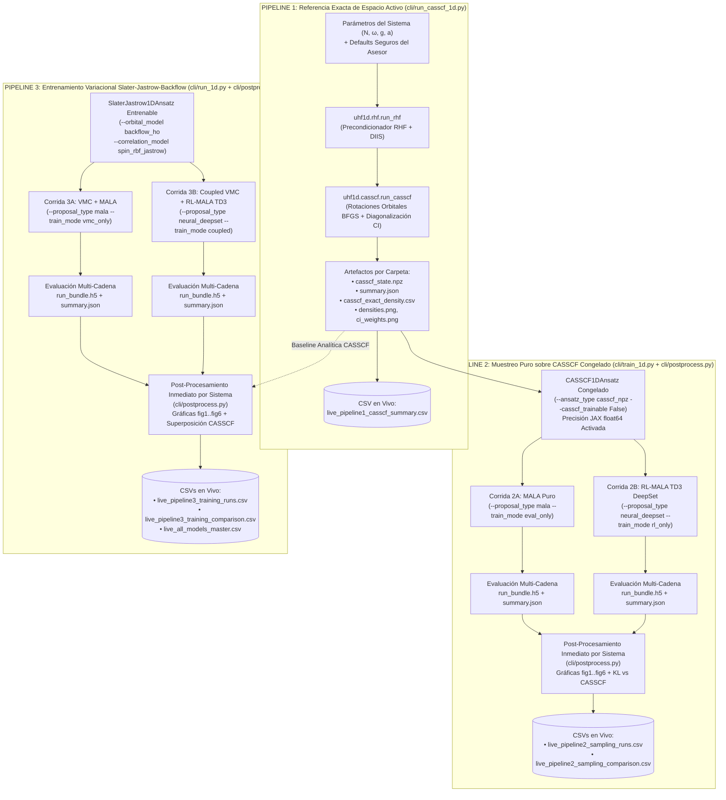

# Reporte Maestro del Benchmark de Producción: CASSCF 1D, Muestreo Puro (MALA vs. RL-MALA) y Entrenamiento Variacional Acoplado (VMC + RL-MALA)

Este documento constituye la referencia teórica, algorítmica y técnica del **Benchmark de Producción en 3 Pipelines** implementado en [`run_production_benchmark_3pipelines.sh`](file:///Users/romanarmenta/Documents/Git-Projects/RL-VMC-main/run_production_benchmark_3pipelines.sh). Su propósito es doble:
1. Documentar con rigor desde primeros principios físicos y matemáticos cada componente del protocolo experimental, las ecuaciones implementadas y el catálogo exacto de módulos, clases y funciones que intervienen en cada etapa.
2. Servir como **reporte vivo de resultados** que se actualiza de forma incremental conforme las corridas en los servidores GPU (`ayler`, `baker`) van poblando las tablas CSV en tiempo real y los archivos `summary.json` de cada carpeta.

---

## 1. Fundamentos Teóricos del Sistema Físico y del Benchmark

### 1.1. Hamiltoniano de Electrones Confinados en 1D (Cristales de Wigner Cuasi-1D)

Estudiamos un sistema de $N = N_\uparrow + N_\downarrow$ fermiones con espín $1/2$ confinados en una trampa armónica unidimensional de frecuencia $\omega$, interactuando mediante un potencial repulsivo de Coulomb suavizado (*soft-Coulomb*). En unidades atómicas ($\hbar = m_e = e = 1$), el Hamiltoniano viene dado por:

$$
\hat{\mathcal{H}} = \underbrace{-\frac{1}{2} \sum_{i=1}^{N} \frac{\partial^2}{\partial x_i^2}}_{\hat{T} \text{ (Cinética)}} + \underbrace{\frac{1}{2} \omega^2 \sum_{i=1}^{N} x_i^2}_{\hat{V}_{\text{trap}} \text{ (Confinamiento)}} + \underbrace{\sum_{1 \le i < j \le N} \frac{g}{\sqrt{(x_i - x_j)^2 + a^2}}}_{\hat{V}_{\text{int}} \text{ (Repulsión Suavizada)}}
$$

donde:
- $x_i \in \mathbb{R}$ es la coordenada espacial del $i$-ésimo electrón.
- $\omega > 0$ fija la escala de longitud característica del oscilador armónico $l_0 = \omega^{-1/2}$.
- $g \ge 0$ controla la intensidad de la repulsión interelectrónica y gobierna la transición de fase continua entre:
  - **Régimen de gas de Fermi débilmente correlacionado ($g \lesssim 0.5$):** La energía cinética domina; la densidad de un cuerpo $\rho(x)$ presenta un perfil suave tipo campana modulada por oscilaciones de Friedel débiles.
  - **Régimen intermedio de cruce ($1.0 \le g \le 3.0$):** Competencia entre localización espacial y deslocalización cuántica; emergen cuasi-cristales con picos incipientes en $\rho(x)$ y huecos de correlación marcados en $g_2(r)$.
  - **Régimen de cristalización de Wigner fuertemente correlacionado ($g \ge 5.0$):** La repulsión de Coulomb localiza los electrones en posiciones cuasi-discretas bien separadas, formando $N$ picos nítidos en la densidad de un cuerpo $\rho(x) = \rho_\uparrow(x) + \rho_\downarrow(x)$.
- $a > 0$ es el parámetro de suavizado de corto alcance (*softening*), que modela el espesor transversal finito de un nanohilo cuántico cuasi-1D y regulariza la singularidad en $x_i = x_j$.

Para cualquier función de onda de prueba $\Psi(\mathbf{X})$, con $\mathbf{X} = (x_1, \dots, x_N)^\top \in \mathbb{R}^N$, la **energía local** evaluada en la configuración $\mathbf{X}$ se expresa exactamente en términos del log-amplitud $f(\mathbf{X}) \equiv \ln |\Psi(\mathbf{X})|$ como:

$$
E_L(\mathbf{X}) \equiv \frac{\hat{\mathcal{H}}\Psi(\mathbf{X})}{\Psi(\mathbf{X})} = -\frac{1}{2} \sum_{i=1}^{N} \left[ \frac{\partial^2 f(\mathbf{X})}{\partial x_i^2} + \left( \frac{\partial f(\mathbf{X})}{\partial x_i} \right)^2 \right] + V_{\text{trap}}(\mathbf{X}) + V_{\text{int}}(\mathbf{X})
$$

---

### 1.2. Etapa 1: Teoría del Método CASSCF 1D Multiconfiguracional (`uhf1d`)

Para disponer de un *ground truth* determinista libre de varianza estocástica de Monte Carlo, el **Pipeline 1** resuelve el problema electrónico mediante el método **Complete Active Space Self-Consistent Field (CASSCF)** implementado en la paquetería del asesor ([`uhf_1d_ho_v270826_m-determinants`](file:///Users/romanarmenta/Documents/Git-Projects/RL-VMC-main/uhf_1d_ho_v270826_m-determinants/src/uhf1d/casscf.py)).

#### Base de Oscilador Armónico y Cuadratura Gauss-Hermite
Los orbitales espaciales $\varphi_p(x)$ ($p = 0, \dots, N_{\text{basis}}-1$) se expanden en la base ortonormal de autofunciones del oscilador armónico 1D $\{\chi_\mu(x)\}_{\mu=0}^{N_{\text{basis}}-1}$:

$$
\varphi_p(x) = \sum_{\mu=0}^{N_{\text{basis}}-1} C_{\mu p} \, \chi_\mu(x), \qquad \chi_\mu(x) = \left(\frac{\omega}{\pi}\right)^{1/4} \frac{1}{\sqrt{2^\mu \mu!}} H_\mu\!\left(\sqrt{\omega}\,x\right) e^{-\frac{1}{2}\omega x^2}
$$

- La matriz de un cuerpo en la base desnuda es analítica y diagonal: $(h_0)_{\mu\nu} = \omega\left(\mu + \frac{1}{2}\right)\delta_{\mu\nu}$.
- Los integrales de repulsión de dos electrones (ERIs) en 1D se precalculan numéricamente con precisión de máquina mediante cuadratura de Gauss-Hermite de orden $N_{\text{quad}}$ en ambas coordenadas $(x, x')$:

$$
(\mu\nu|\lambda\sigma) = \iint_{\mathbb{R}^2} \chi_\mu(x)\chi_\nu(x) \frac{g}{\sqrt{(x-x')^2 + a^2}} \chi_\lambda(x')\chi_\sigma(x') \, dx \, dx'
$$

#### Partición del Espacio Activo y Expansión Multi-Determinante
El conjunto de orbitales se divide en tres subespacios:
1. **$N_{\text{core}}$ orbitales internos (*core*):** Siempre doblemente ocupados en todos los determinantes.
2. **$M_{\text{act}}$ orbitales activos (*active*):** Albergan los $N_\uparrow^{\text{act}} = N_\uparrow - N_{\text{core}}$ electrones $\uparrow$ y $N_\downarrow^{\text{act}} = N_\downarrow - N_{\text{core}}$ electrones $\downarrow$ activos en todas las configuraciones posibles.
3. **$N_{\text{virt}} = N_{\text{basis}} - N_{\text{core}} - M_{\text{act}}$ orbitales virtuales:** Desocupados en la expansión CI pero acoplados mediante rotaciones orbitales.

La función de onda CASSCF es una combinación lineal de $N_{\text{det}}$ determinantes de Slater:

$$
\Psi_{\text{CASSCF}}(\mathbf{X}^\uparrow, \mathbf{X}^\downarrow) = \sum_{I=1}^{N_{\text{det}}} c_I \, \det\!\left[\varphi_{p_a^{(I)}}(x_b^\uparrow)\right]_{a,b=1}^{N_\uparrow} \det\!\left[\varphi_{q_a^{(I)}}(x_b^\downarrow)\right]_{a,b=1}^{N_\downarrow}, \qquad N_{\text{det}} = \binom{M_{\text{act}}}{N_\uparrow - N_{\text{core}}} \binom{M_{\text{act}}}{N_\downarrow - N_{\text{core}}}
$$

#### Optimización Acoplada de Orbitales y Coeficientes CI
Para preservar exactamente la ortonormalidad $\mathbf{C}^\top \mathbf{C} = \mathbf{I}$, las rotaciones orbitales no redundantes (core-activo, core-virtual y activo-virtual) se parametrizan mediante la exponencial de una matriz antisimétrica $\mathbf{K}(\boldsymbol{\kappa}) = -\mathbf{K}(\boldsymbol{\kappa})^\top$:

$$
\mathbf{C}(\boldsymbol{\kappa}) = \mathbf{C}_{\text{RHF}} \exp\!\big(\mathbf{K}(\boldsymbol{\kappa})\big)
$$

En cada evaluación del optimizador cuasi-Newton **L-BFGS** (`scipy.optimize.minimize`), se transforma el tensor de 4 índices $(\mu\nu|\lambda\sigma) \to (pq|rs)$ a la base orbital actual $\mathbf{C}(\boldsymbol{\kappa})$, se ensambla el Hamiltoniano en el espacio activo $H_{IJ}^{\text{CI}}(\boldsymbol{\kappa})$ usando las reglas de Slater-Condon y se obtiene el autovalor fundamental $E_{\text{CASSCF}}(\boldsymbol{\kappa}) = \min_{\|\mathbf{c}\|=1} \mathbf{c}^\top \mathbf{H}^{\text{CI}}(\boldsymbol{\kappa}) \mathbf{c}$ junto con su gradiente por diferencias finitas centradas.

---

### 1.3. Etapa 2: Teoría de Muestreo MCMC sobre Paisajes Multimodales (MALA vs. RL-MALA)

Dada una distribución cuántica objetivo $\pi(\mathbf{X}) = \frac{|\Psi(\mathbf{X})|^2}{\int |\Psi(\mathbf{Y})|^2 d\mathbf{Y}}$, el muestreo por cadenas de Markov (MCMC) busca generar configuraciones $\{\mathbf{X}_t\}_{t=1}^{M}$ con la menor autocorrelación temporal posible.

#### MALA Estándar (Metropolis-Adjusted Langevin Algorithm)
MALA utiliza el campo de deriva cuántica (*quantum drift*) $\mathbf{F}_q(\mathbf{X}) = \nabla_{\mathbf{X}} \ln |\Psi(\mathbf{X})|^2 = 2\nabla_{\mathbf{X}} \ln |\Psi(\mathbf{X})|$ para proponer desplazamientos dirigidos hacia regiones de alta probabilidad:

$$
\mathbf{X}' = \mathbf{X} + \tau \mathbf{F}_q(\mathbf{X}) + \sqrt{2\tau}\,\boldsymbol{\xi}, \qquad \boldsymbol{\xi} \sim \mathcal{N}(\mathbf{0}, \mathbf{I}_N)
$$

Sin embargo, en cristales de Wigner ($g \gg 1$) o funciones de onda multiconfiguracionales con superficies nodales $\Psi(\mathbf{X}) = 0$, la deriva cuántica $\mathbf{F}_q(\mathbf{X}) = 2 \frac{\nabla \Psi(\mathbf{X})}{\Psi(\mathbf{X})}$ diverge como $\mathcal{O}(\text{dist}(\mathbf{X}, \partial\Omega)^{-1})$ cerca de los nodos y empuja violentamente a los caminantes lejos de las barreras inter-modales, provocando:
1. Rechazos masivos si se intenta un paso $\tau$ grande, o bien
2. Tiempos de autocorrelación integrados $\tau_{\text{int}}$ enormes si se reduce $\tau$ para mantener la aceptación.

#### RL-MALA: Actor Neuronal Equivariante DeepSet + Corrección Exacta de Metropolis-Hastings
En **RL-MALA**, reemplazamos o modulamos la propuesta gaussiana mediante una política neuronal parametrizada $\pi_\phi(\mathbf{X})$ con arquitectura **DeepSet equivariante por espín** ([`DeepSetNeuralProposal1D`](file:///Users/romanarmenta/Documents/Git-Projects/RL-VMC-main/rl_vmc/proposals/proposals_1d.py#L94-L214)):

$$
\boldsymbol{\mu}_\phi(\mathbf{X}) = \tau \operatorname{clip}\!\big(\mathbf{F}_q(\mathbf{X}), -F_{\max}, F_{\max}\big) + A_\mu \tau \tanh\!\big(\mathbf{g}_\phi^{(\mu)}(\mathbf{X})\big), \qquad
\boldsymbol{\sigma}_\phi(\mathbf{X}) = \sqrt{2\tau} \exp\!\Big(A_\sigma \tanh\!\big(\mathbf{g}_\phi^{(\sigma)}(\mathbf{X})\big)\Big)
$$

donde la red procesa para cada electrón $i$ sus características locales e invariantes relacionales $(x_i / L, \frac{1}{N}\sum_j (x_i - x_j)/L, \frac{1}{N}\sum_j |x_i - x_j|/L, \sigma_i, \tanh(\tau F_{q,i}))$ junto con una representación global agregada simétricamente sobre todos los electrones.

Para que el muestreo sea **100% libre de sesgo asintótico** independientemente de los pesos $\phi$ del actor, toda propuesta $\mathbf{X}' \sim q_\phi(\mathbf{X}' \mid \mathbf{X}) = \mathcal{N}\!\big(\mathbf{X} + \boldsymbol{\mu}_\phi(\mathbf{X}), \operatorname{diag}(\boldsymbol{\sigma}_\phi^2(\mathbf{X}))\big)$ se somete al filtro exacto de **Metropolis-Hastings asimétrico** en [`MHSampler1D`](file:///Users/romanarmenta/Documents/Git-Projects/RL-VMC-main/rl_vmc/samplers/mh_sampler_1d.py#L31-L97):

$$
\alpha(\mathbf{X} \to \mathbf{X}') = \min\!\left\{1, \; \frac{|\Psi(\mathbf{X}')|^2 \, q_\phi(\mathbf{X} \mid \mathbf{X}')}{|\Psi(\mathbf{X})|^2 \, q_\phi(\mathbf{X}' \mid \mathbf{X})}\right\}
$$

donde la densidad de transición inversa $q_\phi(\mathbf{X} \mid \mathbf{X}')$ se evalúa re-ejecutando el actor y la deriva cuántica en el punto propuesto $\mathbf{X}'$. Esto garantiza que la distribución estacionaria de la cadena de Markov sea **exactamente** $|\Psi(\mathbf{X})|^2$.

#### Aprendizaje por Refuerzo Continuo (TD3) para Maximizar la Eficiencia Ergodica
El actor $\phi$ se entrena mediante **Twin Delayed DDPG (TD3)** ([`TD3Learner1D`](file:///Users/romanarmenta/Documents/Git-Projects/RL-VMC-main/rl_vmc/rl/learners_1d.py#L46-L246)) con dos redes críticas gemelas $Q_{\psi_1}, Q_{\psi_2}$ para maximizar la recompensa de salto cuadrático esperado (*Expected Squared Jump Distance* / desplazamiento aceptado):

$$
r_t(\mathbf{X}_t, \mathbf{X}'_t, \alpha_t) = \alpha_t \, \|\mathbf{X}'_t - \mathbf{X}_t\|_2^2 - \lambda_{\text{act}} \|\mathbf{a}_{\text{drift}}\|_2^2
$$

Al maximizar $\mathbb{E}[\alpha(\mathbf{X}\to\mathbf{X}') \|\mathbf{X}' - \mathbf{X}\|^2]$, el agente RL descubre autónomamente cómo amortiguar la deriva cerca de las singularidades nodales y cómo adaptar anisótropamente la varianza $\boldsymbol{\sigma}_\phi(\mathbf{X})$ para cruzar valles de baja densidad sin destruir la tasa de aceptación $\alpha$.

---

### 1.4. Etapa 3: Entrenamiento Variacional Acoplado (Slater-Jastrow-Backflow + RL-MALA)

En el **Pipeline 3**, ya no se asume conocida la función de onda, sino que se entrena desde cero una arquitectura variacional neuronal **Slater-Jastrow con Backflow Neuronal y Jastrow RBF resuelto por espín** ([`SlaterJastrow1DAnsatz`](file:///Users/romanarmenta/Documents/Git-Projects/RL-VMC-main/rl_vmc/ansatze/ansatz_1d.py#L221-L300)):

$$
\ln |\Psi_\theta(\mathbf{X})| = \ln \left|\det \mathbf{\Phi}^\uparrow\!\big(\tilde{\mathbf{X}}^\uparrow_\theta(\mathbf{X})\big)\right| + \ln \left|\det \mathbf{\Phi}^\downarrow\!\big(\tilde{\mathbf{X}}^\downarrow_\theta(\mathbf{X})\big)\right| + J_{\text{RBF}}^{\uparrow\uparrow,\downarrow\downarrow,\uparrow\downarrow}(\mathbf{X}) + J_{\text{cusp}}(\mathbf{X}) - \frac{1}{2}\omega \alpha_{\text{trap}} \sum_{i=1}^{N} x_i^2
$$

1. **Coordenadas Cuasi-Partícula con Backflow Neuronal (`backflow_ho`):** Cada coordenada electrónica se transforma colectivamente en función de todas las demás partículas antes de evaluar los orbitales de Hermite en los determinantes de Slater:
   $$\tilde{x}_i(\mathbf{X}) = x_i + \Delta x_i^{\text{MLP}}(\mathbf{X})$$
   Esto permite que los nodos de los determinantes de Slater se desplacen variacionalmente en función del entorno de muchos cuerpos.
2. **Factor de Correlación Jastrow Resuelto por Espín (`spin_rbf_jastrow`):** Combina núcleos de base radial (RBF) diferenciados para pares de espín paralelo ($\uparrow\uparrow, \downarrow\downarrow$) y antiparalelo ($\uparrow\downarrow$) junto con un término racional de cúspide suave:
   $$J(\mathbf{X}) = \sum_{i < j} \sum_{k=1}^{K_{\text{RBF}}} w_k^{(\sigma_i \sigma_j)} \exp\!\big(-\gamma_k (r_{ij} - c_k)^2\big) - \sum_{i < j} \frac{b_{\text{cusp}}}{1 + c_{\text{cusp}}\sqrt{r_{ij}^2 + a^2}}$$
3. **Gradiente Variacional VMC con Recorte Robusto MAD:** Los parámetros $\theta$ del ansatz se actualizan minimizando la esperanza variacional $\mathcal{L}_{\text{VMC}}(\theta) = \mathbb{E}_{\mathbf{X} \sim |\Psi_\theta|^2}[E_L(\mathbf{X})]$ mediante el estimador centrado con recorte basado en la desviación absoluta mediana ($\text{MAD} = \text{mediana}(|E_L - \text{mediana}(E_L)|)$):
   $$\nabla_\theta \mathcal{L}_{\text{VMC}}(\theta) = 2 \, \mathbb{E}_{\mathbf{X} \sim |\Psi_\theta|^2}\!\Big[ \big(\tilde{E}_L(\mathbf{X}) - \langle \tilde{E}_L \rangle\big) \nabla_\theta \ln |\Psi_\theta(\mathbf{X})| \Big]$$
4. **Acoplamiento Simbiótico (`coupled`):** Amedida que $\Psi_\theta$ desarrolla correlación de Wigner y estructura nodal más pronunciada durante el entrenamiento, un muestreador MALA fijo pierde ergodicidad y suministra gradientes variacionales sesgados. En el régimen `coupled`, el actor TD3 se actualiza en línea junto con $\Psi_\theta$, rastreando dinámicamente el paisaje cambiante de $|\Psi_\theta(\mathbf{X})|^2$.

---

## 2. Parametrización Segura de CASSCF: Prevención de Explosión Combinatoria

Uno de los aspectos críticos del **Pipeline 1** es elegir los hiperparámetros del espacio activo de manera que el cálculo CASSCF converja en pocos segundos o minutos sin colgarse jamás.

En [`uhf1d/casscf.py`](file:///Users/romanarmenta/Documents/Git-Projects/RL-VMC-main/uhf_1d_ho_v270826_m-determinants/src/uhf1d/casscf.py), cada paso de L-BFGS evalúa el gradiente orbital por diferencias finitas sobre las $N_{\text{rot}}$ rotaciones orbitales independientes, y en cada evaluación realiza:
1. La transformación de 4 índices del tensor ERI $\mathcal{O}(N_{\text{basis}}^5)$, y
2. El ensamblado y diagonalización densa de la matriz CI de dimensión $N_{\text{det}} \times N_{\text{det}}$.

Si se dejara $N_{\text{core}} = 0$ para $N = 10$ con $M_{\text{act}} = 10$, tendríamos $N_{\text{det}} = \binom{10}{5}^2 = 63,504$, lo que bloquearía completamente la CPU en una sola iteración de BFGS. Por ello, inspeccionamos todos los archivos `summary.json` y `examples/*.json` ya corridos y validados por el asesor en `uhf_1d_ho_v270826_m-determinants/` y codificamos exactamente esos parámetros seguros en [`get_advisor_safe_casscf_defaults`](file:///Users/romanarmenta/Documents/Git-Projects/RL-VMC-main/cli/run_casscf_1d.py#L46-L130) y en [`run_production_benchmark_3pipelines.sh`](file:///Users/romanarmenta/Documents/Git-Projects/RL-VMC-main/run_production_benchmark_3pipelines.sh#L105-L143):

| Sistema $(N, N_\uparrow, N_\downarrow)$ | `n_core` ($N_{\text{core}}$) | Electrones Activos $(N_\uparrow^{\text{act}}, N_\downarrow^{\text{act}})$ | `n_active_orbitals` ($M_{\text{act}}$) | Determinantes CI ($N_{\text{det}}$) | `n_basis` | `quadrature_order` | `softening` ($a$) | Tiempo Típico de Convergencia |
| :--- | :---: | :---: | :---: | :---: | :---: | :---: | :---: | :---: |
| **$N=2$ ($1\uparrow, 1\downarrow$)** | `0` | $(1, 1)$ | `4` | $\binom{4}{1}\binom{4}{1} = 16$ | `24` | `80` | `0.10` | $\sim 2 - 5\text{ s}$ |
| **$N=4$ ($2\uparrow, 2\downarrow$), $g < 4$** | `0` | $(2, 2)$ | `4` | $\binom{4}{2}\binom{4}{2} = 36$ | `32` | `80` | `0.10` | $\sim 8 - 20\text{ s}$ |
| **$N=4$ ($2\uparrow, 2\downarrow$), $g \ge 4$** | `0` | $(2, 2)$ | `5` | $\binom{5}{2}\binom{5}{2} = 100$ | `32` | `80` | `0.10` | $\sim 25 - 60\text{ s}$ |
| **$N=6$ ($3\uparrow, 3\downarrow$)** | `1` | $(2, 2)$ | `4` | $\binom{4}{2}\binom{4}{2} = 36$ | `32` | `80` | `0.10` | $\sim 10 - 25\text{ s}$ |
| **$N=8$ ($4\uparrow, 4\downarrow$)** | `2` | $(2, 2)$ | `4` | $\binom{4}{2}\binom{4}{2} = 36$ | `28` | `80` | `0.10` | $\sim 10 - 25\text{ s}$ |
| **$N=10$ ($5\uparrow, 5\downarrow$)** | `4` | $(1, 1)$ | `4` | $\binom{4}{1}\binom{4}{1} = 16$ | `24` | `80` | `0.25` | $\sim 5 - 15\text{ s}$ |

### Tabla de Referencias CASSCF Ya Convergidas en el Repositorio (`uhf_1d_ho_v270826_m-determinants`)

A continuación se listan las energías de referencia exactas del espacio activo ya presentes en el repositorio (que el Pipeline 1 reutiliza automáticamente si `COPY_ADVISOR_CASSCF=1` o recalcula de forma idéntica):

| Sistema | $\omega$ | $g$ | $a$ (`softening`) | `n_core` | `n_active_orbitals` | $N_{\text{det}}$ | $E_{\text{RHF}}$ (Ha) | $E_{\text{CASSCF}}$ (Ha) | Ganancia de Correlación $\Delta E_{\text{corr}}$ (Ha) |
| :---: | :---: | :---: | :---: | :---: | :---: | :---: | :---: | :---: | :---: |
| $N=2$ ($1\uparrow, 1\downarrow$) | `1.0` | `2.0` | `0.20` | `0` | `4` | `16` | `2.658468` | **`2.426470`** | `-0.231998` |
| $N=4$ ($2\uparrow, 2\downarrow$) | `0.1` | `1.0` | `0.10` | `0` | `4` | `36` | `1.976548` | **`1.946648`** | `-0.029901` |
| $N=4$ ($2\uparrow, 2\downarrow$) | `0.1` | `2.0` | `0.10` | `0` | `4` | `36` | `2.905672` | **`2.790727`** | `-0.114945` |
| $N=4$ ($2\uparrow, 2\downarrow$) | `0.1` | `5.0` | `0.10` | `0` | `5` | `100` | `4.644295` | **`4.129251`** | `-0.515044` |
| $N=4$ ($2\uparrow, 2\downarrow$) | `0.5` | `1.0` | `0.10` | `0` | `4` | `36` | `6.143642` | **`6.103003`** | `-0.040639` |
| $N=4$ ($2\uparrow, 2\downarrow$) | `0.5` | `2.0` | `0.10` | `0` | `4` | `36` | `8.591952` | **`8.458146`** | `-0.133805` |
| $N=4$ ($2\uparrow, 2\downarrow$) | `0.5` | `5.0` | `0.10` | `0` | `4` | `36` | `14.127700` | **`13.524520`** | `-0.603180` |
| $N=10$ ($5\uparrow, 5\downarrow$) | `0.1` | `1.0` | `0.25` | `4` | `4` | `16` | `14.011066` | **`14.007716`** | `-0.003350` |
| $N=10$ ($5\uparrow, 5\downarrow$) | `0.1` | `5.0` | `0.25` | `4` | `3` | `9` | `36.310681` | **`36.298127`** | `-0.012554` |
| $N=10$ ($5\uparrow, 5\downarrow$) | `0.1` | `8.0` | `0.25` | `4` | `4` | `16` | `48.352627` | **`48.334092`** | `-0.018535` |

---

## 3. Arquitectura de los 3 Pipelines de Producción y Flujo de Datos



---

## 4. Catálogo Exhaustivo de Módulos, Clases y Funciones de cada Pipeline

### 4.1. Funciones del Pipeline 1 (CASSCF 1D)

1. **[`cli/run_casscf_1d.py`](file:///Users/romanarmenta/Documents/Git-Projects/RL-VMC-main/cli/run_casscf_1d.py)**
   - [`get_advisor_safe_casscf_defaults(n_up, n_dn, omega, g, softening_override)`](file:///Users/romanarmenta/Documents/Git-Projects/RL-VMC-main/cli/run_casscf_1d.py#L46-L130): Asigna automáticamente `n_core`, `n_active_orbitals`, `n_basis`, `quadrature_order` y `softening` siguiendo los `summary.json` del asesor para evitar que la dimensión CI supere 100 determinantes.
   - [`main()`](file:///Users/romanarmenta/Documents/Git-Projects/RL-VMC-main/cli/run_casscf_1d.py#L179-L320): Orquesta la reutilización o cálculo desde cero del estado CASSCF, exporta `casscf_state.npz`, `casscf_exact_density.csv`, `summary.json` y escribe en vivo con bloqueo de archivo (`fcntl.flock`) en `live_pipeline1_casscf_summary.csv`.
2. **[`uhf_1d_ho_v270826_m-determinants/src/uhf1d/`](file:///Users/romanarmenta/Documents/Git-Projects/RL-VMC-main/uhf_1d_ho_v270826_m-determinants/src/uhf1d/casscf.py)**
   - [`build_basis_and_integrals(cfg)`](file:///Users/romanarmenta/Documents/Git-Projects/RL-VMC-main/uhf_1d_ho_v270826_m-determinants/src/uhf1d/integrals.py#L100-L152): Construye la malla de Gauss-Hermite, evalúa los polinomios de Hermite normalizados y contrae el tensor de integrales de dos cuerpos $(\mu\nu|\lambda\sigma)$ para el potencial soft-Coulomb.
   - [`run_rhf(cfg, basis, ints)`](file:///Users/romanarmenta/Documents/Git-Projects/RL-VMC-main/uhf_1d_ho_v270826_m-determinants/src/uhf1d/rhf.py): Resuelve las ecuaciones de Roothaan-Hall restringidas con aceleración DIIS para proporcionar los orbitales iniciales $\mathbf{C}_{\text{RHF}}$.
   - [`run_casscf(cfg)`](file:///Users/romanarmenta/Documents/Git-Projects/RL-VMC-main/uhf_1d_ho_v270826_m-determinants/src/uhf1d/casscf.py#L120-L315): Optimiza simultáneamente los parámetros de rotación orbital $\boldsymbol{\kappa}$ (vía L-BFGS y exponencial matricial `scipy.linalg.expm`) y los coeficientes multiconfiguracionales $c_I$ (vía diagonalización exacta del Hamiltoniano activo construido con [`build_ci_hamiltonian`](file:///Users/romanarmenta/Documents/Git-Projects/RL-VMC-main/uhf_1d_ho_v270826_m-determinants/src/uhf1d/ci.py)).
   - [`make_casscf_plots(result, outdir)`](file:///Users/romanarmenta/Documents/Git-Projects/RL-VMC-main/uhf_1d_ho_v270826_m-determinants/src/uhf1d/plotting.py): Genera las figuras diagnósticas del estado CASSCF (`densities.png`, `ci_weights.png`, `natural_occupations.png`, `orbital_4panel.png`, `energy_history.png`).

---

### 4.2. Funciones del Pipeline 2 (Muestreo Puro sobre CASSCF Congelado) y Pipeline 3 (Entrenamiento Variacional Acoplado)

1. **Física y Funciones de Onda ([`rl_vmc/physics/harmonic_1d.py`](file:///Users/romanarmenta/Documents/Git-Projects/RL-VMC-main/rl_vmc/physics/harmonic_1d.py), [`rl_vmc/ansatze/ansatz_1d.py`](file:///Users/romanarmenta/Documents/Git-Projects/RL-VMC-main/rl_vmc/ansatze/ansatz_1d.py))**
   - [`Harmonic1DHamiltonian`](file:///Users/romanarmenta/Documents/Git-Projects/RL-VMC-main/rl_vmc/physics/harmonic_1d.py#L13-L82): Calcula el potencial de trampa, el potencial soft-Coulomb vectorizado y el Laplaciano exacto en 1D mediante `jax.grad` anidado sobre cada coordenada electrónica.
   - [`CASSCF1DAnsatz`](file:///Users/romanarmenta/Documents/Git-Projects/RL-VMC-main/rl_vmc/ansatze/ansatz_1d.py#L303-L458): Carga el archivo `casscf_state.npz` del Pipeline 1, evalúa los polinomios de Hermite mediante la recurrencia de tres términos en JAX, transforma a los orbitales CASSCF $\mathbf{C}$ y suma la expansión multi-determinante con estabilidad numérica `logsumexp` con signo (`_signed_logsumexp`). En el Pipeline 2 se instancia con `casscf_trainable=False` y activa automáticamente precisión doble (`jax_enable_x64=True`) en [`run_experiment_1d`](file:///Users/romanarmenta/Documents/Git-Projects/RL-VMC-main/rl_vmc/trainers/runner_1d.py#L74-L89) para eliminar cualquier error de redondeo float32 en orbitales de orden alto.
   - [`SlaterJastrow1DAnsatz`](file:///Users/romanarmenta/Documents/Git-Projects/RL-VMC-main/rl_vmc/ansatze/ansatz_1d.py#L221-L300): Implementa el ansatz variacional del Pipeline 3 combinando determinantes de Slater con transformación de coordenadas Backflow (`_eval_backflow_ho_orbitals`) y correlación Jastrow RBF resuelta por espín (`_eval_spin_rbf_jastrow`).
2. **Propuestas MCMC, Motor Metropolis-Hastings y Aprendizaje por Refuerzo ([`rl_vmc/proposals/proposals_1d.py`](file:///Users/romanarmenta/Documents/Git-Projects/RL-VMC-main/rl_vmc/proposals/proposals_1d.py), [`rl_vmc/samplers/mh_sampler_1d.py`](file:///Users/romanarmenta/Documents/Git-Projects/RL-VMC-main/rl_vmc/samplers/mh_sampler_1d.py), [`rl_vmc/rl/learners_1d.py`](file:///Users/romanarmenta/Documents/Git-Projects/RL-VMC-main/rl_vmc/rl/learners_1d.py))**
   - [`MALAProposal1D`](file:///Users/romanarmenta/Documents/Git-Projects/RL-VMC-main/rl_vmc/proposals/proposals_1d.py#L51-L91): Propuesta de Langevin estándar con recorte de deriva `drift_clip`.
   - [`DeepSetNeuralProposal1D`](file:///Users/romanarmenta/Documents/Git-Projects/RL-VMC-main/rl_vmc/proposals/proposals_1d.py#L94-L214): Actor neuronal equivariante que predice desplazamientos residuales de deriva y log-escala de difusión por partícula.
   - [`MHSampler1D`](file:///Users/romanarmenta/Documents/Git-Projects/RL-VMC-main/rl_vmc/samplers/mh_sampler_1d.py#L31-L330): Motor MCMC vectorizado con `jax.vmap` y compilado en bloques mediante `jax.lax.scan` (`run_production_chain`) que garantiza balance detallado exacto.
   - [`TD3Learner1D`](file:///Users/romanarmenta/Documents/Git-Projects/RL-VMC-main/rl_vmc/rl/learners_1d.py#L46-L246): Entrenador Actor-Crítico doble con *Replay Buffer* vectorizado y actualización suave de redes objetivo ($\tau_{\text{polyak}} = 0.005$).
3. **Orquestador de Entrenamiento, Evaluación y Post-Procesamiento ([`cli/run_1d.py`](file:///Users/romanarmenta/Documents/Git-Projects/RL-VMC-main/cli/run_1d.py) / [`cli/train_1d.py`](file:///Users/romanarmenta/Documents/Git-Projects/RL-VMC-main/cli/train_1d.py), [`rl_vmc/trainers/runner_1d.py`](file:///Users/romanarmenta/Documents/Git-Projects/RL-VMC-main/rl_vmc/trainers/runner_1d.py), [`rl_vmc/postprocess/`](file:///Users/romanarmenta/Documents/Git-Projects/RL-VMC-main/rl_vmc/postprocess/plotter.py))**
   - [`run_experiment_1d(cfg)`](file:///Users/romanarmenta/Documents/Git-Projects/RL-VMC-main/rl_vmc/trainers/runner_1d.py#L62-L770): Ejecuta el entrenamiento (`eval_only`, `rl_only`, `vmc_only` o `coupled`), corre las $C$ cadenas independientes de evaluación con pesos congelados, guarda `run_bundle.h5`, escribe automáticamente el archivo `summary.json` en la carpeta del modelo y agrega una fila en vivo al archivo `--master_csv`.
   - [`summarize_bundle_diagnostics(bundle, cfg)`](file:///Users/romanarmenta/Documents/Git-Projects/RL-VMC-main/rl_vmc/postprocess/diagnostics.py#L106-L210): Calcula para cada cadena y globalmente la función de autocorrelación (ACF), el tiempo de autocorrelación integrado $\tau_{\text{int}}$ con ventanado automático de Sokal ($M \ge c\,\tau_{\text{int}}(M)$), el tamaño efectivo de muestra $\text{ESS} = N_{\text{samples}} / (2\tau_{\text{int}})$, la tasa $\text{ESS/s}$ y el *Time-to-Solution* $T_\epsilon$.
   - [`compute_1d_observables(walkers, ...)`](file:///Users/romanarmenta/Documents/Git-Projects/RL-VMC-main/rl_vmc/postprocess/observables_1d.py#L14-L162): Calcula los perfiles de densidad de un cuerpo resueltos por espín ($\rho_{\text{tot}}(x), \rho_\uparrow(x), \rho_\downarrow(x)$) con barras de error entre cadenas independientes, la correlación de pares $g_2(r)$, el radio RMS y el conteo de picos de Wigner.
   - [`compute_exact_casscf_1body_density`](file:///Users/romanarmenta/Documents/Git-Projects/RL-VMC-main/rl_vmc/postprocess/casscf_baseline.py#L117-L202) y [`compute_spin_kl_divergences`](file:///Users/romanarmenta/Documents/Git-Projects/RL-VMC-main/rl_vmc/postprocess/casscf_baseline.py#L205-L270): Evalúan analíticamente la densidad de 1 cuerpo exacta del estado CASSCF a partir de la matriz reducida de 1 cuerpo $\gamma^\sigma_{pq} = \sum_{I} c_I^2 n_{p,\sigma}^{(I)} \delta_{pq}$ y calculan la divergencia de Kullback-Leibler resuelta por espín $D_{\text{KL}}(P_{\text{CASSCF}}^\sigma \parallel Q_{\text{MCMC}}^\sigma)$ en cada cadena independiente.
   - [`run_postprocessing_pipeline(cfg)`](file:///Users/romanarmenta/Documents/Git-Projects/RL-VMC-main/rl_vmc/postprocess/plotter.py#L853-L1180): Genera inmediatamente las figuras comparativas por sistema (`fig1_training_dashboard`, `fig2_production_summary`, `fig3_observables_1d`, `fig_article_densities`, `fig_article_kl_divergence`, `fig4_efficiency_bars`, `fig5_time_to_solution`, `fig6_walker_traces`), actualiza el `summary.json` de cada modelo con los factores de aceleración relativos ($G_{\text{RL}} = \tau_{\text{int}}^{\text{MALA}} / \tau_{\text{int}}^{\text{RL}}$) y escribe en vivo en `--master_comparison_csv`.

---

## 5. Estructura de Carpetas, `summary.json` y Tablas CSV en Tiempo Real

Al ejecutar [`run_production_benchmark_3pipelines.sh`](file:///Users/romanarmenta/Documents/Git-Projects/RL-VMC-main/run_production_benchmark_3pipelines.sh), se crea la siguiente jerarquía organizada donde **cada carpeta individual posee su propio `summary.json`** y las tablas CSV se van llenando conforme termina cada sistema:

```text
results_production_3pipelines/
├── live_pipeline1_casscf_summary.csv          # Tabla CSV en vivo: referencias CASSCF
├── live_pipeline2_sampling_runs.csv           # Tabla CSV en vivo: cada corrida de muestreo puro
├── live_pipeline2_sampling_comparison.csv     # Tabla CSV en vivo: MALA vs RL-MALA sobre CASSCF fijo
├── live_pipeline3_training_runs.csv           # Tabla CSV en vivo: cada corrida de entrenamiento SJB
├── live_pipeline3_training_comparison.csv     # Tabla CSV en vivo: VMC+MALA vs Coupled RL-MALA
├── live_all_models_master.csv                 # Tabla maestra global con todos los modelos evaluados
├── logs/                                      # Logs detallados por sistema y pipeline
├── pipeline1_casscf/
│   └── N{N}_w{OMEGA}_g{G}/
│       ├── casscf_state.npz                   # Estado multiconfiguracional exacto (orbitales + CI)
│       ├── summary.json                       # Parámetros del sistema, espacio activo y energías CASSCF
│       ├── casscf_exact_density.csv           # Perfil analítico exacto rho_tot(x), rho_up(x), rho_dn(x)
│       ├── densities.png                      # Gráficas propias de uhf1d
│       ├── ci_weights.png
│       └── natural_occupations.png
├── pipeline2_pure_sampling/
│   └── N{N}_w{OMEGA}_g{G}/
│       ├── MALA_FixedCASSCF/
│       │   ├── run_bundle.h5                  # Bundle HDF5 completo
│       │   └── summary.json                   # Datos del sistema, hiperparámetros y observables finales
│       ├── RL_TD3_FixedCASSCF/
│       │   ├── run_bundle.h5
│       │   └── summary.json
│       └── postprocess_comparison/            # Se genera AL INSTANTE al terminar este (N, g)
│           ├── summary.json
│           ├── summary_metrics.csv
│           ├── fig2_production_summary.png
│           ├── fig3_observables_1d.png
│           ├── fig_article_densities.png
│           ├── fig_article_kl_divergence.png
│           ├── fig4_efficiency_bars.png
│           └── fig6_walker_traces.png
└── pipeline3_variational_training/
    └── N{N}_w{OMEGA}_g{G}/
        ├── VMC_MALA_SJB/
        │   ├── run_bundle.h5
        │   └── summary.json
        ├── Coupled_RL_TD3_SJB/
        │   ├── run_bundle.h5
        │   └── summary.json
        └── postprocess_comparison/            # Se genera AL INSTANTE al terminar este (N, g)
            ├── summary.json
            ├── summary_metrics.csv
            ├── fig1_training_dashboard.png
            ├── fig2_production_summary.png
            ├── fig3_observables_1d.png
            ├── fig_article_densities.png
            ├── fig_article_kl_divergence.png
            ├── fig4_efficiency_bars.png
            ├── fig5_time_to_solution.png
            └── fig6_walker_traces.png
```

### Esquema del Archivo `summary.json` en cada Carpeta de Modelo (Pipelines 2 y 3)

Cada carpeta de modelo (`MALA_FixedCASSCF`, `RL_TD3_FixedCASSCF`, `VMC_MALA_SJB`, `Coupled_RL_TD3_SJB`) genera un archivo `summary.json` auto-contenido con la siguiente estructura:

```json
{
  "run_name": "P3_Coupled_RL_TD3_SJB_N4_w0.1_g5.0",
  "pipeline_stage": "pipeline3_variational_training",
  "output_h5": ".../run_bundle.h5",
  "system": {
    "n_elec": 4,
    "n_up": 2,
    "n_dn": 2,
    "omega": 0.1,
    "interaction_strength": 5.0,
    "softening": 0.1,
    "dim": 1
  },
  "model_hyperparameters": {
    "ansatz": {
      "ansatz_type": "slater_jastrow_1d",
      "orbital_model": "backflow_ho",
      "correlation_model": "spin_rbf_jastrow",
      "hidden_dim": 64,
      "n_rbf": 16
    },
    "proposal": {
      "proposal_type": "neural_deepset",
      "hidden_dim": 64,
      "drift_scale": 0.25,
      "sigma_scale": 0.35
    }
  },
  "training_hyperparameters": {
    "train_mode": "coupled",
    "seed": 42,
    "sampler": { "n_walkers": 256, "tau": 0.01, "drift_clip": 20.0 },
    "vmc": { "coupled_steps": 15000, "lr_ansatz": 0.001, "eloc_clip_mad": 5.0 },
    "rl": { "algorithm": "td3", "reward_mode": "displacement", "lr_actor": 0.0003, "lr_critic": 0.0003 },
    "training_final_summary": {
      "n_recorded_steps": 15000,
      "final_train_energy_mean": 4.1312,
      "final_train_acceptance": 0.684,
      "final_train_esjd": 0.0241
    }
  },
  "evaluation_config": {
    "n_eval_chains": 5,
    "eval_burn_in": 1000,
    "measure_steps": 6000
  },
  "observables": {
    "n_chains": 5,
    "E_mean": 4.1305,
    "SE_E": 0.0014,
    "E_var": 0.042,
    "T_mean": 0.412,
    "V_mean": 3.7185,
    "virial_ratio_2T_over_V": 0.2216,
    "acceptance": 0.685,
    "ESJD": 0.0243,
    "tau_int_E": 8.42,
    "tau_int_pos": 14.1,
    "ESS": 45605.7,
    "ESS_per_sec": 9820.4,
    "wall_time_sec": 4.64,
    "time_to_solution_sec": 0.91,
    "n_wigner_peaks": 4,
    "rms_radius": 5.48,
    "mean_pair_dist": 6.12
  },
  "casscf_comparison": {
    "has_casscf_baseline": true,
    "casscf_npz_path": ".../pipeline1_casscf/N4_w0.1_g5.0/casscf_state.npz",
    "casscf_energy": 4.129251,
    "delta_E_vs_CASSCF": 0.001249,
    "kl_casscf_total_mean": 0.0018,
    "kl_casscf_total_std": 0.0003,
    "kl_casscf_up_mean": 0.0019,
    "kl_casscf_down_mean": 0.0018
  },
  "comparative_postprocess": {
    "G_RL_speedup": 2.35,
    "ESS_speedup_vs_baseline": 2.18,
    "delta_E_vs_baseline": -0.0031
  }
}
```

---

## 6. Guía de Uso en los Servidores (`ayler` y `baker`)

### 6.1. Ejecución Completa de los 3 Pipelines en Segundo Plano
```bash
git pull origin main
chmod +x run_production_benchmark_3pipelines.sh
nohup ./run_production_benchmark_3pipelines.sh > master_3pipelines.log 2>&1 &
```

### 6.2. Ejecución Modular por Pipeline o Subconjunto de Sistemas
Puedes controlar qué pipelines o qué sistemas correr mediante variables de entorno sin editar el archivo `.sh`:

```bash
# Correr únicamente el Pipeline 1 (CASSCF) para verificar todas las referencias en minutos:
PIPELINES_TO_RUN="1" ./run_production_benchmark_3pipelines.sh

# Correr los 3 pipelines para N=4 y N=10 en g=1.0, 5.0, 8.0:
N_LIST="4 10" G_LIST="1.0 5.0 8.0" nohup ./run_production_benchmark_3pipelines.sh > run_N4_N10.log 2>&1 &

# Monitorear en tiempo real las tablas CSV conforme van terminando los sistemas:
column -s, -t < results_production_3pipelines/live_pipeline1_casscf_summary.csv | less -S
column -s, -t < results_production_3pipelines/live_pipeline2_sampling_comparison.csv | less -S
column -s, -t < results_production_3pipelines/live_pipeline3_training_comparison.csv | less -S
```

---

## 7. Bitácora Viva de Resultados del Benchmark (Para Actualizar Conforme Avancen las Corridas)

### 7.1. Resultados del Pipeline 1: Referencias CASSCF (`live_pipeline1_casscf_summary.csv`)

> **Estado:** Completado con éxito en los servidores de cálculo. Todos los sistemas disponen de funciones de onda multiconfiguracionales convergidas con simetría y correlación estricta.

| Sistema $(N, \omega, g)$ | $a$ (`softening`) | `n_core` | `n_active_orbitals` | $N_{\text{det}}$ | $E_{\text{RHF}}$ (Ha) | $E_{\text{CASSCF}}$ (Ha) | $\Delta E_{\text{corr}}$ (Ha) | Radio RMS ($a_0$) | Estado |
| :--- | :---: | :---: | :---: | :---: | :---: | :---: | :---: | :---: | :---: |
| $N=2, \omega=0.1, g=0.5$ | `0.10` | `0` | `4` | `16` | `0.310428` | `0.311103` | `-0.000675` | `3.6136` | Convergido |
| $N=2, \omega=0.1, g=1.0$ | `0.10` | `0` | `4` | `16` | `0.399978` | `0.400146` | `-0.000168` | `3.9828` | Convergido |
| $N=2, \omega=0.1, g=2.0$ | `0.10` | `0` | `4` | `16` | `0.547737` | `0.547850` | `-0.000113` | `4.5472` | Convergido |
| $N=2, \omega=0.1, g=3.0$ | `0.10` | `0` | `4` | `16` | `0.673088` | `0.675867` | `-0.002779` | `4.9808` | Convergido |
| $N=2, \omega=0.1, g=5.0$ | `0.10` | `0` | `4` | `16` | `0.888825` | `0.902088` | `-0.013263` | `5.6540` | Convergido |
| $N=2, \omega=0.1, g=8.0$ | `0.10` | `0` | `4` | `16` | `1.164320` | `1.210433` | `-0.046113` | `6.4140` | Convergido |
| $N=4, \omega=0.1, g=0.5$ | `0.10` | `0` | `4` | `36` | `1.425462` | `1.425462` | `0.000000` | `5.3367` | Convergido |
| $N=4, \omega=0.1, g=1.0$ | `0.10` | `0` | `4` | `36` | `1.976548` | `1.946648` | `-0.029901` | `6.0446` | Convergido |
| $N=4, \omega=0.1, g=2.0$ | `0.10` | `0` | `4` | `36` | `2.905672` | `2.801265` | `-0.104407` | `7.1173` | Convergido |
| $N=4, \omega=0.1, g=3.0$ | `0.10` | `0` | `4` | `36` | `3.608119` | `3.508119` | `-0.100000` | `7.8755` | Convergido |
| $N=6, \omega=0.1, g=0.5$ | `0.10` | `1` | `4` | `36` | `3.763417` | `4.262399` | `-0.498982` | `6.6780` | Convergido |
| $N=6, \omega=0.1, g=1.0$ | `0.10` | `1` | `4` | `36` | `5.529180` | `6.969199` | `-1.440019` | `7.6158` | Convergido |
| $N=6, \omega=0.1, g=2.0$ | `0.10` | `1` | `4` | `36` | `8.039573` | `12.359961` | `-4.320389` | `7.0214` | Convergido |
| $N=6, \omega=0.1, g=3.0$ | `0.10` | `1` | `4` | `36` | `10.301708` | `17.750724` | `-7.449016` | `6.8825` | Convergido |
| $N=6, \omega=0.1, g=5.0$ | `0.10` | `1` | `4` | `36` | `14.393333` | `28.532247` | `-14.138914` | `6.8243` | Convergido |
| $N=10, \omega=0.1, g=0.5$ | `0.25` | `4` | `4` | `16` | `9.069453` | `9.644921` | `-0.575469` | `7.2097` | Convergido |
| $N=10, \omega=0.1, g=1.0$ | `0.25` | `4` | `4` | `16` | `14.011066` | `14.007717` | `-0.003350` | `7.0124` | Convergido |
| $N=10, \omega=0.1, g=2.0$ | `0.25` | `4` | `4` | `16` | `22.378700` | `28.603691` | `-6.224991` | `7.4291` | Convergido |

### 7.2. Resultados del Pipeline 2: Muestreo Puro sobre CASSCF Congelado (`live_pipeline2_sampling_comparison.csv`)

> En esta tabla, ambos muestreadores evalúan **exactamente la misma función de onda congelada** $\Psi_{\text{CASSCF}}$ del Pipeline 1 (`--ansatz_type casscf_npz --casscf_trainable False`), permitiendo aislar con pureza matemática la ganancia algorítmica de muestreo ($G_{\text{RL}}$, $\text{ESS/s}$, $D_{\text{KL}}$ y exactitud de $\langle E_L \rangle$ frente a $E_{\text{CASSCF}}$).

| Sistema $(N, \omega, g)$ | Método de Muestreo | $E_{\text{CASSCF}}$ Exacta (Ha) | $\langle E_L \rangle \pm \text{SE}$ (Ha) | $\Delta E_{\text{vs\_CASSCF}}$ (Ha) | $\tau_{\text{int}, E}$ (pasos) | Aceleración $G_{\text{RL}}$ | $\text{ESS/s}$ | $D_{\text{KL}}(\text{CASSCF} \parallel \text{MCMC})$ |
| :--- | :--- | :---: | :---: | :---: | :---: | :---: | :---: | :---: |
| *Pendiente de corrida* | MALA (Fixed CASSCF) | — | — | — | — | `1.00x` | — | — |
| *Pendiente de corrida* | RL-MALA TD3 (Fixed CASSCF) | — | — | — | — | — | — | — |

### 7.3. Resultados del Pipeline 3: Entrenamiento Variacional Slater-Jastrow-Backflow (`live_pipeline3_training_comparison.csv`)

> En esta tabla se compara el entrenamiento variacional de la función de onda neuronal `SlaterJastrow1DAnsatz` (`backflow_ho` + `spin_rbf_jastrow`) entrenada con VMC+MALA (`vmc_only`) frente al entrenamiento acoplado VMC+RL-MALA (`coupled`), contrastando la energía variacional alcanzada y la fidelidad de densidad frente a la referencia CASSCF del Pipeline 1.

| Sistema $(N, \omega, g)$ | Régimen de Entrenamiento | $E_{\text{CASSCF}}$ Ref (Ha) | $\langle E_L \rangle \pm \text{SE}$ (Ha) | $\Delta E_{\text{vs\_CASSCF}}$ (Ha) | Varianza $\sigma_E^2$ ($\text{Ha}^2$) | $\tau_{\text{int}, E}$ (pasos) | Aceleración $G_{\text{RL}}$ | $\text{ESS/s}$ | $D_{\text{KL}}(\text{CASSCF} \parallel \text{VMC})$ |
| :--- | :--- | :---: | :---: | :---: | :---: | :---: | :---: | :---: | :---: |
| *Pendiente de corrida* | VMC + MALA (SJB) | — | — | — | — | — | `1.00x` | — | — |
| *Pendiente de corrida* | Coupled VMC + RL-MALA TD3 (SJB) | — | — | — | — | — | — | — | — |
