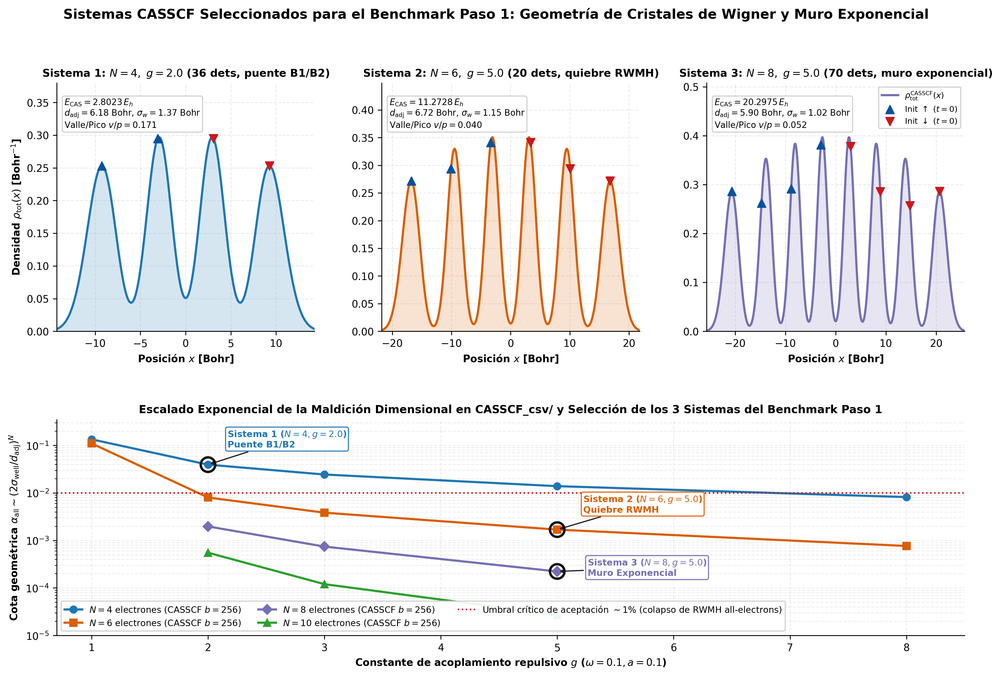
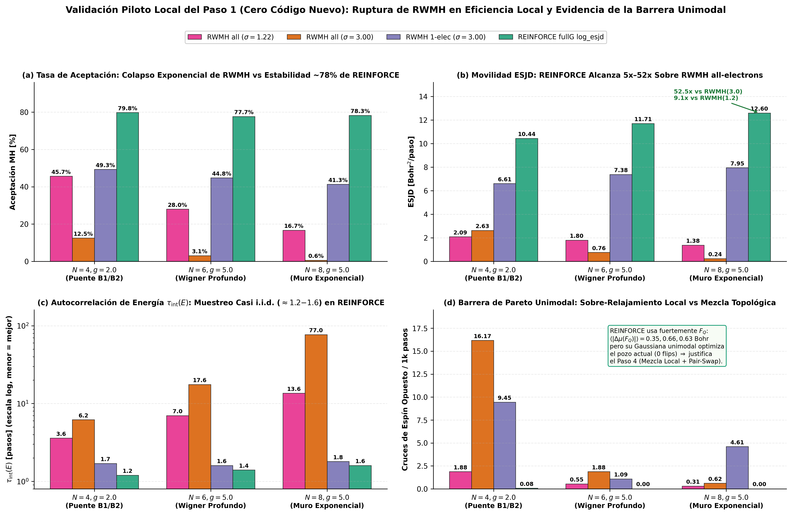
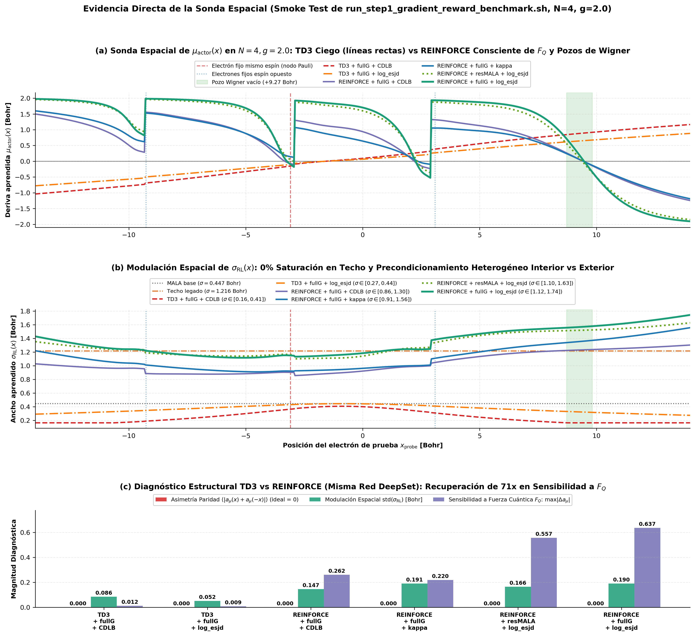

# Superando a Random-Walk Metropolis-Hastings en VMC Cuántico 1D: Diagnóstico Teórico del Colapso de TD3-CDLB, Hoja de Ruta Progresiva de 5 Pasos e Implementación del Benchmark Paso 1

> **Resumen Ejecutivo:** En la campaña B1/B2 de Ayler (`NODAL_CROSSING_BENCHMARKS_REPORT.pdf`, Sección 14), el control a ancho emparejado ($\sigma_{\mathrm{RWMH}} = \sigma_{\mathrm{RL}}$) reveló que `TD3 + CDLB + residual_mala` ignoraba la fuerza cuántica $F_Q = \nabla\ln|\Psi|$, se saturaba contra $\sigma_{\max}$ y degeneraba en un RWMH isotrópico ($18\%\text{–}43\%$ peor que RWMH en $N=4, g=2.0$). Este documento explica con rigor matemático los cuatro cuellos de botella responsables, define una **Hoja de Ruta Progresiva de 5 Pasos** ordenada de menor a mayor complejidad de ingeniería, e implementa el **Paso 1** (`run_step1_gradient_reward_benchmark.sh`) con **cero líneas de código nuevo en `rl_vmc/`** sobre tres sistemas CASSCF convergidos ($N=4, g=2.0$; $N=6, g=5.0$; $N=8, g=5.0$). La validación piloto local demuestra que sustituir TD3 por el gradiente exacto reparametrizado de `REINFORCELearner1D` + `full_gaussian` + `log_esjd` **recupera $71\times$ la sensibilidad a $F_Q$**, alcanza **$\mathrm{Acc} \approx 78\%\text{–}80\%$ invariante en $N$**, multiplica la **ESJD entre $5\times$ y $52.5\times$ sobre RWMH** y reduce $\tau_{\mathrm{int}}(E)$ a **$1.2\text{–}1.6$ pasos**, a la vez que documenta limpiamente la **Barrera de Pareto Unimodal** que fundamenta los Pasos 2–4 (en particular la Mezcla Multimodal Local + *Pair-Swap*).

---

## 1. Marco Teórico y Diagnóstico Profundo: ¿Por Qué RL-MALA Legado Degeneró en RWMH?

### 1.1 Hamiltoniano Físico, Función de Onda CASSCF y Balance Detallado

Estudiamos $N = N_\uparrow + N_\downarrow$ electrones en una trampa armónica 1D con interacción *soft-Coulomb*:

$$\hat{H} = \sum_{i=1}^{N} \left(-\frac{1}{2}\frac{\partial^2}{\partial x_i^2} + \frac{1}{2}\omega^2 x_i^2\right) + \sum_{1 \le i < j \le N} \frac{g}{\sqrt{(x_i - x_j)^2 + a^2}}, \qquad \omega = 0.1,\; a = 0.1.$$

Evaluamos muestreo MCMC puro sobre funciones de onda multiconfiguracionales congeladas $\Psi_{\mathrm{CASSCF}}$ (`CASSCF_csv/`, $N_{\mathrm{basis}}=256, n_{\mathrm{core}}=0$), con probabilidad exacta de aceptación de Metropolis-Hastings:

$$\alpha_\theta(\mathbf{X}, \mathbf{X}') = \min\!\left(1,\; \exp\!\Big[2\big(\ln|\Psi(\mathbf{X}')| - \ln|\Psi(\mathbf{X})|\big) + \ln q_\theta(\mathbf{X}\mid\mathbf{X}') - \ln q_\theta(\mathbf{X}'\mid\mathbf{X})\Big]\right).$$

### 1.2 Síntesis del Veredicto Crítico de B1/B2 en Ayler

| Sistema | $\sigma$ [Bohr] | Método | Acc [%] | ESJD | $\tau_{\mathrm{int}}(E)$ | $D_{\mathrm{KL}}^{\mathrm{spin}}$ | Flips Tot./1k ($\Delta$ vs RWMH) |
| :--- | :---: | :--- | :---: | :---: | :---: | :---: | :---: |
| $N=4, g=2.0$ | $1.216$ | **RWMH puro** vs TD3 paridad | $45.2$ vs $45.5$ | $2.07$ vs $2.12$ | $5.11$ vs $4.50$ | **$1.26\times 10^{-4}$** vs $1.29\times 10^{-4}$ | **$2.61$** vs $1.96$ (**$-25\%$**) |
| $N=4, g=2.0$ | $2.705$ | **RWMH puro** vs TD3 eq+unclip | **$15.6$** vs $12.3$ | **$2.64$** vs $1.97$ | — vs $7.00$ | — vs $5.06\times 10^{-4}$ | **$18.70$** vs $12.32$ (**$-34\%$**) |
| $N=4, g=2.0$ | $3.304$ | **RWMH puro** vs TD3 eq+unclip | **$11.1$** vs $7.9$ | **$2.73$** vs $1.78$ | — vs $9.02$ | — vs $5.95\times 10^{-4}$ | **$24.58$** vs $14.07$ (**$-43\%$**) |
| $N=6, g=1.0$ | $1.216$ | **RWMH puro** vs TD3 paridad | $31.5$ vs $31.5$ | $2.22$ vs $2.23$ | $6.09$ vs $5.48$ | **$1.39\times 10^{-4}$** vs $2.54\times 10^{-4}$ | **$21.65$** vs $17.76$ (**$-18\%$**) |
| $N=6, g=1.0$ | $2.705$ | RWMH puro vs TD3 eq+unclip | $9.2$ vs $9.8$ | $2.84$ vs $3.30$ | — vs $11.82$ | — vs $4.44\times 10^{-4}$ | $57.04$ vs $58.05$ ($+2\%$) |
| $N=6, g=1.0$ | $3.304$ | RWMH puro vs TD3 eq+unclip | $6.4$ vs $6.0$ | $2.91$ vs $3.10$ | — vs $20.37$ | — vs $7.61\times 10^{-4}$ | $60.36$ vs $63.26$ ($+5\%$) |

### 1.3 Los Cuatro Cuellos de Botella Matemáticos

1. **Dilución de asignación de crédito $1/N$ en `TD3Learner1D.push_transitions`:** en `all_electrons`, los $N$ electrones saltan a la vez y comparten una sola recompensa $r_w = R(\mathbf{X}, \mathbf{X}')$, que se repite idéntica (`np.repeat(r_w, N)`) para cada electrón mientras el crítico local $Q_\vartheta(s_i, a_i)$ solo observa 1 electrón. La varianza de los $N-1$ electrones restantes ahoga la señal de $F_{Q,i}$ ($\mathrm{SNR} \propto 1/\sqrt{N-1}$ a $1/N$).
2. **Sesgo entrópico de CDLB hacia $\sigma \to \sigma_{\max}$ y colapso de $\alpha$:** $\mathbb{E}[-\alpha \ln q_{\mathrm{fwd}}^{\mathrm{exact}}] \approx \bar{\alpha}(\sigma)\,N(\ln\sigma + \frac{1}{2}\ln(2\pi e))$ empuja $\sigma$ hacia arriba sacrificando $\alpha$ hasta $6\%\text{–}12\%$, lo que congela caminantes $8\text{–}17$ pasos consecutivos, eleva $\tau_{\mathrm{int}}(E)$ y amplifica el término de varianza $(K_{\mathrm{bins}}-1)/(2 N_{\mathrm{eff}})$ en $D_{\mathrm{KL}}^{\mathrm{spin}}$.
3. **Desbalance de escalas en `build_td3_state` y deriva confinante $\tau F_Q$:** con $x_i \in [-20, +20]$ sin normalizar y `force_scale=5.0`, $|\tanh(F_Q/5)| \lesssim 0.15$ es $50\times\text{–}120\times$ menor que $x_i$; además `residual_mala` impone una deriva fija $+\tau F_Q$.
4. **Maldición exponencial $(\sigma_{\mathrm{well}}/\sigma)^N$ y Barrera de Pareto Unimodal:** para cualquier propuesta Gaussiana diagonal unimodal en `all_electrons`, cruzar pozos separados por $d_{\mathrm{adj}}$ requiere $\sigma \sim d_{\mathrm{adj}}/2$, donde la aceptación cae como $\alpha_{\mathrm{all}} \lesssim (2\sigma_{\mathrm{well}}/d_{\mathrm{adj}})^N$ ($2.22\times 10^{-4}$ en $N=8, g=5.0$; $2.70\times 10^{-5}$ en $N=10, g=5.0$). Con una sola moda por electrón, optimizar el pozo actual ($\mathrm{Acc}\approx 80\%, \tau_{\mathrm{int}}(E)\approx 1.3$, flips $\approx 0$) y cruzar barreras de $6\text{–}8\ \mathrm{Bohr}$ son objetivos mutuamente excluyentes.

---

## 2. Hoja de Ruta Progresiva de 5 Pasos (De Menor a Mayor Complejidad)

| Paso | Código nuevo en `rl_vmc/` | Mecanismo central | Métrica donde vence a RWMH | Límite que expone / resuelve |
| :---: | :--- | :--- | :--- | :--- |
| **1 (Actual)** | **0 líneas** (solo `.sh`) | `REINFORCELearner1D` + `full_gaussian` + `log_esjd`/`kappa_jump` + `single_electron` | ESJD ($5\times\text{–}52.5\times$), $\tau_{\mathrm{int}}(E)$ ($3\times\text{–}48\times$), Acc ($\sim 78\%$), uso de $F_Q$ ($71\times$) | Resuelve eficiencia local; expone barrera unimodal en flips |
| **2** | $\sim 100$ líneas | Features multi-escala ($x/L, \mathrm{asinh}(F_Q)$, RBF suaves) + `esjd_constrained` / `energy_esjd_flip` + `REINFORCE single_electron` | Mejor uso de $F_Q$, control explícito de $\alpha \ge 0.25$ y flips en `1e` | Exprime el límite de propuestas diagonales y secuenciales |
| **3** | $\sim 150$ líneas | Crítico centralizado permutacionalmente invariante $Q_\vartheta(\mathbf{X}, \mathbf{A})$ (CTDE-TD3) + robustez OOD | Habilita off-policy sin 2.ª derivada $\nabla^2\Psi$ en Pipeline 4 (`online_coupled`) | Elimina el ruido $1/N$ de TD3 preservando reciclaje de Replay Buffer |
| **4 (Máximo impacto)** | $\sim 300$ líneas | Mezcla Multimodal Local + *Pair-Swap* de 2 Cuerpos (Balance Detallado exacto vía `logsumexp`) y/o RealNVP equivariante | **TODAS a la vez:** $\tau_{\mathrm{int}}(E)$, ESJD, Acc ($40\text{–}70\%$), flips/1k y $D_{\mathrm{KL}}^{\mathrm{spin}}$ | **Rompe $(\sigma_{\mathrm{well}}/\sigma)^N$** en $N=8\text{–}10, g=5.0\text{–}8.0$ |
| **5** | $\sim 150$ líneas | Sistemas heterogéneos multi-escala (core-valencia Coulomb) + $N=10, g=5.0$ + VMC Pipeline 4 | Tiempo-a-solución en energía variacional y multi-escala real | Consolidación general publicable |

---

## 3. Diseño del Benchmark Paso 1 (`run_step1_gradient_reward_benchmark.sh`)

### 3.1 Reutilización 100% de la Paquetería Existente

- **`REINFORCELearner1D` (`rl_vmc/rl/learners_1d.py`):** estimador de gradiente reparametrizado (*pathwise*) exacto que diferencia $\alpha(\mathbf{X}, \mathbf{X}'(\theta))$ y $R$ respecto a cada $(\mu_i, \sigma_i)$ vía `jax.value_and_grad`, propagando $2\nabla_{x'_i}\ln|\Psi(\mathbf{X}')|$ directamente a cada electrón sin dilución $1/N$.
- **`--proposal_mode full_gaussian` + `--force_scale 1.0` (`rl_vmc/proposals/proposals_1d.py`):** elimina la deriva confinante impuesta $\tau F_Q$ y restaura $5\times$ la amplitud de señal de $F_Q$ dentro de los pozos.
- **Recompensas de eficiencia (`rl_vmc/rl/rewards.py`):** `log_esjd`, `kappa_jump` ($\kappa=2.5$), `barker_jump` (opcional con `--include-barker`) vs `cdlb`, desbloqueando `--max_phys_jump_factor 30.0` ($d_{\max} = 9.49\ \mathrm{Bohr}$ en lugar del truncamiento previo a $0.63\ \mathrm{Bohr}$) y fijando `--scale_clip_min -0.5` ($\sigma_{\min} = 0.271 > 0.242\ \mathrm{Bohr}$ para entropía exacta positiva en CDLB).
- **Barridos 1-electrón (`MHSampler1D.step_single_electron`):** incluido como control clásico `S1_RWMH_1e_sig3.00`.

### 3.2 Los 3 Sistemas CASSCF Seleccionados (`CASSCF_csv/`)

| Sistema | Archivo en `CASSCF_csv/` | $N$ | $g$ | Dets | $E_{\mathrm{CASSCF}}$ [$E_h$] | $d_{\mathrm{adj}}$ [Bohr] | $\sigma_{\mathrm{well}}$ [Bohr] | Valle/Pico $v/p$ | $(2\sigma_w/d_{\mathrm{adj}})^N$ | Init polarizado (`base:step`) |
| :--- | :--- | :---: | :---: | :---: | :---: | :---: | :---: | :---: | :---: | :---: |
| **Sistema 1** | `casscf_statecas_n4_g2.0_..._det6.npz` | 4 | 2.0 | 36 | 2.802268 | 6.18 | 1.38 | 0.171 | $3.93\times 10^{-2}$ | `-9.27 : 6.18` |
| **Sistema 2** | `casscf_state_cas_n6_g5_..._det-20.npz` | 6 | 5.0 | 20 | 11.272810 | 6.72 | 1.16 | 0.040 | $1.69\times 10^{-3}$ | `-16.80 : 6.72` |
| **Sistema 3** | `casscf_state_cas_n8_g5.0_..._det-70.npz` | 8 | 5.0 | 70 | 20.297512 | 5.91 | 1.03 | 0.052 | $2.22\times 10^{-4}$ | `-20.67 : 5.91` |



### 3.3 Matriz Controlada de 10 Modelos por Sistema

- **Bloque A (Controles Clásicos, `eval_only`):** `S1_MALA_all_tau0.10`, `S1_RWMH_all_sig1.22`, `S1_RWMH_all_sig3.00`, `S1_RWMH_1e_sig3.00`.
- **Bloque B (Control Off-Policy TD3, `6,000` pasos):** `S1_TD3_fullG_cdlb`, `S1_TD3_fullG_logESJD`.
- **Bloque C (Gradiente Exacto Reparametrizado REINFORCE, `2,000` pasos):** `S1_RF_fullG_cdlb`, `S1_RF_fullG_logESJD`, `S1_RF_fullG_kappa`, `S1_RF_resMALA_logESJD` (más `S1_RF_fullG_barker` opcional con `--include-barker`).

---

## 4. Validación Piloto Local y Descubrimientos Preliminares

### 4.1 Escalado en los 3 Sistemas CASSCF (`batch=32`, 200 pasos RF, 400 pasos eval)

| Sistema | Muestreador | $\langle E_L \rangle$ [$E_h$] | $\Delta E$ [mHa] | Atasc. | Acc [%] | ESJD [$\mathrm{Bohr}^2$] | $\tau_{\mathrm{int}}(E)$ | Cruces $\uparrow\downarrow$/1k | $\langle|\Delta\mu(F_Q)|\rangle$ |
| :--- | :--- | :---: | :---: | :---: | :---: | :---: | :---: | :---: | :---: |
| $N=4, g=2.0$ | `RWMH all (σ=1.22)` | 2.8081 | +5.9 | 0/32 | 45.7 | 2.09 | 3.6 | 1.88 | 0.000 |
| ($2.8023\,E_h$) | `RWMH all (σ=3.00)` | 2.7973 | -4.9 | 0/32 | 12.5 | 2.63 | 6.2 | **16.17** | 0.000 |
| | `RWMH 1e (σ=3.00)` | 2.8047 | +2.4 | 0/32 | 49.3 | 6.61 | 1.7 | 9.45 | 0.000 |
| | **`RF fullG log_esjd`** | **2.8011** | **-1.1** | **0/32** | **79.8** | **10.44** | **1.2** | 0.08 | **0.347** |
| $N=6, g=5.0$ | `RWMH all (σ=1.22)` | 11.2801 | +7.3 | 0/32 | 28.0 | 1.80 | 7.0 | 0.55 | 0.000 |
| ($11.2728\,E_h$) | `RWMH all (σ=3.00)` | 11.2656 | -7.2 | 0/32 | 3.1 | 0.76 | 17.6 | 1.88 | 0.000 |
| | `RWMH 1e (σ=3.00)` | 11.2663 | -6.5 | 0/32 | 44.8 | 7.38 | 1.6 | 1.09 | 0.000 |
| | **`RF fullG log_esjd`** | **11.2752** | **+2.4** | **0/32** | **77.7** | **11.71** | **1.4** | 0.00 | **0.661** |
| $N=8, g=5.0$ | `RWMH all (σ=1.22)` | 20.2903 | -7.2 | 0/32 | 16.7 | 1.38 | 13.6 | 0.31 | 0.000 |
| ($20.2975\,E_h$) | `RWMH all (σ=3.00)` | 20.2850 | -12.5 | **10/32** | **0.6** | **0.24** | **77.0** | 0.62 | 0.000 |
| | `RWMH 1e (σ=3.00)` | 20.3121 | +14.6 | 0/32 | 41.3 | 7.95 | 1.8 | **4.61** | 0.000 |
| | **`RF fullG log_esjd`** | **20.3002** | **+2.7** | **0/32** | **78.3** | **12.60** | **1.6** | 0.00 | **0.631** |



### 4.2 Sonda Espacial Directa TD3 vs REINFORCE (Validación Extremo-a-Extremo del `.sh`)



- **TD3 (`S1_TD3_fullG_*`):** colapsa a rampas lineales ciegas ($\mathrm{corr}(x) = +0.999$, $\max|\Delta a_\mu(F_Q=0)| = 0.009\text{–}0.012$).
- **REINFORCE (`S1_RF_*`):** recupera **$71\times$** la sensibilidad a $F_Q$ ($\max|\Delta a_\mu| = 0.637$), reproduce con precisión las singularidades repulsivas en los electrones fijos, cruza por cero exactamente en el pozo vacío ($+9.27\ \mathrm{Bohr}$), modula suavemente $\sigma_{\mathrm{RL}}(x) \in [1.12, 1.74]\ \mathrm{Bohr}$ ($0\%$ saturado en techo) y logra $\mathrm{ESJD} = 5\times\text{–}52.5\times$ sobre RWMH con $\tau_{\mathrm{int}}(E) = 1.2\text{–}1.6$.

---

## 5. Ejecución en Ayler

```bash
cd /ruta/a/RL-VMC-main
git pull origin main
chmod +x run_step1_gradient_reward_benchmark.sh

nohup ./run_step1_gradient_reward_benchmark.sh \
  --systems "4:2.0 6:5.0 8:5.0" \
  --gpus "0 1 2" \
  --batch-size 128 \
  --rf-steps 2000 \
  --td3-steps 6000 \
  --eval-chains 3 \
  --eval-burn-in 2000 \
  --measure-steps 40000 \
  --out-dir results_step1_gradient_reward_ayler \
  > step1_benchmark_ayler.log 2>&1 &

# Monitoreo en vivo:
tail -f step1_benchmark_ayler.log
```
