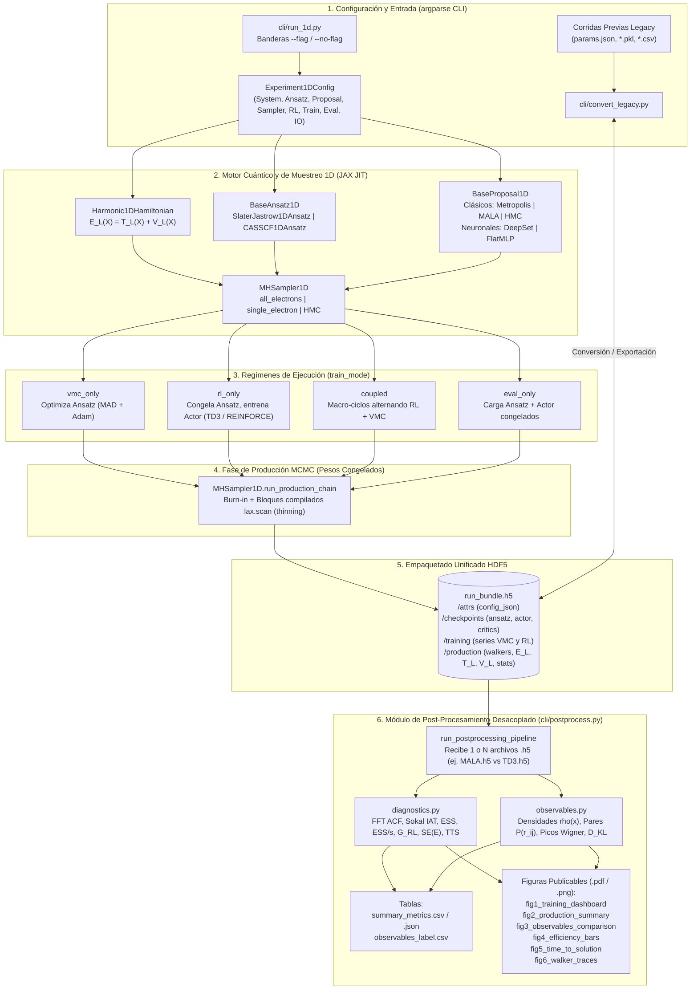
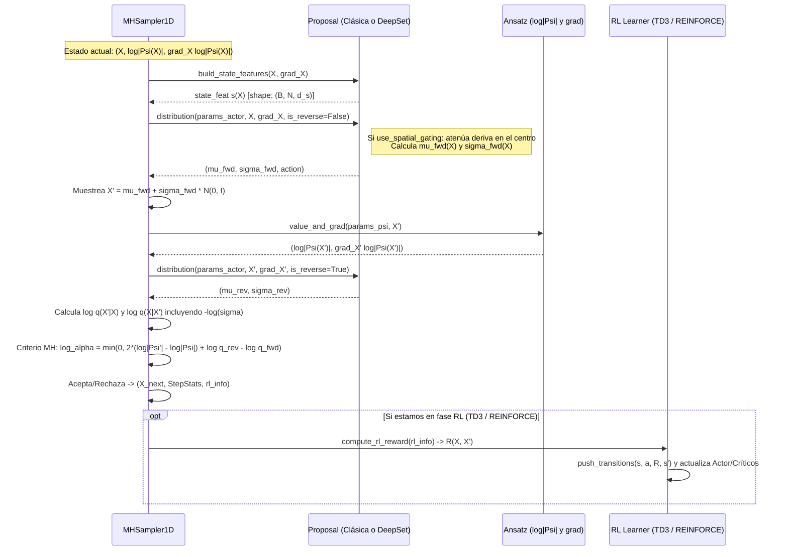
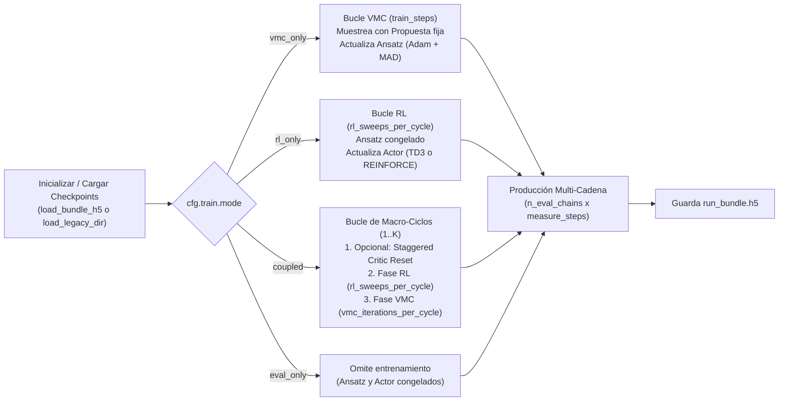

# RL-VMC: Marco Teórico, Arquitectura de Software, Implementación Detallada y Manual de Usuario (Pipeline 1D)

Este documento constituye la referencia técnica, matemática y de ingeniería de software de la paquetería modular **`rl_vmc`**. Describe desde los primeros principios físicos y estadísticos hasta los detalles de implementación en **JAX / Flax / Optax / HDF5**, incluyendo diagramas de flujo de ejecución y tutoriales paso a paso para operar todo el ecosistema desde la línea de comandos o como librería de Python.

---

## Tabla de Contenidos

1. [Fundamentos Teóricos](#1-fundamentos-teóricos)
   - [1.1 Sistema Físico: Electrones Interactuantes en una Trampa Armónica 1D y Cristalización de Wigner](#11-sistema-físico-electrones-interactuantes-en-una-trampa-armónica-1d-y-cristalización-de-wigner)
   - [1.2 Principio Variacional y Energía Local en Dominio Logarítmico](#12-principio-variacional-y-energía-local-en-dominio-logarítmico)
   - [1.3 Arquitecturas de Función de Onda (Ansätze 1D)](#13-arquitecturas-de-función-de-onda-ansätze-1d)
   - [1.4 Optimización Variacional Monte Carlo (VMC) con Recorte Robusto MAD](#14-optimización-variacional-monte-carlo-vmc-con-recorte-robusto-mad)
   - [1.5 Muestreo MCMC y Propuestas Clásicas vs. Actores Neuronales (RL-MALA)](#15-muestreo-mcmc-y-propuestas-clásicas-vs-actores-neuronales-rl-mala)
   - [1.6 Algoritmos de Reinforcement Learning y Funciones de Recompensa MCMC](#16-algoritmos-de-reinforcement-learning-y-funciones-de-recompensa-mcmc)
   - [1.7 Teoría Estadística del Post-Procesamiento y Observables Físicos](#17-teoría-estadística-del-post-procesamiento-y-observables-físicos)
2. [Arquitectura de Software y Diagramas de Flujo](#2-arquitectura-de-software-y-diagramas-de-flujo)
   - [2.1 Árbol Completo de la Paquetería Modular](#21-árbol-completo-de-la-paquetería-modular)
   - [2.2 Diagrama de Flujo General del Pipeline (Extremo a Extremo)](#22-diagrama-de-flujo-general-del-pipeline-extremo-a-extremo)
   - [2.3 Diagrama de Secuencia de un Paso MCMC con Actor Neuronal](#23-diagrama-de-secuencia-de-un-paso-mcmc-con-actor-neuronal)
   - [2.4 Diagrama de Flujo de los Cuatro Regímenes de Ejecución](#24-diagrama-de-flujo-de-los-cuatro-regímenes-de-ejecución)
3. [Especificación Detallada de la Implementación Módulo por Módulo](#3-especificación-detallada-de-la-implementación-módulo-por-módulo)
4. [Referencia Completa de Banderas CLI y Valores Default](#4-referencia-completa-de-banderas-cli-y-valores-default)
5. [Tutoriales Prácticos Paso a Paso](#5-tutoriales-prácticos-paso-a-paso)

---

## 1. Fundamentos Teóricos

### 1.1 Sistema Físico: Electrones Interactuantes en una Trampa Armónica 1D y Cristalización de Wigner

Consideramos un sistema cuántico de $N = N_\uparrow + N_\downarrow$ fermiones con proyección de espín fija $\sigma_i \in \{+1, -1\}$ (donde $+1 \equiv \uparrow$ para $i \in \{1, \dots, N_\uparrow\}$ y $-1 \equiv \downarrow$ para $i \in \{N_\uparrow + 1, \dots, N\}$) confinados en un pozo armónico unidimensional con frecuencia angular $\omega > 0$ e interacción repulsiva de Coulomb suavizada (*soft-Coulomb*). En unidades atómicas ($\hbar = m_e = e = 1$), el Hamiltoniano del sistema es:

$$
\hat{\mathcal{H}} = -\frac{1}{2} \sum_{i=1}^{N} \frac{\partial^2}{\partial x_i^2} + \frac{1}{2} \omega^2 \sum_{i=1}^{N} x_i^2 + g \sum_{1 \le i < j \le N} \frac{1}{\sqrt{(x_i - x_j)^2 + a^2}}
$$

donde:
* $X = (x_1, \dots, x_N) \in \mathbb{R}^N$ representa la configuración espacial de los $N$ electrones.
* $g \ge 0$ (`--interaction_strength` o `--g`) controla la intensidad del acoplamiento repulsivo electrón-electrón.
* $a > 0$ (`--softening`) regulariza la singularidad de corto alcance en $x_i = x_j$ en una dimensión.

La longitud característica del oscilador armónico es $\ell_0 = 1/\sqrt{\omega}$. Cuando la razón adimensional entre la energía de repulsión de Coulomb y la energía cinética de confinamiento ($\lambda_{\text{W}} = g / (\omega^{1/2})$) es pequeña ($\lambda_{\text{W}} \ll 1$), los electrones forman un líquido cuántico de Fermi deslocalizado alrededor de $x = 0$. Cuando $\lambda_{\text{W}} \gg 1$, la repulsión domina sobre la energía cinética y el sistema experimenta una transición suave hacia un **cristal molecular de Wigner**, caracterizado por:
1. La aparición de $N$ picos bien resueltos en la densidad de un cuerpo $\rho_{\text{tot}}(x)$.
2. Un agujero de correlación de dos cuerpos pronunciado ($P(\lvert x_i - x_j \rvert) \to 0$ cuando $\lvert x_i - x_j \rvert \to 0$) tanto para espines iguales (exclusión de Pauli + repulsión) como para espines opuestos (repulsión correlacionada).
3. Barreras de potencial efectivas y superficies nodales que atrapan a los muestreadores de paso fijo en modos metaestables, motivando el uso de propuestas adaptativas entrenadas con Reinforcement Learning.

En el límite exactamente soluble sin interacción ($g = 0$), los fermiones ocupan los orbitales más bajos $n = 0, \dots, N_\sigma - 1$ de cada sector de espín, dando la energía de referencia exacta implementada en [`Harmonic1DHamiltonian.noninteracting_reference_energy`](file:///Users/romanarmenta/Documents/Git-Projects/RL-VMC-main/rl_vmc/physics/harmonic_1d.py#L20-L24):

$$
E_0^{(g=0)} = \sum_{n=0}^{N_\uparrow - 1} \omega \left(n + \frac{1}{2}\right) + \sum_{n=0}^{N_\downarrow - 1} \omega \left(n + \frac{1}{2}\right) = \frac{\omega}{2}\left(N_\uparrow^2 + N_\downarrow^2\right)
$$

---

### 1.2 Principio Variacional y Energía Local en Dominio Logarítmico

Dado un estado de prueba real $\Psi_\phi(X)$ parametrizado por un conjunto de pesos variacionales $\phi$, el valor esperado del Hamiltoniano satisface la cota variacional de Rayleigh-Ritz:

$$
E[\phi] = \frac{\int_{\mathbb{R}^N} \Psi_\phi(X) \hat{\mathcal{H}} \Psi_\phi(X) \, dX}{\int_{\mathbb{R}^N} \lvert \Psi_\phi(X) \rvert^2 \, dX} = \int_{\mathbb{R}^N} \pi_\phi(X) \, E_L(X; \phi) \, dX = \mathbb{E}_{X \sim \pi_\phi}\!\left[E_L(X; \phi)\right] \ge E_0
$$

donde la densidad de probabilidad de Born es:

$$
\pi_\phi(X) = \frac{\lvert \Psi_\phi(X) \rvert^2}{Z_\phi} = \frac{\exp\!\left(2 \ln \lvert \Psi_\phi(X) \rvert\right)}{\int_{\mathbb{R}^N} \exp\!\left(2 \ln \lvert \Psi_\phi(Y) \rvert\right) dY}
$$

Para garantizar estabilidad numérica a través de muchos órdenes de magnitud en amplitud, el código trabaja exclusivamente con $f_\phi(X) \equiv \ln \lvert \Psi_\phi(X) \rvert$. Aplicando la identidad $\Psi^{-1} \nabla_X^2 \Psi = \nabla_X^2 \ln \lvert \Psi \rvert + \lVert \nabla_X \ln \lvert \Psi \rvert \rVert^2$, la **energía local** $E_L(X; \phi) = T_L(X; \phi) + V_L(X)$ se calcula en [`Harmonic1DHamiltonian.local_energy_and_components`](file:///Users/romanarmenta/Documents/Git-Projects/RL-VMC-main/rl_vmc/physics/harmonic_1d.py#L46-L70) mediante:

$$
T_L(X; \phi) = -\frac{1}{2} \sum_{i=1}^{N} \left[ \frac{\partial^2 f_\phi(X)}{\partial x_i^2} + \left( \frac{\partial f_\phi(X)}{\partial x_i} \right)^2 \right] = -\frac{1}{2} \left[ \operatorname{Tr}\!\left(\nabla_X^2 f_\phi(X)\right) + \left\lVert \nabla_X f_\phi(X) \right\rVert_2^2 \right]
$$

$$
V_L(X) = \frac{1}{2} \omega^2 \sum_{i=1}^{N} x_i^2 + g \sum_{1 \le i < j \le N} \frac{1}{\sqrt{(x_i - x_j)^2 + a^2}}
$$

---

### 1.3 Arquitecturas de Función de Onda (Ansätze 1D)

El módulo [`rl_vmc/ansatze/ansatz_1d.py`](file:///Users/romanarmenta/Documents/Git-Projects/RL-VMC-main/rl_vmc/ansatze/ansatz_1d.py) unifica todas las funciones de onda bajo la interfaz [`BaseAnsatz1D`](file:///Users/romanarmenta/Documents/Git-Projects/RL-VMC-main/rl_vmc/ansatze/ansatz_1d.py#L34-L61), exponiendo `init(key, walkers)`, `apply(params, walkers)` y `value_and_grad(params, walkers)`.

#### A. Familia Slater-Jastrow-Backflow ([`SlaterJastrow1DAnsatz`](file:///Users/romanarmenta/Documents/Git-Projects/RL-VMC-main/rl_vmc/ansatze/ansatz_1d.py#L64-L120))

La función de onda se factoriza en determinantes de Slater antisimétricos por canal de espín evaluados sobre coordenadas cuasipartícula $\tilde{X}$, multiplicados por el factor de correlación simétrico $\exp(J(X))$:

$$
\ln \lvert \Psi_\phi(X) \rvert = \frac{1}{2}\ln\!\left(\det\!\left[\Phi_\uparrow(\tilde{X}_\uparrow)\right]^2 + \varepsilon_{\text{node}}^2\right) + \frac{1}{2}\ln\!\left(\det\!\left[\Phi_\downarrow(\tilde{X}_\downarrow)\right]^2 + \varepsilon_{\text{node}}^2\right) + J(X)
$$

donde $\varepsilon_{\text{node}} = 10^{-14}$ evita singularidades numéricas exactas sobre la hipersuperficie nodal.

##### 1. Modelos de Orbitales Espaciales (`--orbital_model`)

* **`ho_fixed` y `ho_variational`:** Utilizan las autofunciones del oscilador armónico 1D con escala inversa $\alpha > 0$ (fija $\alpha = 1$ en `ho_fixed`, o variacional $\alpha = \alpha_{\min} + \operatorname{softplus}(\tilde{\alpha})$ en `ho_variational`). Definiendo $z_i = \alpha \sqrt{\omega} \, x_i$, el orbital $n$-ésimo ($n = 0, \dots, N_\sigma - 1$) es:

$$
\varphi_n(x_i; \alpha) = \left(\frac{\alpha^2 \omega}{\pi}\right)^{1/4} \frac{1}{\sqrt{2^n n!}} \, H_n(z_i) \, \exp\!\left(-\frac{1}{2} z_i^2\right)
$$

donde los polinomios de Hermite de los físicos $H_n(z)$ se evalúan recursivamente en JAX:

$$
H_0(z) = 1, \qquad H_1(z) = 2z, \qquad H_{n}(z) = 2z H_{n-1}(z) - 2(n-1) H_{n-2}(z)
$$

* **`gaussian_basis`:** Expande cada orbital molecular como una combinación lineal entrenable de $M_{\text{G}}$ funciones Gaussianas centradas en una rejilla uniforme $\{c_m\}_{m=1}^{M_{\text{G}}} \subset [-x_{\max}, x_{\max}]$:

$$
\varphi_n(x_i) = \sum_{m=1}^{M_{\text{G}}} C_{m, n} \exp\!\left(-\frac{(x_i - c_m)^2}{2 w_m^2}\right)
$$

* **`backflow_ho`:** Transforma las coordenadas desnudas $x_i$ en coordenadas efectivas vestidas $\tilde{x}_i(X)$ mediante un desplazamiento de dos cuerpos diferenciable por canal de espín antes de evaluar los orbitales de Hermite-Gauss:

$$
\tilde{x}_i = x_i + \sum_{j \neq i} (x_i - x_j) \, \eta_{s_{ij}}\!\left(\lvert x_i - x_j \rvert\right), \qquad s_{ij} = \begin{cases} \text{same}, & \sigma_i = \sigma_j \\ \text{opp}, & \sigma_i \neq \sigma_j \end{cases}
$$

donde la función radial de Backflow $\eta_s(r)$ utiliza un banco de $K_{\text{bf}}$ Gaussianas moduladas por una envolvente exponencial de decaimiento $L_{\text{env}}$:

$$
\eta_s(r) = \exp\!\left(-\frac{r}{L_{\text{env}}}\right) \sum_{k=1}^{K_{\text{bf}}} c_{k,s}^{(\text{bf})} \exp\!\left(-\frac{(r - \mu_k)^2}{2 w_{\text{bf}}^2}\right)
$$

##### 2. Modelos del Factor de Correlación (`--correlation_model`)

Sea $r_{ij} = \sqrt{(x_i - x_j)^2 + \varepsilon_{\text{pair}}^2}$ la distancia suavizada entre el par $(i, j)$ con $\varepsilon_{\text{pair}} = 10^{-4}$:

* **`none`:** $J(X) = 0$.
* **`jastrow`:** Término racional de Padé separado para pares de igual espín ($\mathcal{P}_{\text{same}}$) y espín opuesto ($\mathcal{P}_{\text{opp}}$):

$$
J_{\text{Padé}}(X) = \sum_{(i,j) \in \mathcal{P}_{\text{same}}} \frac{c_{\text{same}} \, r_{ij}}{1 + \beta_{\text{same}} \, r_{ij}} + \sum_{(i,j) \in \mathcal{P}_{\text{opp}}} \frac{c_{\text{opp}} \, r_{ij}}{1 + \beta_{\text{opp}} \, r_{ij}}
$$

* **`spin_rbf`:** Expansión multiplicativa positiva en funciones de base radial Gaussianas $G_k(r) = \exp\!\left(-\frac{(r - \mu_k)^2}{2 w_k^2}\right)$ con coeficientes positivos $a_{k,s} > 0$:

$$
J_{\text{RBF}}(X) = \sum_{(i,j) \in \mathcal{P}_{\text{same}}} \ln\!\left(1 + \sum_{k=1}^{K_{\text{rbf}}} a_{k,\text{same}} \, G_k(r_{ij})\right) + \sum_{(i,j) \in \mathcal{P}_{\text{opp}}} \ln\!\left(1 + \sum_{k=1}^{K_{\text{rbf}}} a_{k,\text{opp}} \, G_k(r_{ij})\right)
$$

* **`spin_rbf_jastrow`:** Suma ambos efectos de corto y mediano alcance:

$$
J_{\text{SRJ}}(X) = J_{\text{Padé}}(X) + J_{\text{RBF}}(X)
$$

* **`spin_rbf_threebody`:** Añade a $J_{\text{SRJ}}(X)$ una correlación simétrica de tres cuerpos sobre todas las tripletas $1 \le i < j < k \le N$ en función del hiperradio $Q_{ijk} = \sqrt{r_{ij}^2 + r_{jk}^2 + r_{ki}^2}$:

$$
J_{3\text{B}}(X) = J_{\text{SRJ}}(X) + \sum_{1 \le i < j < k \le N} \ln\!\left(1 + \sum_{m=1}^{K_{3\text{B}}} a_m^{(3\text{B})} \exp\!\left(-\frac{(Q_{ijk} - q_m)^2}{2 w_{3\text{B},m}^2}\right)\right)
$$

---

#### B. Familia Multideterminantal CASSCF ([`CASSCF1DAnsatz`](file:///Users/romanarmenta/Documents/Git-Projects/RL-VMC-main/rl_vmc/ansatze/ansatz_1d.py#L123-L203))

Carga desde un archivo `.npz` los coeficientes de orbitales moleculares $C \in \mathbb{R}^{N_{\text{basis}} \times N_{\text{orb}}}$, los determinantes seleccionados $\{(I_\uparrow, I_\downarrow)\}_{I=1}^{N_{\text{det}}}$ y sus pesos de interacción de configuraciones $\{c_I\}_{I=1}^{N_{\text{det}}}$. Para cada determinante $I$, se evalúan el signo $s_I = s_{I,\uparrow} s_{I,\downarrow}$ y la magnitud logarítmica $\ell_I = \ln\lvert\det M_{I,\uparrow}\rvert + \ln\lvert\det M_{I,\downarrow}\rvert$ vía `jnp.linalg.slogdet`. El logaritmo de la función de onda total se obtiene con precisión de punto flotante completa mediante:

$$
\ell_{\max} = \max_{1 \le I \le N_{\text{det}}} \ell_I, \qquad \ln \lvert \Psi(X) \rvert = \ell_{\max} + \ln\!\left( \left\lvert \sum_{I=1}^{N_{\text{det}}} c_I \, s_I \, \exp(\ell_I - \ell_{\max}) \right\rvert + 10^{-15} \right)
$$

---

### 1.4 Optimización Variacional Monte Carlo (VMC) con Recorte Robusto MAD

El gradiente exacto de la energía variacional respecto a los parámetros $\phi$ del Ansatz es:

$$
\nabla_\phi E[\phi] = 2 \, \mathbb{E}_{X \sim \pi_\phi}\!\left[ \left(E_L(X; \phi) - \mathbb{E}_{Y \sim \pi_\phi}[E_L(Y; \phi)]\right) \nabla_\phi \ln \lvert \Psi_\phi(X) \rvert \right]
$$

Para evitar que configuraciones cercanas a los nodos ($\Psi_\phi(X) \approx 0$) produzcan picos de varianza infinita en el estimador por lotes $\{X_b\}_{b=1}^B$, [`run_experiment_1d`](file:///Users/romanarmenta/Documents/Git-Projects/RL-VMC-main/rl_vmc/trainers/runner_1d.py#L162-L202) aplica un recorte estadístico robusto basado en la mediana $m_E$ y la desviación absoluta mediana ($\operatorname{MAD}$):

$$
m_E = \operatorname{med}_{1 \le b \le B}\!\left(E_L(X_b)\right), \qquad \operatorname{MAD} = \operatorname{med}_{1 \le b \le B}\!\left(\left\lvert E_L(X_b) - m_E \right\rvert\right) + 10^{-8}
$$

$$
\tilde{E}_L(X_b) = \operatorname{clip}\!\left(E_L(X_b), \; m_E - k_\sigma \operatorname{MAD}, \; m_E + k_\sigma \operatorname{MAD}\right)
$$

donde $k_\sigma$ es `--sigma_energy_clip` (por defecto $5.0$). Con las energías recortadas y centradas $\Delta \tilde{E}_b = \tilde{E}_L(X_b) - \frac{1}{B}\sum_{b'=1}^B \tilde{E}_L(X_{b'})$, se define la pérdida sustituta:

$$
\mathcal{L}_{\text{VMC}}(\phi) = \frac{2}{B} \sum_{b=1}^{B} \mathrm{stopgrad}\!\left(\Delta \tilde{E}_b\right) \ln \lvert \Psi_\phi(X_b) \rvert
$$

Al diferenciar $\mathcal{L}_{\text{VMC}}(\phi)$ con `jax.grad`, se obtiene exactamente el estimador de covarianza recortado, al cual se le aplica recorte de norma global (`--grad_clip_norm`) y actualización con el optimizador `optax.adam(--lr_ansatz)`.

---

### 1.5 Muestreo MCMC y Propuestas Clásicas vs. Actores Neuronales (RL-MALA)

#### A. Condición de Balance Detallado y Probabilidad de Aceptación Asimétrica

Para garantizar que la distribución estacionaria de la cadena de Markov sea exactamente $\pi(X) \propto \lvert \Psi(X) \rvert^2$ bajo cualquier política de propuesta $q_\theta(X' \mid X)$ (clásica o neuronal), el paso de Metropolis-Hastings acepta la transición $X \to X'$ con probabilidad $\alpha(X, X') = \exp(\ln \alpha(X, X'))$:

$$
\ln \alpha(X, X') = \min\!\left(0, \; 2\Big[\ln \lvert \Psi(X') \rvert - \ln \lvert \Psi(X) \rvert\Big] + \ln q_\theta(X \mid X') - \ln q_\theta(X' \mid X)\right)
$$

Para propuestas Gaussianas diagonales $\mathcal{N}(\mu_\theta(X), \operatorname{diag}(\sigma_\theta(X)^2))$, la densidad logarítmica implementada en [`gaussian_log_prob`](file:///Users/romanarmenta/Documents/Git-Projects/RL-VMC-main/rl_vmc/proposals/proposals_1d.py#L16-L27) es:

$$
\ln q_\theta(X' \mid X) = \sum_{i=1}^{N} \left[ -\frac{\left(x'_i - \mu_{\theta,i}(X)\right)^2}{2\left(\sigma_{\theta,i}(X)^2 + 10^{-12}\right)} - \frac{1}{2} \ln\!\left(2\pi \left(\sigma_{\theta,i}(X)^2 + 10^{-12}\right)\right) \right]
$$

> [!IMPORTANT]
> **Importancia del término $-\frac{1}{2}\ln(2\pi\sigma_{\theta,i}^2)$:** En MALA clásico con paso fijo $\sigma_i \equiv \sqrt{2\tau}$, el término de normalización se cancela entre $\ln q(X \mid X')$ y $\ln q(X' \mid X)$. En cambio, en **RL-MALA** la escala $\sigma_{\theta,i}(X)$ depende de la posición $X$; por lo tanto, $\sigma_{\theta,i}(X) \neq \sigma_{\theta,i}(X')$ y conservar el término $-\frac{1}{2}\ln(2\pi\sigma_{\theta,i}^2)$ es matemáticamente indispensable para preservar la ergodicidad sin sesgo.

---

#### B. Propuestas Clásicas (`metropolis`, `mala`, `hmc`)

1. **Random-Walk Metropolis ([`MetropolisRandomWalkProposal1D`](file:///Users/romanarmenta/Documents/Git-Projects/RL-VMC-main/rl_vmc/proposals/proposals_1d.py#L105-L129)):** Propuesta Gaussiana isotrópica sin deriva cuántica ($q(X \mid X') = q(X' \mid X)$):

$$
\mu_i(X) = x_i, \qquad \sigma_i(X) = \sigma_{\text{RW}}
$$

2. **Metropolis-Adjusted Langevin Algorithm ([`MALAProposal1D`](file:///Users/romanarmenta/Documents/Git-Projects/RL-VMC-main/rl_vmc/proposals/proposals_1d.py#L132-L161)):** Discretización de Euler-Maruyama de la ecuación diferencial estocástica de Langevin sobreamortiguada con deriva recortada:

$$
\mu_i(X) = x_i + \operatorname{clip}\!\left(c_{\text{drift}} \, \tau \frac{\partial \ln \lvert \Psi(X) \rvert}{\partial x_i}, \; -D_{\max}, \; D_{\max}\right), \qquad \sigma_i(X) = \sqrt{2\tau}
$$

donde $c_{\text{drift}} = 1$ si `--legacy_drift_factor` está activo (valor por defecto para compatibilidad exacta con pesos entrenados previamente) o $c_{\text{drift}} = 2$ si se especifica `--no-legacy_drift_factor`.

3. **Hamiltonian Monte Carlo ([`HMCProposal1D`](file:///Users/romanarmenta/Documents/Git-Projects/RL-VMC-main/rl_vmc/proposals/proposals_1d.py#L164-L171) y [`MHSampler1D.step_hmc`](file:///Users/romanarmenta/Documents/Git-Projects/RL-VMC-main/rl_vmc/samplers/mh_sampler_1d.py#L318-L419)):** Introduce momentos auxiliares $P \sim \mathcal{N}(0, I_N)$ y evoluciona el sistema Hamiltoniano conservativo con energía potencial efectiva $U(X) = -2\ln\lvert\Psi(X)\rvert$ y fuerza $F(X) = -\nabla_X U(X) = 2\nabla_X \ln\lvert\Psi(X)\rvert$ durante $L$ pasos (`--hmc_leapfrog_steps`) de tamaño $\epsilon$ (`--hmc_step_size`) mediante el integrador simpléctico **Leapfrog**:

$$
P^{(l + 1/2)} = P^{(l)} + \frac{\epsilon}{2} F\!\left(X^{(l)}\right), \qquad X^{(l+1)} = X^{(l)} + \epsilon P^{(l + 1/2)}, \qquad P^{(l+1)} = P^{(l+1/2)} + \frac{\epsilon}{2} F\!\left(X^{(l+1)}\right)
$$

Al ser simpléctico y reversible en el tiempo, el criterio de aceptación de Metropolis conserva exactamente la medida conjunta en el espacio fase:

$$
\ln \alpha_{\text{HMC}}\!\left((X, P) \to (X', P')\right) = \min\!\left(0, \; 2\Big[\ln\lvert\Psi(X')\rvert - \ln\lvert\Psi(X)\rvert\Big] + \frac{1}{2}\lVert P \rVert_2^2 - \frac{1}{2}\lVert P' \rVert_2^2\right)
$$

---

#### C. Propuestas Neuronales RL-MALA: DeepSet Equivariante, Modos de Propuesta y Spatial Gating

Para cada electrón $i \in \{1, \dots, N\}$, el Actor neuronal produce un vector de acción acotado de dos componentes $a_{\theta,i}(X) = \left(a_{\theta,i}^{(0)}, \, a_{\theta,i}^{(1)}\right) \in [-1, 1]^2$:
* $a_{\theta,i}^{(0)}$ controla la **corrección residual de deriva**.
* $a_{\theta,i}^{(1)}$ controla el **logaritmo de la escala adaptativa del paso**.

Según el modo configurado en `--proposal_mode`, la distribución Gaussiana de propuesta en [`DeepSetNeuralProposal1D.distribution_from_action`](file:///Users/romanarmenta/Documents/Git-Projects/RL-VMC-main/rl_vmc/proposals/proposals_1d.py#L256-L295) es:

$$
\sigma_{\theta,i}(X) = \max\!\left(\sqrt{2\tau} \exp\!\left(\operatorname{clip}\!\left(a_{\theta,i}^{(1)}, \, s_{\min}, \, s_{\max}\right)\right), \; 10^{-4}\right)
$$

$$
\mu_{\theta,i}(X) = \begin{cases}
x_i + \operatorname{clip}\!\left(c_{\text{drift}} \tau \partial_{x_i}\ln\lvert\Psi\rvert, -D_{\max}, D_{\max}\right) + A_{\text{amp}} \, a_{\theta,i}^{(0)}, & \text{si } \texttt{proposal\_mode = "residual\_mala"} \\[6pt]
x_i + \operatorname{clip}\!\left(c_{\text{drift}} \tau \partial_{x_i}\ln\lvert\Psi\rvert, -D_{\max}, D_{\max}\right), & \text{si } \texttt{proposal\_mode = "scale\_only"} \\[6pt]
x_i + A_{\text{amp}} \, a_{\theta,i}^{(0)}, & \text{si } \texttt{proposal\_mode = "full\_gaussian"}
\end{cases}
$$

##### Representación de Estado Equivariante por Canal de Espín (`build_td3_state`)

Para respetar la indistinguibilidad fermiónica, el estado de entrada $s_i \in \mathbb{R}^{d_s}$ del electrón $i$ se construye en [`build_td3_state`](file:///Users/romanarmenta/Documents/Git-Projects/RL-VMC-main/src/td3_modules.py#L78-L118) concatenando cuatro bloques:

1. **Bloque Local ($4$ dimensiones):**

$$
s_i^{(\text{loc})} = \left[ x_i, \; x_i - \frac{1}{N}\sum_{k=1}^N x_k, \; \tanh\!\left(\frac{\partial_{x_i}\ln\lvert\Psi\rvert}{S_F}\right), \; \sigma_i \right]
$$

2. **Bloque Global ($5$ dimensiones):**

$$
s^{(\text{glob})} = \left[ \frac{N}{S_N}, \; \frac{N_\uparrow}{N}, \; \tanh(\omega), \; \tanh(g), \; \tanh(a) \right]
$$

3. **Ranuras Relativas de Igual Espín ($\sigma_j = \sigma_i, j \neq i$) y Espín Opuesto ($\sigma_j \neq \sigma_i$):** Para cada canal se ordenan las distancias $r_{ij} = \lvert x_i - x_j \rvert$ de menor a mayor y se forman tuplas de $3$ características por vecino:

$$
u_{ij} = \left[ \frac{\lvert x_i - x_j \rvert}{S_r} m_{ij}, \; \operatorname{sgn}(x_i - x_j) m_{ij}, \; m_{ij} \right] \in \mathbb{R}^3
$$

donde $m_{ij} \in \{0, 1\}$ es la máscara de validez de la ranura. La red [`FlaxTD3Actor`](file:///Users/romanarmenta/Documents/Git-Projects/RL-VMC-main/src/td3_modules.py#L123-L158) aplica perceptrones multicapa con activación $\operatorname{SiLU}$ sobre cada rama y agrega los mensajes de vecinos mediante *mean-pooling* enmascarado:

$$
h_i^{(\text{same})} = \frac{\sum_{j \in \mathcal{S}_{\text{same}}(i)} m_{ij} \, \phi_{\text{same}}(u_{ij})}{\max\!\left(1, \sum_{j \in \mathcal{S}_{\text{same}}(i)} m_{ij}\right)}, \qquad h_i^{(\text{opp})} = \frac{\sum_{j \in \mathcal{S}_{\text{opp}}(i)} m_{ij} \, \phi_{\text{opp}}(u_{ij})}{\max\!\left(1, \sum_{j \in \mathcal{S}_{\text{opp}}(i)} m_{ij}\right)}
$$

$$
h_i = \operatorname{SiLU}\!\left(W_{\text{act}} \left[ h_i^{(\text{loc})} \,\Vert\, h^{(\text{glob})} \,\Vert\, h_i^{(\text{same})} \,\Vert\, h_i^{(\text{opp})} \right] + b_{\text{act}}\right)
$$

Finalmente, las capas de salida se inicializan con **pesos en cero** (`nn.initializers.zeros`), garantizando que en $t = 0$ el Actor reproduzca exactamente a MALA clásico ($a_{\theta,i} = (0, 0)$).

##### Máscara Espacial Suave (`--use_spatial_gating`)

Cuando se activa `--use_spatial_gating`, [`apply_spatial_gating`](file:///Users/romanarmenta/Documents/Git-Projects/RL-VMC-main/src/td3_modules.py#L45-L76) calcula la dispersión cuadrática media respecto al centro de masa $\bar{x} = \frac{1}{N}\sum_{k=1}^N x_k$:

$$
\eta(X) = \frac{1}{N R_{\text{cut}}^2} \sum_{i=1}^{N} (x_i - \bar{x})^2
$$

y modula la deriva residual $a_{\theta,i}^{(0)} \leftarrow (1 - \gamma(\eta)) a_{\theta,i}^{(0)}$ mediante la función de transición suave $C^\infty$ soportada en $\eta \in [0.5, 1.0]$:

$$
\gamma(\eta) = \begin{cases}
0, & \eta \le 0.5 \\[4pt]
\left[1 + \exp\!\left(-\dfrac{4\eta - 3}{4\eta^2 - 6\eta + 2}\right)\right]^{-1}, & 0.5 < \eta < 1.0 \\[8pt]
1, & \eta \ge 1.0
\end{cases}
$$

---

### 1.6 Algoritmos de Reinforcement Learning y Funciones de Recompensa MCMC

#### A. Funciones de Recompensa ([`compute_rl_reward`](file:///Users/romanarmenta/Documents/Git-Projects/RL-VMC-main/rl_vmc/rl/rewards.py#L8-L51))

Sea $\alpha = \exp(\ln \alpha(X, X')) \in (0, 1]$ la probabilidad de aceptación de Metropolis-Hastings, $\Delta \ln \pi = 2(\ln\lvert\Psi(X')\rvert - \ln\lvert\Psi(X)\rvert)$, $d = \frac{1}{N}\sum_{i=1}^N \lvert x'_i - x_i \rvert$ el desplazamiento medio propuesto, y $\tilde{d} = \min(d, \, c_{\max}\sqrt{\tau})$ el desplazamiento físico acotado:

1. **CDLB (`--reward_type cdlb` — *Capacitated Detailed-Balance Lower Bound*):**

$$
r_{\text{exploit}} = \alpha \, \Delta \ln \pi, \qquad r_{\text{entropy}} = -\alpha \ln(\alpha + 10^{-8}) - (1 - \alpha)\ln(1 - \alpha + 10^{-8}), \qquad r_{\text{explore}} = -\alpha \ln q_\theta(X' \mid X)
$$

$$
R_{\text{CDLB}}(X, X') = \lambda_{\text{pen}} \left( r_{\text{exploit}} + r_{\text{entropy}} + r_{\text{explore}} \right)
$$

2. **Log-ESJD (`--reward_type log_esjd`):**

$$
R_{\text{log-ESJD}}(X, X') = \ln\!\left(\epsilon_R + \alpha \, \tilde{d}^2\right)
$$

3. **Barker Jump (`--reward_type barker_jump`):**

$$
R_{\text{Barker}}(X, X') = \left(\frac{\alpha}{1 + \alpha}\right) \beta \tilde{d} + \gamma \alpha
$$

4. **Kappa Jump (`--reward_type kappa_jump`):**

$$
R_{\kappa}(X, X') = \alpha \tilde{d} + \kappa \, \alpha (1 - \alpha)
$$

---

#### B. Twin Delayed Deep Deterministic Policy Gradient ([`TD3Learner1D`](file:///Users/romanarmenta/Documents/Git-Projects/RL-VMC-main/rl_vmc/rl/learners_1d.py#L26-L287))

En cada paso de exploración RL, las tuplas por electrón $\left(s_{b,i}, \, a_{b,i}, \, R_b, \, s'_{b,i}\right)$ de los $B \times N$ electrones se insertan en el [`ReplayBuffer`](file:///Users/romanarmenta/Documents/Git-Projects/RL-VMC-main/src/td3_modules.py#L11-L39). Al muestrear un minibatch $\mathcal{B}$ de tamaño $N_{\text{batch}}$ (`--rl_batch_size`):

1. **Suavizado de la Política Objetivo (*Target Policy Smoothing*):**

$$
\tilde{a}' = \operatorname{clip}\!\left(\pi_{\bar{\theta}}(s') + \operatorname{clip}(\varepsilon, -c_{\text{noise}}, c_{\text{noise}}), \; -1, \; 1\right), \qquad \varepsilon \sim \mathcal{N}(0, \sigma_{\text{target}}^2 I_2)
$$

2. **Objetivo de Bellman con Doble Crítico Recortado (*Clipped Double Q-Learning*):**

$$
y = R + \gamma_{\text{TD3}} \min\!\left( Q_{\bar{\psi}_1}(s', \tilde{a}'), \; Q_{\bar{\psi}_2}(s', \tilde{a}') \right)
$$

3. **Actualización de los Críticos ($k \in \{1, 2\}$):**

$$
\mathcal{L}_{\text{critic}}(\psi_k) = \frac{1}{\lvert \mathcal{B} \rvert} \sum_{(s, a, y) \in \mathcal{B}} \left( Q_{\psi_k}(s, a) - \mathrm{stopgrad}(y) \right)^2
$$

4. **Actualización Retardada del Actor y Redes Objetivo (cada `policy_delay` pasos):**

$$
\mathcal{L}_{\text{actor}}(\theta) = -\frac{1}{\lvert \mathcal{B} \rvert} \sum_{s \in \mathcal{B}} Q_{\psi_1}\!\left(s, \, \pi_\theta(s)\right), \qquad \bar{\theta} \leftarrow (1 - \tau_{\text{polyak}})\bar{\theta} + \tau_{\text{polyak}}\theta, \qquad \bar{\psi}_k \leftarrow (1 - \tau_{\text{polyak}})\bar{\psi}_k + \tau_{\text{polyak}}\psi_k
$$

---

#### C. Gradiente de Política On-Policy Reparametrizado ([`REINFORCELearner1D`](file:///Users/romanarmenta/Documents/Git-Projects/RL-VMC-main/rl_vmc/rl/learners_1d.py#L290-L420))

Fijando un vector de ruido estándar $\xi \sim \mathcal{N}(0, I)$, la configuración propuesta es una función explícitamente diferenciable de los parámetros $\theta$ del Actor:

$$
X'(\xi; \theta) = \mu_\theta(X) + \sigma_\theta(X) \odot \xi
$$

Dado que tanto $\ln \lvert \Psi(X'(\xi; \theta)) \rvert$ como $\ln q_\theta(X' \mid X)$ y $\ln q_\theta(X \mid X')$ son diferenciables respecto a $\theta$ en JAX, [`REINFORCELearner1D._grad_step`](file:///Users/romanarmenta/Documents/Git-Projects/RL-VMC-main/rl_vmc/rl/learners_1d.py#L334-L398) minimiza directamente la pérdida on-policy:

$$
\mathcal{L}_{\text{REINFORCE}}(\theta) = -\frac{1}{B} \sum_{b=1}^{B} R\!\left(X_b, \, X'_b(\xi_b; \theta)\right)
$$

---

### 1.7 Teoría Estadística del Post-Procesamiento y Observables Físicos

El módulo [`rl_vmc/postprocess/`](file:///Users/romanarmenta/Documents/Git-Projects/RL-VMC-main/rl_vmc/postprocess/__init__.py) recibe uno o varios archivos `run_bundle.h5` y ejecuta el análisis estadístico completo:

#### A. Diagnósticos de Autocorrelación y Eficiencia MCMC ([`diagnostics.py`](file:///Users/romanarmenta/Documents/Git-Projects/RL-VMC-main/rl_vmc/postprocess/diagnostics.py))

Dada la serie temporal del promedio por paso $\bar{E}_t = \frac{1}{B}\sum_{b=1}^B E_L(X_{t,b})$ para $t = 0, \dots, M-1$:

1. **Función de Autocorrelación (ACF) vía Transformada Rápida de Fourier (FFT):** En [`compute_acf_1d`](file:///Users/romanarmenta/Documents/Git-Projects/RL-VMC-main/rl_vmc/postprocess/diagnostics.py#L7-L40), la serie centrada $\delta E_t = \bar{E}_t - \hat{\mu}_E$ se rellena con ceros hasta una potencia de dos $N_{\text{FFT}} \ge 2M - 1$ y se aplica el teorema de Wiener-Khinchin en tiempo $\mathcal{O}(M \log M)$:

$$
\hat{C}(k) = \frac{1}{M - k} \mathcal{F}^{-1}\!\left\{ \left\lvert \mathcal{F}(\delta E) \right\rvert^2 \right\}_k, \qquad \hat{\rho}_E(k) = \frac{\hat{C}(k)}{\hat{C}(0)}, \qquad k = 0, 1, \dots, K_{\max}
$$

2. **Tiempo de Autocorrelación Integrado (IAT) con Ventana Automática de Sokal:** En [`compute_iat_sokal`](file:///Users/romanarmenta/Documents/Git-Projects/RL-VMC-main/rl_vmc/postprocess/diagnostics.py#L43-L56), se acumula la suma truncada:

$$
\hat{\tau}_{\text{int}}(W) = 1 + 2 \sum_{k=1}^{W} \hat{\rho}_E(k)
$$

deteniendo la suma en el menor entero $W^*$ donde $\hat{\rho}_E(W^* + 1) \le 0$ o donde se alcanza la ventana de estabilidad de Sokal $W^* \ge c_{\text{Sokal}} \, \hat{\tau}_{\text{int}}(W^*)$ (con $c_{\text{Sokal}} = 5.0$).

3. **Métricas de Eficiencia, Error Estándar y Time-to-Solution:**

$$
\text{ESS} = \frac{M \cdot B}{\hat{\tau}_{\text{int}, E}}, \qquad \text{ESS/s} = \frac{\text{ESS}}{T_{\text{wall}}}, \qquad G_{\text{RL}} = \frac{\hat{\tau}_{\text{int}, E}^{(\text{referencia})}}{\hat{\tau}_{\text{int}, E}^{(\text{actual})}}
$$

$$
\mathrm{SE}(E) = \sqrt{\frac{\operatorname{Var}(\bar{E}_t)}{M / \hat{\tau}_{\text{int}, E}}}, \qquad T_\epsilon = \frac{\operatorname{Var}(\bar{E}_t)}{\left(\dfrac{M / \hat{\tau}_{\text{int}, E}}{T_{\text{wall}}}\right) \epsilon_{\text{target}}^2}
$$

---

#### B. Observables Físicos 1D ([`observables.py`](file:///Users/romanarmenta/Documents/Git-Projects/RL-VMC-main/rl_vmc/postprocess/observables.py))

1. **Densidades de Un Cuerpo Resueltas por Espín:** Normalizadas sobre la rejilla $[-x_{\max}, x_{\max}]$ de modo que su integral reproduzca el número de partículas correspondiente:

$$
\rho_\uparrow(x) = \left\langle \sum_{i=1}^{N_\uparrow} \delta(x - x_i) \right\rangle, \qquad \rho_\downarrow(x) = \left\langle \sum_{i=N_\uparrow + 1}^{N} \delta(x - x_i) \right\rangle, \qquad \int_{-\infty}^{\infty} \rho_{\text{tot}}(x) \, dx = N
$$

2. **Distribución de Distancia de Pares $P(r)$:** Histograma normalizado de las separaciones inter-electrónicas $r_{ij} = \lvert x_i - x_j \rvert$ separado en canal total, canal de igual espín ($\uparrow\uparrow / \downarrow\downarrow$) y canal de espín opuesto ($\uparrow\downarrow$).
3. **Detección de Picos de Localización de Wigner:** Suavizado Gaussiano ($\sigma = 2$ celdas) de $\rho_{\text{tot}}(x)$ seguido de detección de máximos locales con prominencia $\ge 5\%$ del máximo global (`scipy.signal.find_peaks`).
4. **Divergencia de Kullback-Leibler 2D Exacta ($N = 2$):** Compara la distribución empírica bidimensional $\hat{P}_{\text{MCMC}}(x_1, x_2)$ contra la densidad exacta del Ansatz $Q_\phi(x_1, x_2) \propto \lvert \Psi_\phi(x_1, x_2) \rvert^2$ sobre una malla cartesiana de $80 \times 80$ celdas:

$$
D_{\text{KL}}\!\left(\hat{P}_{\text{MCMC}} \parallel Q_\phi\right) = \sum_{u, v} \hat{P}_{\text{MCMC}}(u, v) \ln\!\left(\frac{\hat{P}_{\text{MCMC}}(u, v)}{Q_\phi(u, v)}\right)
$$

---

## 2. Arquitectura de Software y Diagramas de Flujo

### 2.1 Árbol Completo de la Paquetería Modular

* [`rl_vmc/__init__.py`](file:///Users/romanarmenta/Documents/Git-Projects/RL-VMC-main/rl_vmc/__init__.py): Punto de entrada del paquete.
* [`rl_vmc/config.py`](file:///Users/romanarmenta/Documents/Git-Projects/RL-VMC-main/rl_vmc/config.py): Dataclasses jerárquicos (`System1DConfig`, `Ansatz1DConfig`, `Proposal1DConfig`, `Sampler1DConfig`, `RL1DConfig`, `Train1DConfig`, `Eval1DConfig`, `IOConfig`, `Experiment1DConfig`, `PostProcessConfig`) y constructores `argparse`.
* [`rl_vmc/core/types.py`](file:///Users/romanarmenta/Documents/Git-Projects/RL-VMC-main/rl_vmc/core/types.py): Estructuras inmutables `SamplerState`, `StepStats` y `RLTransitionStep`.
* [`rl_vmc/core/io_bundle.py`](file:///Users/romanarmenta/Documents/Git-Projects/RL-VMC-main/rl_vmc/core/io_bundle.py): Empaquetado/desempaquetado `save_run_bundle_h5`, `load_run_bundle_h5`, `convert_legacy_dir_to_h5` y `export_h5_to_legacy_dir`.
* [`rl_vmc/physics/harmonic_1d.py`](file:///Users/romanarmenta/Documents/Git-Projects/RL-VMC-main/rl_vmc/physics/harmonic_1d.py): Clase [`Harmonic1DHamiltonian`](file:///Users/romanarmenta/Documents/Git-Projects/RL-VMC-main/rl_vmc/physics/harmonic_1d.py#L8-L78).
* [`rl_vmc/ansatze/ansatz_1d.py`](file:///Users/romanarmenta/Documents/Git-Projects/RL-VMC-main/rl_vmc/ansatze/ansatz_1d.py): Clases [`BaseAnsatz1D`](file:///Users/romanarmenta/Documents/Git-Projects/RL-VMC-main/rl_vmc/ansatze/ansatz_1d.py#L34-L61), [`SlaterJastrow1DAnsatz`](file:///Users/romanarmenta/Documents/Git-Projects/RL-VMC-main/rl_vmc/ansatze/ansatz_1d.py#L64-L120), [`CASSCF1DAnsatz`](file:///Users/romanarmenta/Documents/Git-Projects/RL-VMC-main/rl_vmc/ansatze/ansatz_1d.py#L123-L203) y fábrica [`build_ansatz_1d`](file:///Users/romanarmenta/Documents/Git-Projects/RL-VMC-main/rl_vmc/ansatze/ansatz_1d.py#L206-L212).
* [`rl_vmc/proposals/proposals_1d.py`](file:///Users/romanarmenta/Documents/Git-Projects/RL-VMC-main/rl_vmc/proposals/proposals_1d.py): Clases [`BaseProposal1D`](file:///Users/romanarmenta/Documents/Git-Projects/RL-VMC-main/rl_vmc/proposals/proposals_1d.py#L35-L102), [`MetropolisRandomWalkProposal1D`](file:///Users/romanarmenta/Documents/Git-Projects/RL-VMC-main/rl_vmc/proposals/proposals_1d.py#L105-L129), [`MALAProposal1D`](file:///Users/romanarmenta/Documents/Git-Projects/RL-VMC-main/rl_vmc/proposals/proposals_1d.py#L132-L161), [`HMCProposal1D`](file:///Users/romanarmenta/Documents/Git-Projects/RL-VMC-main/rl_vmc/proposals/proposals_1d.py#L164-L171), [`DeepSetNeuralProposal1D`](file:///Users/romanarmenta/Documents/Git-Projects/RL-VMC-main/rl_vmc/proposals/proposals_1d.py#L174-L315), [`FlatMLPNeuralProposal1D`](file:///Users/romanarmenta/Documents/Git-Projects/RL-VMC-main/rl_vmc/proposals/proposals_1d.py#L318-L343) y fábrica [`build_proposal_1d`](file:///Users/romanarmenta/Documents/Git-Projects/RL-VMC-main/rl_vmc/proposals/proposals_1d.py#L346-L359).
* [`rl_vmc/samplers/mh_sampler_1d.py`](file:///Users/romanarmenta/Documents/Git-Projects/RL-VMC-main/rl_vmc/samplers/mh_sampler_1d.py): Motor [`MHSampler1D`](file:///Users/romanarmenta/Documents/Git-Projects/RL-VMC-main/rl_vmc/samplers/mh_sampler_1d.py#L16-L580).
* [`rl_vmc/rl/rewards.py`](file:///Users/romanarmenta/Documents/Git-Projects/RL-VMC-main/rl_vmc/rl/rewards.py) y [`rl_vmc/rl/learners_1d.py`](file:///Users/romanarmenta/Documents/Git-Projects/RL-VMC-main/rl_vmc/rl/learners_1d.py): Función [`compute_rl_reward`](file:///Users/romanarmenta/Documents/Git-Projects/RL-VMC-main/rl_vmc/rl/rewards.py#L8-L51) y entrenadores [`TD3Learner1D`](file:///Users/romanarmenta/Documents/Git-Projects/RL-VMC-main/rl_vmc/rl/learners_1d.py#L26-L287) y [`REINFORCELearner1D`](file:///Users/romanarmenta/Documents/Git-Projects/RL-VMC-main/rl_vmc/rl/learners_1d.py#L290-L420).
* [`rl_vmc/trainers/runner_1d.py`](file:///Users/romanarmenta/Documents/Git-Projects/RL-VMC-main/rl_vmc/trainers/runner_1d.py): Orquestador [`run_experiment_1d`](file:///Users/romanarmenta/Documents/Git-Projects/RL-VMC-main/rl_vmc/trainers/runner_1d.py#L61-L497).
* [`rl_vmc/postprocess/`](file:///Users/romanarmenta/Documents/Git-Projects/RL-VMC-main/rl_vmc/postprocess/__init__.py): Módulos [`diagnostics.py`](file:///Users/romanarmenta/Documents/Git-Projects/RL-VMC-main/rl_vmc/postprocess/diagnostics.py), [`observables.py`](file:///Users/romanarmenta/Documents/Git-Projects/RL-VMC-main/rl_vmc/postprocess/observables.py) y [`plotter.py`](file:///Users/romanarmenta/Documents/Git-Projects/RL-VMC-main/rl_vmc/postprocess/plotter.py).
* [`cli/`](file:///Users/romanarmenta/Documents/Git-Projects/RL-VMC-main/cli/run_1d.py): Scripts ejecutables [`cli/run_1d.py`](file:///Users/romanarmenta/Documents/Git-Projects/RL-VMC-main/cli/run_1d.py), [`cli/postprocess.py`](file:///Users/romanarmenta/Documents/Git-Projects/RL-VMC-main/cli/postprocess.py) y [`cli/convert_legacy.py`](file:///Users/romanarmenta/Documents/Git-Projects/RL-VMC-main/cli/convert_legacy.py).
* [`notebooks/tutorial_pipeline_1d.ipynb`](file:///Users/romanarmenta/Documents/Git-Projects/RL-VMC-main/notebooks/tutorial_pipeline_1d.ipynb): Notebook interactivo que ejercita de extremo a extremo todas las funcionalidades implementadas.

---

### 2.2 Diagrama de Flujo General del Pipeline (Extremo a Extremo)



---

### 2.3 Diagrama de Secuencia de un Paso MCMC con Actor Neuronal



---

### 2.4 Diagrama de Flujo de los Cuatro Regímenes de Ejecución (`--train_mode`)



---

## 3. Especificación Detallada de la Implementación Módulo por Módulo

### 3.1 Configuración y CLI ([`rl_vmc/config.py`](file:///Users/romanarmenta/Documents/Git-Projects/RL-VMC-main/rl_vmc/config.py))
* Centraliza todos los hiperparámetros en ocho dataclasses anidados dentro de [`Experiment1DConfig`](file:///Users/romanarmenta/Documents/Git-Projects/RL-VMC-main/rl_vmc/config.py#L156-L190) y el dataclass independiente [`PostProcessConfig`](file:///Users/romanarmenta/Documents/Git-Projects/RL-VMC-main/rl_vmc/config.py#L194-L219).
* Provee serialización bidireccional `to_dict()`, `to_json()` y `Experiment1DConfig.from_dict(dict)` capaz de reconstruir la configuración completa desde el atributo `config_json` de cualquier archivo `run_bundle.h5`.
* Todas las banderas booleanas utilizan `argparse.BooleanOptionalAction`, habilitando tanto `--bandera` como `--no-bandera`.

### 3.2 Empaquetado HDF5 y Convertidor Legacy ([`rl_vmc/core/io_bundle.py`](file:///Users/romanarmenta/Documents/Git-Projects/RL-VMC-main/rl_vmc/core/io_bundle.py))
* **Serialización sin pérdida de PyTrees (`_serialize_pytree` / `_deserialize_pytree`):** Convierte cualquier árbol arbitrario de arreglos JAX/Flax (`params_psi`, `params_actor`, `params_critic1`, `params_critic2`) a hojas NumPy y lo almacena como un dataset `uint8` compacto dentro del grupo `/checkpoints` del archivo HDF5.
* **Compresión transparente (`compression="gzip"`):** Las trayectorias de producción (`/production/walkers`, `/production/local_energy`, `/production/kinetic_energy`, `/production/potential_energy`, `/production/sampler_stats/*`) y el historial de entrenamiento (`/training/*`) se almacenan comprimidos en formato HDF5 nativo.
* **Conversión bidireccional Legacy $\leftrightarrow$ HDF5:**
  * [`convert_legacy_dir_to_h5`](file:///Users/romanarmenta/Documents/Git-Projects/RL-VMC-main/rl_vmc/core/io_bundle.py#L273-L392): Inspecciona cualquier carpeta generada por scripts anteriores (`params.json`, `*_ansatz_weights.pkl`, `*_actor_weights.pkl`, `TD3_critic*_weights.pkl`, `training_metrics.csv`, `measurement_data.csv`), normaliza los parámetros planos al esquema jerárquico de `Experiment1DConfig` y empaqueta todo en un archivo `.h5` listo para usarse en `cli/run_1d.py` o `cli/postprocess.py`.
  * [`export_h5_to_legacy_dir`](file:///Users/romanarmenta/Documents/Git-Projects/RL-VMC-main/rl_vmc/core/io_bundle.py#L395-L442): Extrae los pesos y tablas de un `.h5` y genera los archivos clásicos `params.json`, `*.pkl` y `*.csv`.

### 3.3 Figuras Generadas por el Módulo de Post-Procesamiento ([`rl_vmc/postprocess/plotter.py`](file:///Users/romanarmenta/Documents/Git-Projects/RL-VMC-main/rl_vmc/postprocess/plotter.py))
Cuando se ejecuta [`run_postprocessing_pipeline`](file:///Users/romanarmenta/Documents/Git-Projects/RL-VMC-main/rl_vmc/postprocess/plotter.py#L316-L469), se generan hasta 6 figuras multi-panel comparando todas las corridas suministradas en `--inputs`:
1. **`fig1_training_dashboard`** (`--plot_training_metrics`): Panel $2 \times 2$ con convergencia de $\langle E_L \rangle$, varianza $\operatorname{Var}(E_L)$, tasa de aceptación MCMC y evolución del ESJD durante el entrenamiento.
2. **`fig2_production_summary`** (`--plot_production_summary`): Panel $2 \times 2$ con la traza y media acumulada de energía local en producción, la función de autocorrelación $\hat{\rho}_E(k)$ con el valor de $\hat{\tau}_{\text{int}, E}$ en la leyenda, el histograma empírico de $\langle E_L \rangle_w$ y el decaimiento log-log del error estándar correlacionado $\mathrm{SE}(E)$ en función del número de pasos $M$.
3. **`fig3_observables_comparison`** (`--plot_observables_comparison`): Panel $1 \times 3$ con el perfil de densidad total de un cuerpo $\rho_{\text{tot}}(x)$ (indicando el número de picos de Wigner detectados), las densidades resueltas por espín $\rho_\uparrow(x)$ y $\rho_\downarrow(x)$, y la distribución de distancias inter-electrónicas $P(\lvert x_i - x_j \rvert)$.
4. **`fig4_efficiency_bars`** (`--plot_efficiency_bars`): Gráficas de barras comparando directamente $\hat{\tau}_{\text{int}, E}$, $\text{ESS/s}$ y $\text{ESJD}$ entre todos los muestreadores evaluados.
5. **`fig5_time_to_solution`** (`--plot_time_to_solution`): Curva log-log del error estándar $\mathrm{SE}(E)$ contra el tiempo real de cómputo en segundos ($T_{\text{wall}}$), mostrando la intersección con el umbral objetivo $\epsilon_{\text{target}}$.
6. **`fig6_walker_traces`** (`--plot_walker_trace`): Evolución temporal de las posiciones individuales $x_1(t), \dots, x_N(t)$ de un caminante a lo largo de la cadena de producción para visualizar el confinamiento de las capas de Wigner y los eventos de intercambio/tunelamiento nodal.

---

## 4. Referencia Completa de Banderas CLI y Valores Default

### 4.1 Banderas de Experimento ([`cli/run_1d.py`](file:///Users/romanarmenta/Documents/Git-Projects/RL-VMC-main/cli/run_1d.py))

| Grupo | Bandera | Default | Descripción |
| :--- | :--- | :--- | :--- |
| **0. Atajo** | `--method` | `None` | Preconfigura `proposal_type` y `train_mode`: `{MH, MALA, HMC, TD3, REINFORCE}`. |
| **1. Sistema** | `--n_elec`, `--n_up`, `--n_dn` | `4`, `2`, `2` | Número total de electrones y partición de espín $\uparrow / \downarrow$. |
| | `--omega` | `0.1` | Frecuencia $\omega$ de la trampa armónica 1D. |
| | `--interaction_strength`, `--g` | `1.0` | Intensidad repulsiva $g$ de la interacción soft-Coulomb. |
| | `--softening` | `0.1` | Parámetro de suavizado $a$ de la interacción soft-Coulomb. |
| **2. Ansatz** | `--ansatz_type` | `slater_jastrow_1d` | `{slater_jastrow_1d, casscf_npz}`. |
| | `--orbital_model` | `backflow_ho` | `{ho_fixed, ho_variational, gaussian_basis, backflow_ho}`. |
| | `--correlation_model` | `spin_rbf_jastrow` | `{none, jastrow, spin_rbf, spin_rbf_jastrow, spin_rbf_threebody}`. |
| | `--backflow_components` | `8` | Número de funciones base radiales en la transformación Backflow. |
| | `--casscf_npz_path` | `None` | Ruta al archivo `.npz` cuando `--ansatz_type casscf_npz`. |
| | `--[no-]casscf_trainable` | `False` | Habilita/deshabilita optimización VMC de orbitales y coeficientes CI. |
| **3. Propuesta** | `--proposal_type` | `mala` | `{metropolis, mala, hmc, neural_deepset, neural_flat}`. |
| | `--proposal_mode` | `residual_mala` | `{residual_mala, scale_only, full_gaussian}`. |
| | `--tau` | `0.01` | Paso temporal $\tau$ base para MALA y RL-MALA. |
| | `--rw_sigma` | `0.5` | Desviación estándar del salto para Metropolis Random-Walk. |
| | `--hmc_leapfrog_steps`, `--hmc_step_size` | `5`, `0.05` | Número de pasos Leapfrog y paso $\epsilon$ para HMC. |
| | `--actor_amplitude` | `0.15` | Amplitud máxima $A_{\text{amp}}$ de la deriva residual del Actor. |
| | `--sigma_action_scale` | `0.2` | Rango máximo del exponente de escala de varianza del Actor. |
| | `--[no-]use_spatial_gating` | `False` | Activa/desactiva la máscara espacial suave sobre la deriva del Actor. |
| | `--spatial_gating_radius` | `10.0` | Radio característico (Bohr) para el spatial gating. |
| | `--[no-]legacy_drift_factor` | `True` | `True`: deriva $\tau\nabla\ln\lvert\Psi\rvert$ (compatible con `.pkl` previos); `False`: $2\tau\nabla\ln\lvert\Psi\rvert$. |
| **4. MCMC** | `--batch_size` | `2048` | Número de caminantes paralelos. |
| | `--update_mode` | `all_electrons` | `{all_electrons, single_electron}`. |
| | `--n_burn_in` (`--n_ter`) | `2000` | Pasos de termalización previos al entrenamiento. |
| **5. RL** | `--rl_algorithm` | `td3` | `{td3, reinforce}`. |
| | `--reward_type` | `cdlb` | `{cdlb, log_esjd, barker_jump, kappa_jump}`. |
| | `--lr_actor`, `--lr_critic` | `1e-3`, `3e-4` | Tasas de aprendizaje Adam para el Actor y Críticos. |
| | `--exp_noise_init`, `--exp_noise_final` | `0.20`, `0.00` | Ruido de exploración inicial y final durante el entrenamiento RL. |
| | `--[no-]staggered_critic_reset` | `False` | Reinicia alternadamente uno de los dos críticos TD3 en cada ciclo acoplado. |
| **6. Train** | `--train_mode` | `vmc_only` | `{vmc_only, rl_only, coupled, eval_only}`. |
| | `--seed` | `42` | Semilla pseudoaleatoria global JAX. |
| | `--lr_ansatz` | `5e-4` | Tasa de aprendizaje Adam para el Ansatz. |
| | `--train_steps` | `5000` | Iteraciones VMC cuando `--train_mode vmc_only`. |
| | `--coupled_training_cycles` | `8` | Macro-ciclos alternando RL y VMC cuando `--train_mode coupled`. |
| | `--vmc_iterations_per_cycle` | `1250` | Pasos VMC por cada macro-ciclo acoplado. |
| | `--rl_sweeps_per_cycle` | `100` | Barridos RL por cada macro-ciclo acoplado (o totales en `rl_only`). |
| **7. Eval** | `--[no-]run_evaluation` | `True` | Ejecuta o desactiva la fase de producción al terminar el entrenamiento. |
| | `--n_eval_chains` | `1` | Número de cadenas independientes de evaluación. |
| | `--eval_burn_in`, `--measure_steps` | `2000`, `5000` | Pasos de burn-in y pasos de medición en cada cadena de producción. |
| | `--thin`, `--jit_chunk_size` | `1`, `1000` | Submuestreo y tamaño de bloque compilado `lax.scan`. |
| | `--[no-]use_actor_in_eval` | `True` | Mantiene activo el Actor entrenado (sin ruido) durante la evaluación. |
| **8. Guardado** | `--output_h5` | `results/run_bundle.h5` | Ruta del archivo unificado HDF5 de salida. |
| | `--load_bundle_h5`, `--load_legacy_dir` | `None`, `None` | Restaura pesos previos desde un `.h5` o desde una carpeta legacy `.pkl`. |
| | `--[no-]save_config` | `True` | Guarda/omite el JSON de hiperparámetros en el `.h5`. |
| | `--[no-]save_ansatz_weights` | `True` | Guarda/omite los pesos del Ansatz en `/checkpoints`. |
| | `--[no-]save_actor_weights` | `True` | Guarda/omite los pesos del Actor en `/checkpoints`. |
| | `--[no-]save_critic_weights` | `True` | Guarda/omite los pesos de los Críticos TD3 en `/checkpoints`. |
| | `--[no-]save_training_history` | `True` | Guarda/omite las series de entrenamiento en `/training`. |
| | `--[no-]save_production_walkers` | `True` | Guarda/omite las trayectorias espaciales en `/production/walkers`. |
| | `--save_walkers_max_batch` | `64` | Máximo de caminantes guardados en disco (`-1` guarda los `batch_size` completos). |
| | `--[no-]save_production_energies` | `True` | Guarda/omite las energías locales en `/production`. |
| | `--[no-]save_production_sampler_stats` | `True` | Guarda/omite las estadísticas de aceptación y ESJD en `/production`. |
| | `--[no-]export_legacy_files` | `False` | Exporta adicionalmente `params.json`, `*.pkl` y `*.csv` sueltos. |

### 4.2 Banderas de Post-Procesamiento ([`cli/postprocess.py`](file:///Users/romanarmenta/Documents/Git-Projects/RL-VMC-main/cli/postprocess.py))

| Bandera | Default | Descripción |
| :--- | :--- | :--- |
| `--inputs` | *(Requerido)* | Lista de uno o más archivos `.h5` a analizar y comparar (ej. `mala.h5 td3.h5`). |
| `--labels` | Automático | Etiquetas legibles para cada corrida en las tablas y leyendas. |
| `--out_dir` | `results/postprocess` | Carpeta destino para los CSV, JSON y figuras. |
| `--sokal_window_c`, `--max_acf_lag` | `5.0`, `2000` | Parámetro de ventana de Sokal y lag máximo para la ACF. |
| `--target_se_epsilon` | `1e-3` | Error estándar objetivo (Ha) para calcular el Time-to-Solution $T_\epsilon$. |
| `--n_density_bins`, `--density_x_max` | `120`, `15.0` | Número de bins y rango $[-x_{\max}, x_{\max}]$ para densidades $\rho(x)$ y pares $P(r_{ij})$. |
| `--[no-]compute_observables` | `True` | Activa/desactiva el cálculo de densidades 1D, correlación de pares y picos de Wigner. |
| `--[no-]compute_diagnostics` | `True` | Activa/desactiva el cálculo de ACF, IAT, ESS, ESS/s, $G_{\text{RL}}$ y $\mathrm{SE}(E)$. |
| `--[no-]save_summary_csv` | `True` | Guarda `summary_metrics.csv` y `summary_metrics.json`. |
| `--[no-]save_observables_csv` | `True` | Guarda `observables_<label>.csv` con los perfiles espaciales. |
| `--[no-]plot_training_metrics` | `True` | Genera `fig1_training_dashboard` (energía, varianza, aceptación, ESJD). |
| `--[no-]plot_production_summary` | `True` | Genera `fig2_production_summary` (traza, ACF, histograma, decaimiento de SE). |
| `--[no-]plot_observables_comparison` | `True` | Genera `fig3_observables_comparison` ($\rho_{\text{tot}}, \rho_\uparrow, \rho_\downarrow, P(r_{ij})$). |
| `--[no-]plot_efficiency_bars` | `True` | Genera `fig4_efficiency_bars` ($\tau_{\text{int}}$, ESS/s, ESJD). |
| `--[no-]plot_time_to_solution` | `True` | Genera `fig5_time_to_solution` ($\mathrm{SE}(E)$ vs tiempo de cómputo en segundos). |
| `--[no-]plot_walker_trace` | `True` | Genera `fig6_walker_traces` (trayectorias individuales e intercambio nodal). |
| `--[no-]plot_kl_divergence` | `False` | Calcula la divergencia KL 2D exacta para sistemas de $N=2$ electrones. |
| `--figure_format`, `--dpi` | `pdf`, `300` | Formato de figuras (`{pdf, png, both}`) y resolución DPI. |

---

## 5. Tutoriales Prácticos Paso a Paso

### Tutorial 1: Explorar las Banderas Disponibles (`--help`)
Para inspeccionar en cualquier momento todas las opciones configurables y sus valores por defecto:
```bash
/usr/local/bin/python3.12 cli/run_1d.py --help
/usr/local/bin/python3.12 cli/postprocess.py --help
/usr/local/bin/python3.12 cli/convert_legacy.py --help
```

---

### Tutorial 2: Entrenamiento VMC con Actores Clásicos (Metropolis, MALA y HMC)
Supongamos un punto cuántico de $N=4$ electrones ($2\uparrow, 2\downarrow$) en el régimen de localización de Wigner ($\omega = 0.1, g = 4.0$). Podemos correr tres experimentos clásicos de referencia:

```bash
# 1. Metropolis-Hastings simétrico (Random Walk)
/usr/local/bin/python3.12 cli/run_1d.py \
  --method MH \
  --n_elec 4 --n_up 2 --n_dn 2 --omega 0.1 --g 4.0 \
  --rw_sigma 0.35 \
  --train_steps 3000 --measure_steps 5000 \
  --output_h5 results/tutorial_n4_g4/mh_bundle.h5

# 2. MALA clásico (con deriva de fuerza cuántica)
/usr/local/bin/python3.12 cli/run_1d.py \
  --method MALA \
  --n_elec 4 --n_up 2 --n_dn 2 --omega 0.1 --g 4.0 \
  --tau 0.01 \
  --train_steps 3000 --measure_steps 5000 \
  --output_h5 results/tutorial_n4_g4/mala_bundle.h5

# 3. Hamiltonian Monte Carlo (HMC con 5 pasos Leapfrog)
/usr/local/bin/python3.12 cli/run_1d.py \
  --method HMC \
  --n_elec 4 --n_up 2 --n_dn 2 --omega 0.1 --g 4.0 \
  --hmc_leapfrog_steps 5 --hmc_step_size 0.04 \
  --train_steps 3000 --measure_steps 5000 \
  --output_h5 results/tutorial_n4_g4/hmc_bundle.h5
```

---

### Tutorial 3: Entrenamiento Acoplado VMC + Actor Neuronal RL-MALA (TD3 y REINFORCE)
Para entrenar simultáneamente la función de onda Slater-Jastrow-Backflow y el Actor neuronal equivariante DeepSet mediante ciclos acoplados:

```bash
# Opción A: Actor DeepSet entrenado con TD3 y recompensa CDLB + Gating Espacial + Staggered Critic Reset
/usr/local/bin/python3.12 cli/run_1d.py \
  --method TD3 \
  --n_elec 4 --n_up 2 --n_dn 2 --omega 0.1 --g 4.0 \
  --proposal_type neural_deepset \
  --reward_type cdlb \
  --use_spatial_gating --spatial_gating_radius 10.0 \
  --staggered_critic_reset \
  --coupled_training_cycles 8 \
  --rl_sweeps_per_cycle 100 \
  --vmc_iterations_per_cycle 1000 \
  --measure_steps 5000 \
  --output_h5 results/tutorial_n4_g4/td3_deepset_bundle.h5

# Opción B: Ablación con Actor MLP Plano (sin invarianza de permutación)
/usr/local/bin/python3.12 cli/run_1d.py \
  --method TD3 \
  --n_elec 4 --n_up 2 --n_dn 2 --omega 0.1 --g 4.0 \
  --proposal_type neural_flat \
  --reward_type cdlb \
  --coupled_training_cycles 8 \
  --rl_sweeps_per_cycle 100 \
  --vmc_iterations_per_cycle 1000 \
  --measure_steps 5000 \
  --output_h5 results/tutorial_n4_g4/td3_flat_bundle.h5

# Opción C: Actor DeepSet entrenado On-Policy con REINFORCE Reparametrizado y recompensa Kappa-Jump
/usr/local/bin/python3.12 cli/run_1d.py \
  --method REINFORCE \
  --n_elec 4 --n_up 2 --n_dn 2 --omega 0.1 --g 4.0 \
  --reward_type kappa_jump \
  --coupled_training_cycles 8 \
  --rl_sweeps_per_cycle 100 \
  --vmc_iterations_per_cycle 1000 \
  --measure_steps 5000 \
  --output_h5 results/tutorial_n4_g4/reinforce_bundle.h5
```

---

### Tutorial 4: Corrida Monte Carlo Pura sobre un Ansatz y un Actor Ya Entrenados (`eval_only`)
Una vez que tienes un archivo `.h5` (o una carpeta legacy) con un Ansatz y un Actor ya entrenados, puedes lanzar una corrida Monte Carlo larga con múltiples cadenas independientes manteniendo ambos modelos congelados:

```bash
# 1. Evaluar con el Actor Neuronal encendido (--use_actor_in_eval)
/usr/local/bin/python3.12 cli/run_1d.py \
  --train_mode eval_only \
  --proposal_type neural_deepset \
  --load_bundle_h5 results/tutorial_n4_g4/td3_deepset_bundle.h5 \
  --use_actor_in_eval \
  --n_eval_chains 4 \
  --eval_burn_in 2000 \
  --measure_steps 20000 \
  --thin 2 \
  --output_h5 results/tutorial_n4_g4/prod_with_actor.h5

# 2. Evaluar EXACTAMENTE el mismo Ansatz pero apagando el Actor (--no-use_actor_in_eval -> MALA puro)
/usr/local/bin/python3.12 cli/run_1d.py \
  --train_mode eval_only \
  --proposal_type neural_deepset \
  --load_bundle_h5 results/tutorial_n4_g4/td3_deepset_bundle.h5 \
  --no-use_actor_in_eval \
  --n_eval_chains 4 \
  --eval_burn_in 2000 \
  --measure_steps 20000 \
  --thin 2 \
  --output_h5 results/tutorial_n4_g4/prod_without_actor_mala.h5
```

---

### Tutorial 5: Entrenar Solo el Sampler RL sobre un Ansatz CASSCF Congelado (`rl_only`)
Si tienes una función de onda CASSCF exportada en formato `.npz` y deseas entrenar un Actor TD3 para acelerar su muestreo sin modificar la función de onda:

```bash
/usr/local/bin/python3.12 cli/run_1d.py \
  --train_mode rl_only \
  --ansatz_type casscf_npz \
  --casscf_npz_path results/casscf_1d/wf_N2_g4_c0-a6.npz \
  --no-casscf_trainable \
  --proposal_type neural_deepset \
  --rl_algorithm td3 \
  --rl_sweeps_per_cycle 1500 \
  --measure_steps 10000 \
  --output_h5 results/casscf_1d/casscf_td3_bundle.h5
```

---

### Tutorial 6: Conversión de Modelos y Carpetas Legacy al Formato Unificado `.h5`
Todas las carpetas generadas por tus scripts anteriores (`params.json`, `TD3_ansatz_weights.pkl`, `TD3_actor_weights.pkl`, `MALA_ansatz_weights.pkl`, `training_metrics.csv`, `measurement_data.csv`) se convierten directamente a `.h5` con [`cli/convert_legacy.py`](file:///Users/romanarmenta/Documents/Git-Projects/RL-VMC-main/cli/convert_legacy.py):

```bash
# Caso 1: Convertir una carpeta legacy individual a .h5
/usr/local/bin/python3.12 cli/convert_legacy.py \
  --legacy_dir results/corrida_antigua_td3 \
  --output_h5 results/corrida_antigua_td3/run_bundle.h5

# Caso 2: Convertir una carpeta legacy y correr una cadena de producción con sus pesos congelados
/usr/local/bin/python3.12 cli/convert_legacy.py \
  --legacy_dir results/corrida_antigua_td3 \
  --output_h5 results/corrida_antigua_td3/run_bundle.h5 \
  --resample_production \
  --measure_steps 5000 \
  --batch_size 1024

# Caso 3: Convertir recursivamente TODAS las carpetas legacy dentro de un directorio raíz
/usr/local/bin/python3.12 cli/convert_legacy.py \
  --batch_root results/

# Caso 4: Operación inversa (exportar un archivo .h5 de vuelta a archivos .json, .pkl y .csv)
/usr/local/bin/python3.12 cli/convert_legacy.py \
  --export_h5 results/tutorial_n4_g4/td3_deepset_bundle.h5 \
  --export_dir results/tutorial_n4_g4/legacy_export
```

---

### Tutorial 7: Post-Procesamiento Modular y Comparación Multi-Corrida
El script [`cli/postprocess.py`](file:///Users/romanarmenta/Documents/Git-Projects/RL-VMC-main/cli/postprocess.py) recibe uno o varios archivos `.h5` y genera automáticamente la tabla comparativa `summary_metrics.csv`, los perfiles espaciales `observables_<label>.csv` y las figuras de publicación:

```bash
/usr/local/bin/python3.12 cli/postprocess.py \
  --inputs \
    results/tutorial_n4_g4/mala_bundle.h5 \
    results/tutorial_n4_g4/hmc_bundle.h5 \
    results/tutorial_n4_g4/td3_deepset_bundle.h5 \
  --labels "MALA Clásico" "HMC (L=5)" "RL-MALA (TD3 DeepSet)" \
  --out_dir results/tutorial_n4_g4/comparativa_postprocess \
  --figure_format both \
  --dpi 300
```

---

### Tutorial 8: Uso Programático desde Python o Jupyter Notebooks
Además de los scripts CLI, puedes ejecutar el notebook interactivo incluido en [`notebooks/tutorial_pipeline_1d.ipynb`](file:///Users/romanarmenta/Documents/Git-Projects/RL-VMC-main/notebooks/tutorial_pipeline_1d.ipynb) o importar los componentes de `rl_vmc` directamente en tus scripts:

```python
from rl_vmc.config import Experiment1DConfig, PostProcessConfig
from rl_vmc.trainers.runner_1d import run_experiment_1d
from rl_vmc.core.io_bundle import load_run_bundle_h5
from rl_vmc.postprocess.plotter import run_postprocessing_pipeline

# 1. Configurar y lanzar un experimento desde Python
cfg = Experiment1DConfig()
cfg.system.n_elec = 2
cfg.system.n_up = 1
cfg.system.n_dn = 1
cfg.system.omega = 0.1
cfg.system.interaction_strength = 4.0
cfg.proposal.proposal_type = "neural_deepset"
cfg.train.mode = "coupled"
cfg.train.coupled_training_cycles = 4
cfg.io.output_h5 = "results/notebook_run/run_bundle.h5"

h5_path = run_experiment_1d(cfg)

# 2. Inspeccionar el contenido del archivo unificado .h5
bundle = load_run_bundle_h5(h5_path, load_walkers=True)
print("Claves en checkpoints:", list(bundle["checkpoints"].keys()))
print("Shape de caminantes de producción:", bundle["production"]["walkers"].shape)
print("Shape de energías locales:", bundle["production"]["local_energy"].shape)

# 3. Ejecutar el post-procesamiento y obtener el DataFrame de métricas
pp_cfg = PostProcessConfig(
    inputs=[h5_path],
    labels=["Notebook-TD3"],
    out_dir="results/notebook_run/postprocess",
    figure_format="both",
)
df_metrics = run_postprocessing_pipeline(pp_cfg)
```
